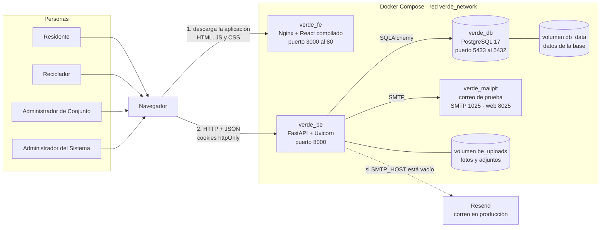
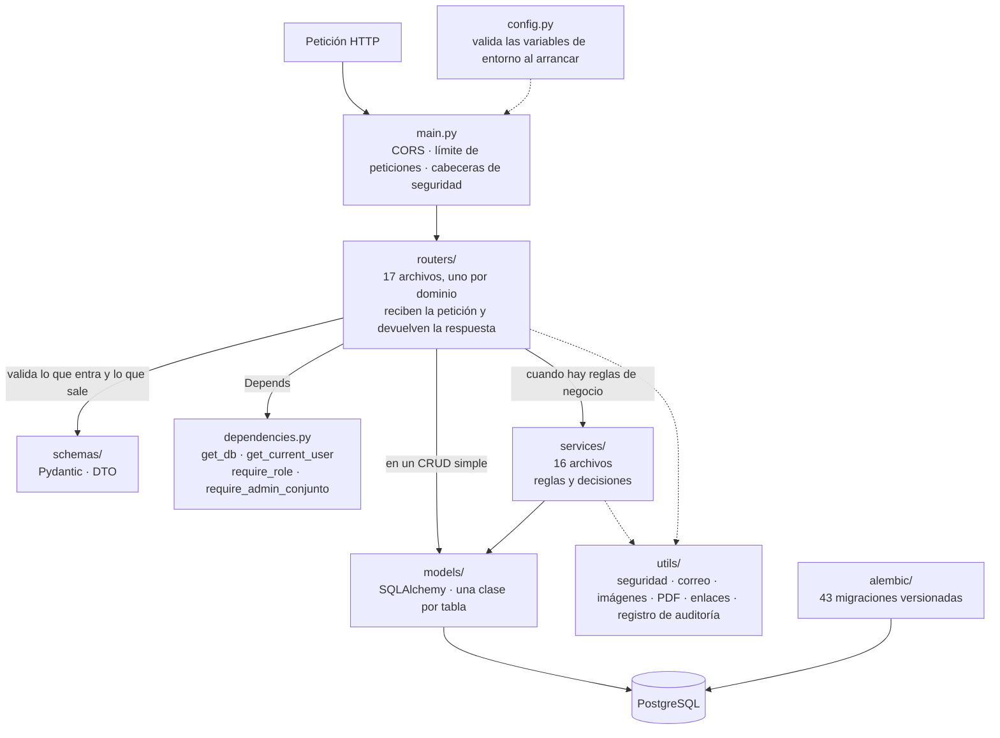
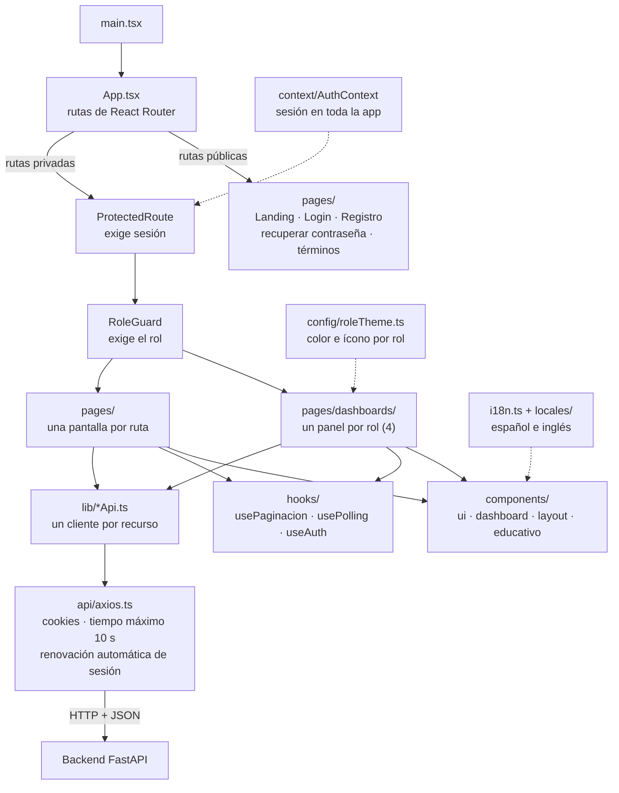
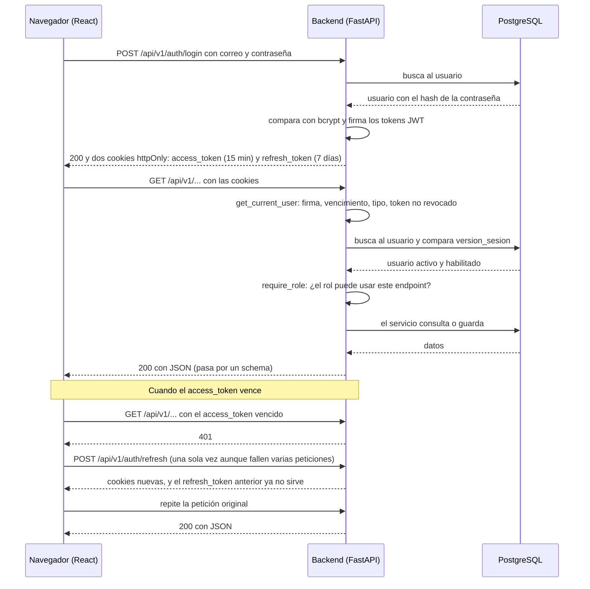
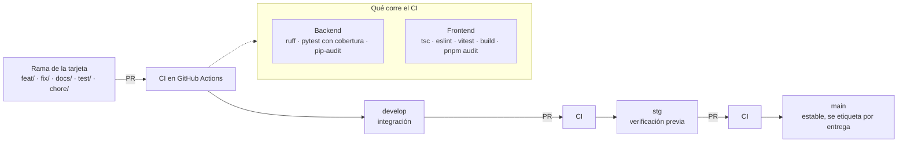

# Arquitectura de VerdeApp

<!--
  ¿Qué? Diagramas de la arquitectura de VerdeApp: el sistema completo, las capas del backend,
        la estructura del frontend, el recorrido de una petición autenticada y el flujo de
        ramas con el CI.
  ¿Para qué? Es la evidencia del criterio 5 de la revisión (diagrama de arquitectura que
            muestre lo aprendido en las formaciones previas). Los patrones se explican con
            código real en `docs/conceptos/patrones-arquitectonicos.md`.
  ¿Impacto? Todo lo dibujado se comprobó contra el código el 20 de noviembre de 2026. Si
            cambia un puerto, una capa o el flujo de sesión, se corrige aquí en la misma rama.
-->

| Campo | Valor |
|---|---|
| **Fecha** | 20 de noviembre de 2026 |
| **Estilo de arquitectura** | Cliente-servidor en tres capas lógicas (frontend, backend, base de datos), con una API REST entre el frontend y el backend |
| **Documento hermano** | [Patrones arquitectónicos](conceptos/patrones-arquitectonicos.md): explica cada patrón con el archivo y la línea reales |

## 1. El sistema completo

**Cómo leerlo**

- **El frontend no habla con el backend.** Nginx solo entrega los archivos de la aplicación al navegador. Una vez cargada, es el navegador el que llama directamente a la API del backend. Por eso `VITE_API_URL` se escribe en el JavaScript al compilar y `FRONTEND_URL` se usa en el backend para el CORS (ver [despliegue](despliegue.md)).
- **Solo el backend toca la base de datos.** El navegador nunca llega a PostgreSQL.
- **En desarrollo** el frontend corre con `pnpm dev` (Vite, puerto 5173) en vez de `verde_fe`, y el backend con `uv run uvicorn`. La arquitectura es la misma.
- **Todos los puertos de Docker** están ligados a `127.0.0.1`: solo se alcanzan desde el mismo equipo.
- **Resend** es la alternativa de correo para producción: se usa solo si `SMTP_HOST` está vacío.

## 2. Las capas del backend

**Los 17 routers por dominio**

| Dominio | Routers |
|---|---|
| Cuenta y sesión | `auth`, `users`, `contact` |
| Administración del sistema | `admin`, `puntos_acopio` |
| Contenido y avisos | `contenido_educativo`, `novedades`, `novedades_enviadas`, `comunicados` |
| Conjunto residencial | `admin_conjunto`, `conjunto_panel`, `reciclador_conjunto` |
| Operación del reciclaje | `auditoria_conjunto`, `notificaciones` |
| Consulta | `directorio`, `geography` |
| Archivos | `uploads` |

**Reglas que cumple el diseño**

- **Un router no tiene reglas de negocio:** recibe, valida y delega. Si hay lógica, está en `services/`.
- **Los permisos no se escriben a mano en cada endpoint.** Se declaran con `Depends(require_role(...))`: inyección de dependencias.
- **La respuesta nunca es el modelo de la base:** pasa por un schema, para no exponer datos internos como el hash de la contraseña (patrón DTO).
- **El esquema de la base lo crea Alembic**, nunca el código de la aplicación.

## 3. La estructura del frontend

**Reglas que cumple el diseño**

- **Dos guardas:** `ProtectedRoute` pregunta si hay sesión y `RoleGuard`, si el rol puede entrar. Ninguna página repite esa lógica.
- **Ninguna pantalla llama a `axios` directo.** Pasa por `lib/*Api.ts` y por un único cliente (`api/axios.ts`), que concentra las cookies, el tiempo máximo y el manejo de errores.
- **El JavaScript nunca ve el token:** vive en una cookie `httpOnly` que el navegador adjunta solo.
- **Los componentes de `components/ui/` se reutilizan** en las cuatro vistas (`Button`, `Modal`, `Alert`, `InputField` y otros).

## 4. Una petición autenticada, paso a paso

**Qué se ve aquí**

- **JWT sin sesión en el servidor:** el backend no guarda sesiones; verifica la firma del token. La excepción honesta es la lista de tokens revocados (`tokens_revocados`) y el contador `version_sesion`, que permiten cerrar sesión y invalidar tokens al cambiar la contraseña.
- **Defensa en capas:** hay tres comprobaciones antes del servicio (token válido, usuario activo y rol permitido), y el frontend además oculta lo que el rol no puede ver.
- **Un refresh token sirve una sola vez** (rotación): si dos pestañas lo mandan juntas, el cliente usa un candado para enviar una sola renovación.

## 5. Del código a la rama principal

- Cada tarjeta vive en su propia rama, creada desde `develop` actualizado.
- `stg` solo recibe PR de `develop` y `main` solo recibe PR de `stg`. Un error hallado en `stg` se corrige en una rama nueva desde `develop`.
- El CI corre en **cada** PR hacia `develop`, `stg` y `main`, con una base de datos PostgreSQL temporal.

## 6. Qué se aplicó de lo aprendido

| Concepto de las formaciones | Dónde se ve en los diagramas | Evidencia en código |
|---|---|---|
| Arquitectura cliente-servidor | Diagrama 1: navegador, frontend y backend separados | `fe/`, `be/` |
| API REST con JSON | Diagramas 1, 3 y 4: rutas bajo `/api/v1/` | `be/app/routers/` |
| Arquitectura en capas y separación de responsabilidades | Diagrama 2: `routers`, `services`, `models` | `be/app/` |
| DTO (schemas de Pydantic) | Diagrama 2: `schemas/` entre el router y el cliente | `be/app/schemas/` |
| Inyección de dependencias | Diagramas 2 y 4: `Depends(get_current_user)` y `require_role` | `be/app/dependencies.py` |
| Autenticación con JWT y cookies httpOnly | Diagrama 4 | `be/app/utils/security.py`, `be/app/routers/auth.py` |
| Migraciones de base de datos | Diagrama 2: `alembic/` | `be/alembic/versions/` |
| Configuración por variables de entorno | Diagrama 2: `config.py` | `be/app/config.py`, [despliegue](despliegue.md) |
| SPA con guardas de ruta y de rol | Diagrama 3 | `fe/src/components/ProtectedRoute.tsx`, `RoleGuard.tsx` |
| Cliente HTTP único con interceptores | Diagramas 3 y 4 | `fe/src/api/axios.ts` |
| Contenedores con Docker Compose | Diagrama 1 | `docker-compose.yml`, `be/Dockerfile`, `fe/Dockerfile` |
| Integración continua y ramas por entorno | Diagrama 5 | `.github/workflows/ci.yml` |
| Monorepo | Diagramas 1 y 5: `be/`, `fe/` y `e2e/` en un repositorio | raíz del repositorio |
