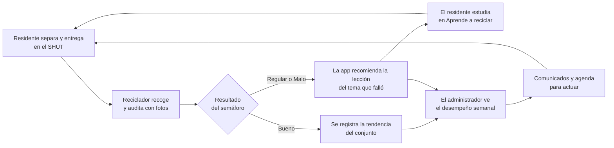

# El proyecto: qué es VerdeApp y qué hace

<!-- resumen: Qué problema resuelve VerdeApp, quién la usa y qué puede hacer cada persona, explicado desde cero y con ejemplos reales del proyecto. -->

## Cómo leer este documento

Este documento explica VerdeApp **desde cero**: no supone que sepas programar ni que conozcas el reciclaje. Cada palabra técnica se explica la primera vez que aparece, con un ejemplo del propio proyecto. Al final de cada documento hay un **glosario** con todos los términos nuevos y unas preguntas para comprobar que entendiste.

El orden es este:

1. Qué es VerdeApp, en palabras simples.
2. Las palabras que necesitas conocer.
3. El problema que resuelve y la misión.
4. Los cuatro tipos de usuario (roles) y qué hace cada uno, paso a paso.
5. Cómo se conectan todas las funciones.
6. Qué hace VerdeApp hoy y qué no hace.
7. Cómo se muestra con datos reales (la demostración).

## 1. Qué es VerdeApp, en palabras simples

VerdeApp es una **aplicación web** para los conjuntos residenciales de Bogotá. Una *aplicación web* es un programa que se usa desde el navegador (Chrome, Edge, Firefox), escribiendo una dirección, sin instalar nada en el computador o el celular.

Sirve para que tres grupos de personas se pongan de acuerdo sobre el reciclaje:

- **Los residentes**: las personas que viven en los apartamentos y generan los residuos.
- **Los recicladores**: las personas que recogen el material aprovechable (cartón, plástico, vidrio, metal) para venderlo.
- **La administración del conjunto**: quienes administran el edificio y se encargan de que todo funcione.

**VerdeApp no recoge basura ni procesa material.** Su trabajo es otro: lograr que esas personas se enteren a tiempo de lo que les importa, medir qué tan bien se está separando el material en cada conjunto, y enseñar a quien lo necesita cómo hacerlo mejor.

### Un ejemplo de cómo se usa

Imagina el conjunto «Quintas de Aranjuez». Un martes, el cuarto donde los residentes dejan las bolsas de reciclaje se llena. Una residente abre VerdeApp y pulsa un botón que dice «SHUT lleno». Al reciclador autorizado en ese conjunto le llega un aviso. Cuando llega, también pulsa un botón («Llegué al conjunto») y a los residentes les llega la noticia de que ya está ahí. Al terminar, el reciclador revisa cómo venía separado el material y califica al conjunto con un nivel (Bueno, Regular o Malo) y de una a tres fotos. Si salió Regular o Malo, VerdeApp les recomienda a los residentes de ese conjunto una lección sobre el tema que falló. Y el administrador ve, semana a semana, cómo evoluciona su conjunto.

Eso es todo el proyecto en pequeño: **avisar, medir, enseñar**.

### Es un proyecto de formación

Lo desarrollamos cuatro aprendices del programa Análisis y Desarrollo de Software (ADSO) del SENA, durante 2026. Trabajamos con una metodología llamada **Scrum** (se explica en el documento 4) y guardamos el código en **GitHub**, un sitio web donde un equipo comparte y revisa código. VerdeApp está en **español y en inglés**: cada usuario elige su idioma y la aplicación lo recuerda.

## 2. Las palabras que necesitas conocer

Estas son las palabras que más se repiten. Vuelve a esta sección cuando alguna te confunda.

### Palabras del negocio (el reciclaje)

- **Conjunto residencial:** un grupo de torres o casas que comparten una administración. VerdeApp trae cargados más de 14.500 conjuntos reales de Bogotá, tomados de datos abiertos del Distrito.
- **SHUT:** el cuarto o ducto de basuras del edificio, donde los residentes dejan sus bolsas. Es el punto desde donde el reciclador recoge. En la aplicación hay dos avisos: «SHUT lleno» (lo manda el residente) y «SHUT vaciado» (lo manda el reciclador).
- **Separación en la fuente:** separar los residuos **en cada hogar**, antes de entregarlos. En Bogotá se usan tres bolsas: **blanca** para el material aprovechable limpio y seco, **verde** para los residuos orgánicos (restos de comida) y **negra** para lo que ya no se puede aprovechar. Mejorar esto es el objetivo final de VerdeApp.
- **Reciclador de oficio:** una persona cuyo trabajo es recoger, transportar y vender el material aprovechable. Su actividad está reconocida como un servicio público.
- **Auditoría (o semáforo):** la calificación que el reciclador le da a un conjunto después de recoger. Tiene tres niveles (**Bueno, Regular o Malo**), un tema, una descripción y de 1 a 3 fotos como evidencia. Se llama «semáforo» porque tiene tres niveles que van de mejor a peor. **Califica al conjunto entero, no a cada residente**, porque nadie puede saber qué apartamento entregó cada bolsa.
- **Punto de acopio o ECA:** un lugar donde se entrega material para su aprovechamiento. ECA significa *Estación de Clasificación y Aprovechamiento*. VerdeApp incluye un directorio con 799 ECA reales del inventario de la UAESP (la entidad del Distrito que gestiona el aseo), organizadas por localidad (zona de la ciudad).

### Palabras de la tecnología

- **Navegador:** el programa con el que entras a internet (Chrome, Edge, Firefox).
- **Frontend:** la parte de VerdeApp que la persona ve y toca: pantallas, botones, formularios, gráficas. Corre dentro del navegador. Su código está en la carpeta `fe/` del proyecto.
- **Backend:** la parte de VerdeApp que no se ve. Es un programa que recibe las peticiones del frontend, aplica las reglas y guarda o busca datos. Su código está en la carpeta `be/`.
- **Petición:** un mensaje que el frontend le manda al backend para pedirle algo. Por ejemplo: «guarda esta auditoría» o «dame las notificaciones de esta persona».
- **API:** la lista de cosas que el backend sabe hacer, cada una con su dirección. El frontend usa esa lista para pedirle cosas. En VerdeApp todas las direcciones empiezan con `/api/v1/`. Cada dirección se llama **endpoint**; VerdeApp tiene 104.
- **Base de datos:** el lugar donde los datos quedan guardados de forma permanente, aunque se apague el programa. Está organizada en **tablas**, parecidas a una hoja de cálculo: cada fila es un registro (un usuario, una auditoría) y cada columna es un dato (el correo, la fecha). VerdeApp usa un programa llamado **PostgreSQL** y tiene 30 tablas.
- **Rol:** el tipo de usuario. Cada rol tiene permisos distintos: lo que un residente puede hacer no es lo mismo que lo que puede hacer un administrador.

## 3. El problema y la misión

### 3.1 El problema

La propuesta técnica del proyecto (`docs/gestion-proyecto/propuesta-tecnica.md`) lo resume así: la gestión de residuos en los conjuntos residenciales de Bogotá es deficiente, y la falta de comunicación entre residentes y recicladores hace la recolección ineficiente y deja a la gente desinformada sobre cómo reciclar. Esto se ve en cinco situaciones concretas:

1. **El reciclador llega y no sabe si el SHUT está lleno.** Puede llegar cuando no hay nada que recoger y perder el viaje, o tardar en llegar cuando ya hay material acumulado.
2. **El residente no sabe cuándo pasa el reciclador.** Entonces no sabe cuándo sacar el material, y a veces lo deja revuelto o mucho tiempo en el cuarto.
3. **Nadie mide si el conjunto separa bien.** Sin una medición no hay forma de saber si las cosas mejoran o empeoran.
4. **Aunque se sepa que se separa mal, nadie le explica al residente qué hacer distinto.** Saber que algo está mal no sirve si no se sabe cómo corregirlo.
5. **La administración no tiene un canal oficial** para avisar a residentes y recicladores. Los avisos se hacen por chats informales o carteleras.

### 3.2 La misión

> **Incentivar, coordinar y optimizar la separación de residuos en la fuente dentro de los conjuntos residenciales de Bogotá.**

Cada una de esas tres palabras se traduce en funciones concretas de la aplicación:

- **Incentivar** significa darle al residente motivos y herramientas para separar mejor. En VerdeApp: la calificación semanal que puede ver, la gráfica de cómo va su conjunto y el catálogo de lecciones «Aprende a reciclar».
- **Coordinar** significa que todos se enteren a tiempo de lo que les importa. En VerdeApp: los avisos de SHUT lleno y vaciado, el aviso de llegada del reciclador, los comunicados, las notificaciones y las invitaciones.
- **Optimizar** significa que la recolección sea más eficiente: menos viajes en vano y menos material perdido. En VerdeApp: los avisos de llenado, la auditoría con fotos y la recomendación automática de lecciones.

## 4. Los cuatro roles, paso a paso

Un **rol** decide qué puede ver y hacer cada persona dentro de VerdeApp. Hay cuatro. Para cada uno explico quién es, cómo entra, qué ve en su menú, qué hace paso a paso y qué reglas aplica el sistema por detrás. Las reglas salen del código real del backend (`be/app/services/`).

### 4.1 Residente

**Quién es:** una persona que vive en un apartamento de un conjunto.

**Cómo entra:** se registra sola desde la pantalla de registro. Elige el rol Residente y escribe su localidad, su conjunto, su torre y su número de apartamento. Debe escribir el **código de acceso** de su conjunto: un código de 6 letras o números que el administrador del conjunto le comparte. **Es obligatorio:** si falta o no coincide con el del conjunto, el registro se rechaza. Así solo se registran como residentes quienes de verdad pertenecen al conjunto. Después de registrarse, debe **verificar su correo**: VerdeApp le envía un correo con un enlace y, hasta que lo abra, no puede iniciar sesión. Esto comprueba que el correo es real y suyo.

**Lo que ve en el menú:** Panel principal · Comunicados · Soporte técnico · Aprende a reciclar · Directorio general · Mi perfil · Seguridad.

**Lo que hace, paso a paso:**

1. **Entra a su panel principal.** Ve primero lo nuevo: la última auditoría de su conjunto, los avisos y los comunicados recientes, cada uno con el nombre del conjunto y cuánto hace que llegó.
2. **Avisa cuando el SHUT se llena.** Pulsa «Reportar». El aviso es **anónimo**: los demás no ven quién lo mandó (el sistema sí guarda internamente quién fue, solo para evitar avisos repetidos). Le llega a los recicladores autorizados en su conjunto y a sus administradores.
3. **Abre la auditoría nueva.** Ve el nivel (Bueno, Regular o Malo), las fotos de evidencia, el tema, la descripción y quién la hizo.
4. **Si salió Regular o Malo, estudia.** Le llega el aviso «el reciclador recomienda contenido educativo». Lo abre y llega directo a la lección del tema que falló, dentro de «Aprende a reciclar». La lección queda marcada como **Visto**.
5. **Mira cómo va su conjunto.** En «Mi conjunto» ve las auditorías del período, el porcentaje calificado como Bueno, el tema que más conviene reforzar y una gráfica de las últimas 8 semanas.
6. **Pide ayuda si algo falla.** En «Soporte técnico» escribe una consulta al equipo de VerdeApp eligiendo un motivo.

**Las reglas que aplica el sistema (y por qué existen):**

- **Solo puede mandar el aviso «SHUT lleno».** No puede mandar los de llegada o vaciado, porque esos son del reciclador. Así cada aviso lo manda quien de verdad puede saber que es cierto.
- **Si el SHUT ya está marcado como lleno, el sistema rechaza un segundo reporte** (con el error `400`). Esto evita que dos vecinos avisen lo mismo y el reciclador reciba el mismo aviso varias veces.
- **Solo ve lo de su propio conjunto.** Un residente no puede ver las auditorías ni los comunicados de otro conjunto.

### 4.2 Reciclador

**Quién es:** un reciclador de oficio.

**Cómo entra:** se registra solo, con sus datos (su localidad y, si quiere, la asociación a la que pertenece) y verifica su correo igual que el residente. **Pero al registrarse todavía no trabaja en ningún conjunto**: un administrador de un conjunto debe invitarlo, y él debe aceptar la invitación. Esto evita que cualquier persona avise o califique en un conjunto donde no está autorizada.

**Lo que ve en el menú:** Panel principal · Comunicados · Soporte técnico · Puntos de acopio · Mi perfil · Seguridad.

**Lo que hace, paso a paso:**

1. **Acepta o rechaza la invitación** de un conjunto. Desde que acepta está autorizado allí, hasta que el administrador le quite el acceso («revocar»).
2. **Avisa que llegó**, con el botón «Llegué al conjunto» y eligiendo el conjunto. El aviso llega a los residentes y a los administradores.
3. **Avisa el estado del SHUT.** Si estaba lleno y lo vació, pulsa «SHUT ya está libre» y el estado del conjunto vuelve a «libre». También puede avisar él mismo que el SHUT está lleno.
4. **Avisa que terminó**, con «Finalicé separación».
5. **Califica el conjunto.** Desde el aviso «Auditoría semanal pendiente» pulsa «Auditar ahora» y elige el nivel (Bueno, Regular o Malo), el tema, escribe una descripción si quiere y sube de 1 a 3 fotos. **Las fotos son obligatorias.** Antes de enviar, la aplicación le pide confirmar, porque **una auditoría enviada no se puede editar**.
6. **El sistema avisa.** Al guardar, VerdeApp les avisa a los residentes y administradores del conjunto. Si la calificación fue Regular o Malo, además les recomienda la lección sobre el tema.

**Las reglas que aplica el sistema (y por qué existen):**

- **Los avisos de SHUT y de finalización solo se envían si antes avisó su llegada.** Esto hace que cada aviso corresponda a una visita real al conjunto, y no a alguien que escribe desde su casa.
- **Entre dos avisos de llegada al mismo conjunto hay una espera de 2 horas;** entre los demás avisos, 5 minutos. Evita avisos repetidos por error o por descuido.
- **No puede calificar el mismo conjunto dos veces en menos de 24 horas.** Así las calificaciones no se duplican.
- **El aviso «Auditoría semanal pendiente» aparece** cuando el conjunto nunca se ha auditado o cuando su última auditoría tiene **7 días o más**. Se calcula cada vez que el reciclador abre su panel; no hay ningún proceso corriendo en segundo plano.
- **Cada foto se revisa de verdad.** El sistema abre el archivo para comprobar que realmente es una imagen (no solo mira el nombre), con un máximo de 5 MB y solo en formato JPG, PNG o WEBP. Esto evita que alguien suba un archivo peligroso con nombre de foto.
- **Solo ve el detalle de las auditorías que él mismo envió**, no las de otro reciclador del mismo conjunto.

### 4.3 Administrador de Conjunto

**Quién es:** la persona que administra uno o más conjuntos residenciales.

**Cómo entra:** **no hay registro público** para este rol. El Administrador del Sistema lo invita por correo, indicando los conjuntos que va a administrar. La invitación vale 48 horas: la persona la acepta y crea su contraseña. Si alguien nuevo quiere administrar un conjunto, la pantalla de registro le explica cómo pedir su cuenta: enviar por correo el certificado de representación legal de la propiedad horizontal y una copia de la cédula, que se eliminan al terminar la revisión. Se hace así porque este rol tiene poder sobre la información de todo un conjunto, y hay que comprobar que la persona de verdad lo administra.

**Lo que ve en el menú:** Panel principal · Comunicados · Agenda · Desempeño · Soporte técnico · Mi perfil · Seguridad.

**Lo que hace, paso a paso:**

1. **Ve sus conjuntos.** En su panel, cada conjunto aparece como una tarjeta con su NIT, su cantidad de apartamentos y su **código de acceso**.
2. **Comparte el código de acceso** con los residentes para que se registren en su conjunto. Si el código se filtra, puede **regenerarlo** y el anterior deja de servir.
3. **Invita recicladores.** Escribe el correo de un reciclador que ya esté registrado y lo invita al conjunto. Más adelante puede **revocarle** el acceso.
4. **Publica comunicados.** Son avisos oficiales para residentes, recicladores o ambos. Hay cinco tipos: informativo, urgente, convocatoria, mantenimiento y reciclaje. Cada tipo vence solo: el urgente a las 48 horas, el de mantenimiento a los 7 días, el de reciclaje a los 14, el informativo a los 30, y la convocatoria al día siguiente del evento. Así los avisos viejos no se quedan estorbando.
5. **Lleva la agenda del comité.** Es una lista de temas por tratar en las reuniones del comité del conjunto. Cada tema puede llevar una foto. Cuando se resuelve, se **archiva** (no se borra), y el historial se puede **descargar en PDF o CSV** (un archivo que se abre en Excel).
6. **Mira el desempeño.** En «Desempeño» ve la gráfica semanal de cada conjunto y el tema que conviene reforzar.
7. **Pide otro conjunto o pide dejar uno.** Puede solicitar administrar un conjunto adicional o solicitar su **desvinculación** de uno; el Administrador del Sistema decide.

**Las reglas que aplica el sistema (y por qué existen):**

- **Un conjunto tiene un solo administrador activo a la vez.** Lo garantiza la propia base de datos, no solo el código, para que nunca haya dos personas con autoridad sobre el mismo conjunto.
- **Si un administrador deja de administrar un conjunto, deja de ver sus datos.**
- **Un comunicado vencido no se borra:** deja de mostrarse a los residentes, pero queda en el historial del administrador.

### 4.4 Administrador del Sistema

**Quién es:** el equipo que opera la plataforma completa.

**Cómo entra:** tampoco hay registro público. Es una cuenta que se crea directamente en la base de datos cuando se instala el sistema (se llama «sembrar» la base).

**Lo que ve en el menú:** Panel principal · Solicitudes · Novedades · Contenido educativo · Puntos de acopio · Seguridad.

**Lo que hace, paso a paso:**

1. **Invita administradores de conjunto** y les asigna conjuntos adicionales cuando lo piden.
2. **Gestiona usuarios.** Consulta residentes, recicladores y administradores, los ordena, abre su perfil y puede **desactivar o activar** una cuenta (una cuenta desactivada no puede iniciar sesión).
3. **Atiende la bandeja de Solicitudes**, que tiene dos pestañas: *Soporte técnico* (consultas de los usuarios) y *Desvinculaciones* (administradores que piden dejar un conjunto: se aprueban o se rechazan).
4. **Publica novedades.** Son avisos para toda la plataforma o para un rol, sobre cambios de la aplicación o temas ambientales.
5. **Gestiona el contenido educativo.** Crea, edita y elimina las lecciones de «Aprende a reciclar», con portada e imágenes dentro de la lección.
6. **Gestiona el directorio de puntos de acopio.**

**Las reglas que aplica el sistema (y por qué existen):**

- **Cada consulta de soporte tiene una prioridad** que el sistema calcula según el motivo que eligió quien la escribió: **alta** para fallos de ingreso o de la aplicación y problemas del reciclador con su conjunto o su auditoría; **media** para cuenta, notificaciones, unidad o SHUT; **baja** para consultas de información y sugerencias. Así el equipo atiende primero lo urgente.
- **Cada consulta tiene un estado:** nueva, en revisión o resuelta. **Quien la escribió recibe un aviso cuando el estado cambia**, y ve la respuesta en su historial.

## 5. Cómo se conectan todas las funciones

Las funciones de VerdeApp no son piezas sueltas: forman un **ciclo**, donde *medir* alimenta a *enseñar*.

1. El residente separa su material y lo deja en el SHUT.
2. El reciclador recoge, y **califica** el conjunto con fotos.
3. Si la calificación es Bueno, se registra y alimenta la gráfica de tendencia del conjunto.
4. Si es **Regular o Malo**, VerdeApp **recomienda** automáticamente a los residentes la lección del tema que falló.
5. El residente estudia esa lección. El administrador ve en su panel cómo va el conjunto y, si hace falta, publica un comunicado o agenda el tema en el comité.
6. Con eso, en la siguiente recogida, el residente separa mejor, y el ciclo vuelve a empezar.

La conexión clave está en el paso 4: **la auditoría (lo que se mide) y el catálogo educativo (lo que se enseña) están unidos.** Sin esa unión, VerdeApp sería solo una cartelera de avisos.

## 6. Qué hace VerdeApp hoy y qué no hace

### 6.1 Lo que hace hoy

La propuesta original comprometía 16 funcionalidades. Durante el desarrollo creció hasta **53 historias de usuario**. Una **historia de usuario** es la descripción de una cosa que una persona quiere poder hacer, escrita así: «como [rol], quiero [acción], para [beneficio]». Cada una está en su propio archivo en `docs/requisitos/HUs/`, con sus criterios de aceptación (las condiciones para darla por terminada). Las 53 están implementadas.

Las funcionalidades se agrupan así:

- **Cuenta y sesión:** registro con verificación de correo, inicio y cierre de sesión seguros, recuperación y cambio de contraseña, edición del perfil y cambio de idioma.
- **Avisos operativos:** SHUT lleno y vaciado, llegada y salida del reciclador.
- **Medición:** auditoría con semáforo y fotos, historial de auditorías y desempeño semanal en una gráfica de 8 semanas.
- **Educación:** el catálogo «Aprende a reciclar» (33 lecciones en 8 categorías), la recomendación automática después de una auditoría y el registro de qué lecciones ya vio cada residente.
- **Comunicación:** comunicados del conjunto, novedades de la plataforma y notificaciones (la campanita de la aplicación).
- **Organización:** invitaciones y autorización de recicladores, desvinculación de administradores, agenda del comité con historial descargable.
- **Administración:** gestión de usuarios, puntos de acopio, contenido educativo y soporte técnico.

### 6.2 Lo que todavía no hace, y por qué

Ninguna de estas exclusiones es «para siempre». Son decisiones de alcance de este trimestre, y cada una tiene su razón escrita.

- **App móvil nativa (Android o iOS).** No existe. La versión web ya se adapta al celular y mantener un solo código es lo que el equipo puede sostener. Como el backend ya es una API, una app móvil podría usarlo más adelante sin rehacer las reglas.
- **Chat en tiempo real.** Un chat solo funciona si alguien contesta al momento, y somos cuatro personas con 10 horas por semana cada una. Además, la infraestructura actual no está preparada para conexiones continuas. En su lugar existe el soporte técnico, con motivo, prioridad, estado y respuesta.
- **Que el residente califique al reciclador.** Se descartó por el riesgo de calificaciones malintencionadas sin motivo. El semáforo ya mide lo que importa: cómo llega el material.
- **Cámaras y sensores (IoT) en el SHUT.** Exigen hardware; hoy el aviso lo da una persona con un botón.
- **Pagos, nómina o reportes financieros.** No son un problema de coordinación de residuos.
- **Chatbot o inteligencia artificial.** Se descartó por costo, seguridad y calidad de las respuestas. Además, lo que escribe el usuario saldría a un servicio externo, y eso es tratamiento de datos personales, regulado por la Ley 1581 de 2012.

### 6.3 Estado actual

- **Funcionalidad:** las 53 historias de usuario y los 21 requisitos funcionales (las funciones que el sistema debe tener) están implementados.
- **Requisitos no funcionales:** son 6 (seguridad, disponibilidad, usabilidad, tiempo de respuesta, accesibilidad y mantenibilidad). Cuatro están implementados y dos son parciales: la **disponibilidad** (meta: que esté activa el 99,9 % del tiempo) y el **tiempo de respuesta** (meta: menos de 2 segundos) no se han podido medir porque todavía no hay un servidor real.
- **Despliegue:** *desplegar* es publicar la aplicación en un servidor para que cualquiera la use por internet. VerdeApp **todavía no está desplegada**: corre en los computadores del equipo. Esto se explica en el documento 5.

**Datos que cambian cada semana** (vuelve a comprobarlos antes de citarlos):

| Dato | Valor al 26 de nov de 2026 | Dónde se comprueba |
|---|---|---|
| Historias de usuario | 53, todas «Implementada» | `docs/requisitos/HUs/` |
| Requisitos funcionales | 21, todos «Implementado» | `docs/requisitos/RFs/` |
| Tablas de la base de datos | 30 | `docs/referencia-proyecto/diagramas-UML/diagrama-mr.md` |
| Endpoints de la API | 104 | `docs/api.md` |
| Módulos educativos | 33 | `be/app/data/contenido_educativo.json` |
| Pull Requests integrados | 415 | `gh pr list --state merged --limit 2000 --json number --jq length` |
| Issues | 271 (255 cerrados, 16 abiertos) | pestaña *Issues* de GitHub |

## 7. La demostración: cómo se muestra con datos reales

La demostración cuenta **la historia de un reciclaje completo** pasando por los cuatro roles. Dura de 5 a 7 minutos.

### 7.1 Preparación

- **Las cuentas de prueba.** Hay una cuenta por rol, creadas al instalar el sistema. Sus correos y la contraseña están en la sección «Usuarios de Prueba» del `README.md`: `residente.prueba@`, `reciclador.prueba@`, `admin.conjunto.prueba@` y `admin@`, todos con el dominio `@verdeapp.com`.
- **Los datos de demostración.** Una base de datos recién instalada está casi vacía. El comando `uv run python -m app.seed_demo` (se corre desde la carpeta `be/`, después de `app.seed`) la llena con 3 conjuntos, 8 semanas de auditorías con fotos, comunicados, novedades y solicitudes, para que cada rol tenga algo que mostrar. Conviene correrlo justo antes de presentar, porque las fechas se calculan a partir del día en que se corre.
- **Cuatro ventanas, una por rol.** Cuando alguien inicia sesión, el navegador guarda su sesión en una *cookie* (un dato pequeño que el navegador guarda y manda solo a cada petición). Si abres dos roles en la misma ventana, el segundo borra la sesión del primero. Por eso se usan perfiles distintos del navegador o ventanas de incógnito, una por rol.
- **Las fotos para la auditoría en vivo** están en `be/app/data/demo/fotos/` (usa `regular-1.jpg` y `regular-2.jpg`).

**Tres reglas del sistema que pueden estorbar si ya ensayaste:** solo se acepta una llegada del reciclador cada 2 horas por conjunto (alterna entre conjuntos o reinicia los datos); si el SHUT ya está marcado como «lleno», no deja reportarlo otra vez; y el botón «Auditar ahora» solo aparece en un conjunto que no ha sido auditado en los últimos 7 días.

### 7.2 El recorrido, minuto a minuto

1. **0:00. Pantalla de inicio.** Muestras la pantalla de inicio, cambias el idioma a inglés y activas el modo oscuro. *Dices:* «VerdeApp tiene cuatro roles, dos idiomas y modo oscuro. Esta es la historia de un reciclaje completo.»
2. **0:30. Residente.** Muestras su panel y pulsas «Reportar SHUT lleno». *Dices:* «El residente avisa con un botón que el cuarto de basuras está lleno. Es anónimo y le llega al reciclador y al administrador.»
3. **1:15. Reciclador.** Ve el aviso (puede tardar hasta 20 segundos en aparecer), pulsa «Llegué al conjunto» y elige el conjunto. *Dices:* «Recibe el aviso y avisa que llegó. Solo puede avisar si está autorizado en ese conjunto.»
4. **2:00. Reciclador.** Pulsa «SHUT ya está libre» y luego «Finalicé separación». *Dices:* «Cada aviso exige haber avisado la llegada antes, para que corresponda a una visita real.»
5. **2:30. Reciclador.** Pulsa «Auditar ahora», elige el nivel Regular, un tema, una descripción y sube 2 fotos. *Dices:* «Califica el conjunto con evidencia. La foto es obligatoria y la auditoría no se puede editar después.»
6. **3:30. Residente.** Ve el aviso de la auditoría y el de contenido recomendado, y abre «Aprende a reciclar». *Dices:* «Como salió Regular, la app le recomienda la lección del tema que falló.»
7. **4:30. Administrador de Conjunto.** Muestra sus conjuntos, el código de acceso, «Desempeño» y descarga la agenda. *Dices:* «Ve la tendencia semana a semana y organiza al comité.»
8. **5:30. Administrador del Sistema.** Muestra los totales, «Solicitudes», los usuarios y «Contenido educativo». *Dices:* «Supervisa la plataforma, atiende el soporte y publica contenido.»
9. **6:30. Cierre.** Cierras con los números de la sección 6.3. *Dices:* «53 historias implementadas, miles de pruebas automáticas y un camino claro de qué sigue.»

**Versión de 3 minutos:** el residente reporta SHUT lleno (0:30), el reciclador avisa llegada y audita (1:15), el residente ve la auditoría y la lección (2:15), y el administrador de conjunto muestra la gráfica (2:45).

**Si el público es técnico**, puedes mostrar además la documentación automática de la API en `http://localhost:8000/docs` (solo funciona con el backend en modo desarrollo), una prueba corriendo con `uv run pytest app/tests/test_auth.py -q --no-cov`, el diagrama de la base de datos y el historial de Pull Requests.

## Lo que debes saber explicar

Después de leer este documento, deberías poder responder **sin mirar**:

1. ¿Qué problema resuelve VerdeApp y para quién?
2. ¿Cuáles son los cuatro roles y cómo entra cada uno?
3. ¿Qué pasa desde que un residente avisa que el SHUT está lleno hasta que se califica el conjunto?
4. ¿Cómo se conectan «medir» y «enseñar»?
5. ¿Qué no hace VerdeApp todavía y por qué?

### Preguntas que te pueden hacer

**¿Por qué el reciclador califica al conjunto y no a cada residente?**
Porque no hay forma de saber qué apartamento entregó qué bolsa. Calificar a una persona sin pruebas sería injusto; calificar al conjunto, con fotos, sí se puede sostener.

**¿Por qué el residente no puede calificar al reciclador?**
Por el riesgo de calificaciones malintencionadas sin motivo. El semáforo ya mide lo que importa, que es cómo llega el material. Está descartado por ahora, y podría retomarse si se definen salvaguardas.

**¿Por qué no hay un chat?**
Un chat solo funciona si alguien contesta al momento, y el equipo son cuatro personas con 10 horas por semana cada una. En su lugar hay soporte técnico, con motivo, prioridad, estado y respuesta.

**¿Por qué no hay una app móvil?**
La web ya se adapta al celular, y mantener un solo código es lo que el equipo puede sostener. Como el backend es una API, una app móvil podría usarla más adelante.

**¿VerdeApp ya está en un servidor público?**
No. Corre en los computadores del equipo. Está preparada para publicarse (toda su configuración sale de variables de entorno, y el modo producción se probó en local), pero faltan el servidor, el dominio y la conexión segura (HTTPS). Se explica en el documento 5.

**¿Por qué la auditoría no se puede editar después de enviarla?**
Porque es evidencia: si se pudiera cambiar, el historial y la gráfica de desempeño dejarían de ser confiables. Por eso, antes de enviarla, la aplicación pide confirmar.

**¿Por qué el administrador de conjunto no se registra solo?**
Porque este rol tiene autoridad sobre la información de todo un conjunto. Hay que comprobar que la persona de verdad lo administra, con un certificado de representación legal.

## Glosario

- **Aplicación web:** programa que se usa desde el navegador, sin instalar nada.
- **API:** lista de cosas que el backend sabe hacer, cada una con su dirección.
- **Auditoría (semáforo):** calificación Bueno, Regular o Malo que el reciclador le da a un conjunto, con fotos.
- **Backend:** la parte que no se ve de VerdeApp; recibe peticiones, aplica reglas y guarda datos (carpeta `be/`).
- **Base de datos:** lugar donde los datos quedan guardados de forma permanente, en tablas.
- **Cookie:** dato pequeño que el navegador guarda y manda solo en cada petición; guarda la sesión.
- **Conjunto residencial:** grupo de torres o casas con una administración común.
- **Desplegar:** publicar la aplicación en un servidor para que se use por internet.
- **ECA:** Estación de Clasificación y Aprovechamiento; lugar donde se entrega material.
- **Endpoint:** una dirección concreta de la API, que hace una cosa.
- **Frontend:** la parte que ve la persona, dentro del navegador (carpeta `fe/`).
- **Historia de usuario:** descripción de algo que una persona quiere poder hacer.
- **Petición:** mensaje que el frontend le manda al backend para pedirle algo.
- **Rol:** tipo de usuario, con permisos propios (Residente, Reciclador, Administrador de Conjunto, Administrador del Sistema).
- **Separación en la fuente:** separar los residuos en el hogar antes de entregarlos.
- **SHUT:** cuarto o ducto de basuras del edificio.
- **Tabla:** cada una de las «hojas» de la base de datos; sus filas son registros y sus columnas son datos.
