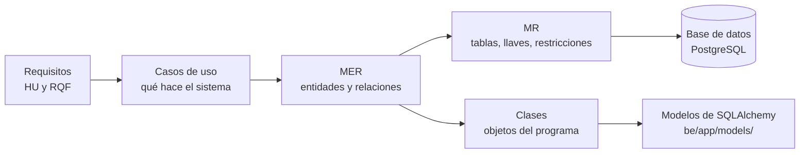
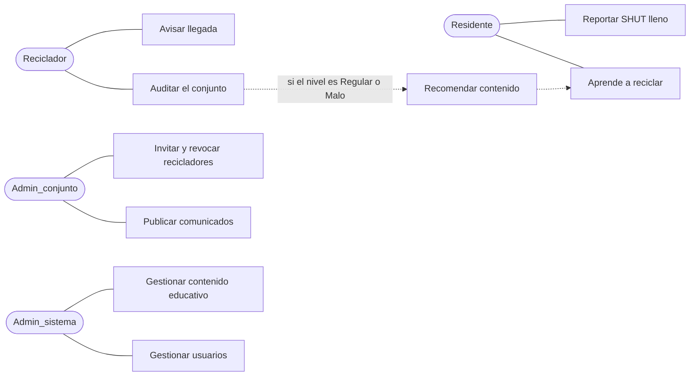
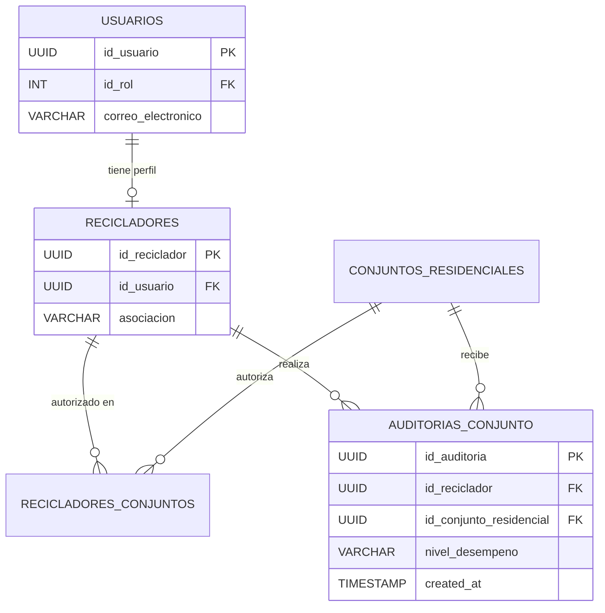
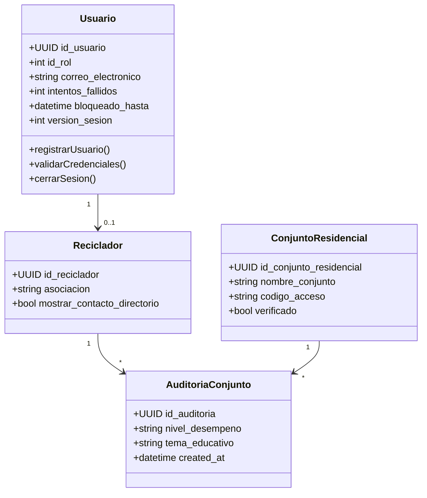

# Diagramas y modelo de datos

<!-- resumen: Qué son el diagrama de casos de uso, el de clases, el modelo entidad-relación y el modelo relacional, cómo se leen y qué dicen de VerdeApp: sus 4 actores, 21 casos de uso y 30 tablas. -->

## Cómo leer este documento

Antes de construir un sistema, y mientras se construye, se hacen **dibujos** que lo describen desde distintos ángulos. Son parte de la **documentación de diseño** y uno de los criterios de la revisión del proyecto: casos de uso, diagrama de clases, modelo entidad-relación (MER) y modelo relacional (MR).

Este documento explica **qué es cada uno desde cero, cómo se lee y qué dice sobre VerdeApp**. No supone que conozcas el tema: cada término se explica al aparecer y al final hay un glosario. Aquí los diagramas son un apoyo para entender; lo importante es entender **qué pregunta responde cada uno**.

Los diagramas completos están en `docs/referencia-proyecto/diagramas-UML/` (cuatro archivos). Este documento los explica y resume; no los reemplaza.

Orden del documento:

1. Las cuatro vistas y cómo se relacionan.
2. Los casos de uso: qué hace el sistema y para quién.
3. El modelo entidad-relación: qué cosas existen y cómo se relacionan.
4. El modelo relacional: cómo quedan esas cosas en tablas.
5. El diagrama de clases: los objetos del programa.
6. Cómo se mantienen al día.

## 1. Las cuatro vistas y cómo se relacionan

Un mismo sistema se puede describir de cuatro maneras. Cada una responde una pregunta distinta:

| Diagrama | Pregunta que responde | Nivel | En VerdeApp |
|---|---|---|---|
| **Casos de uso** | ¿Qué puede hacer cada tipo de usuario con el sistema? | Lo que se ve desde afuera | 4 actores y 21 casos de uso |
| **Modelo entidad-relación (MER)** | ¿Qué cosas existen en el negocio y cómo se relacionan? | Conceptual | 30 entidades |
| **Modelo relacional (MR)** | ¿Cómo quedan esas cosas guardadas en tablas, con sus llaves? | Técnico (base de datos) | 30 tablas |
| **Diagrama de clases** | ¿Qué objetos tiene el programa, con qué datos y qué comportamientos? | Técnico (código) | 30 clases |

Se pasa de uno al siguiente en este orden: primero se piensa **qué debe hacer el sistema** (casos de uso, que salen de los requisitos), luego **qué información maneja** (MER y clases) y por último **cómo se guarda** (MR y tablas reales).



**Un ejemplo para ver las cuatro vistas de una misma cosa.** Tomemos la auditoría de un conjunto (documento 1):
- En los **casos de uso** aparece como «RQF009 — Visualizar gestión de residuos del conjunto» y «RQF013 — Recomendar contenido por auditoría».
- En el **MER** es la entidad `AUDITORIAS_CONJUNTO`, relacionada con un reciclador y con un conjunto.
- En el **MR** es la tabla `auditorias_conjunto`, con su llave primaria, dos llaves foráneas y sus columnas.
- En el **diagrama de clases** es la clase `AuditoriaConjunto`, que en el código es el archivo `be/app/models/auditoria_conjunto.py`.

## 2. Los casos de uso

### 2.1 Qué es un caso de uso

Un **caso de uso** describe **una cosa que un usuario quiere lograr con el sistema**, vista desde afuera: «reportar que el SHUT está lleno», «invitar a un reciclador». No dice cómo está programado; dice qué ocurre entre la persona y el sistema. Sus partes:

- **Actor:** quien interactúa con el sistema. Puede ser una persona (un rol) o el propio sistema cuando actúa solo.
- **Descripción:** qué logra.
- **Flujo principal:** los pasos cuando todo sale bien.
- **Flujo alternativo:** lo que cambia en otra situación (un error, otro rol, otra condición).

**Qué problema resuelven:** permiten ponerse de acuerdo con el cliente (en este caso, los profesores) sobre **qué debe hacer el sistema**, antes de programarlo, usando un lenguaje que no exige saber programar.

### 2.2 Los actores de VerdeApp

Son los cuatro roles del documento 1, más el **sistema** como actor automático en algunos casos (por ejemplo, cuando crea una recomendación después de una auditoría):

| Actor | Qué puede hacer, en resumen |
|---|---|
| **Residente** | Registrarse, reportar el SHUT lleno, ver auditorías y comunicados, estudiar «Aprende a reciclar», consultar el directorio, escribir a soporte |
| **Reciclador** | Registrarse, avisar llegada y estado del SHUT, auditar el conjunto con fotos, ver comunicados y puntos de acopio, escribir a soporte |
| **Admin_conjunto** | Administrar sus conjuntos: invitar y revocar recicladores, publicar comunicados, llevar la agenda, ver el desempeño, pedir o dejar conjuntos |
| **Admin_sistema** | Supervisar la plataforma: invitar administradores, gestionar usuarios, publicar novedades, administrar el contenido educativo y el directorio, atender solicitudes |

### 2.3 El catálogo: 21 casos de uso

Cada caso de uso lleva el código del **requisito funcional** del que sale (documento 7, sección 7.6):

| Código | Caso de uso | Actores |
|---|---|---|
| RQF001 | Validar usuario (iniciar sesión) | Residente, Reciclador, Admin_sistema |
| RQF002 | Registrar usuarios | Residente, Reciclador |
| RQF003 | Alertar máxima capacidad del SHUT | Residente, Reciclador, Admin_conjunto |
| RQF004 | Visualizar catálogo educativo | Residente |
| RQF005 | Visualizar directorio de recicladores y puntos de acopio | Residente, Reciclador |
| RQF006 | Notificar llegada al conjunto | Reciclador, Admin_conjunto |
| RQF007 | Cerrar sesión | Los cuatro roles |
| RQF008 | Actualizar perfil | Residente, Reciclador, Admin_conjunto |
| RQF009 | Visualizar gestión de residuos del conjunto (auditorías) | Los cuatro roles |
| RQF010 | Gestionar contenido educativo | Admin_sistema |
| RQF011 | Gestionar directorio de puntos de acopio y recicladores | Admin_sistema |
| RQF012 | Invitación, vinculación y revocación (administradores y recicladores) | Admin_sistema, Admin_conjunto, Reciclador |
| RQF013 | Recomendar contenido educativo por auditoría | Reciclador, Residente, Admin_sistema y el sistema |
| RQF014 | Gestionar comunicados del conjunto | Admin_conjunto, Residente, Reciclador |
| RQF015 | Publicar novedades generales | Admin_sistema y los demás roles (las reciben) |
| RQF016 | Desvinculación y reasignación de conjuntos | Admin_conjunto, Admin_sistema |
| RQF017 | Cambiar idioma de la interfaz | Los cuatro roles |
| RQF018 | Gestión de usuarios | Admin_sistema |
| RQF019 | Recuperación y cambio de contraseña | Los cuatro roles |
| RQF020 | Agenda interna del conjunto | Admin_conjunto |
| RQF021 | Novedades enviadas al Admin_sistema y bandeja de solicitudes | Residente, Reciclador, Admin_conjunto, Admin_sistema |



*(El diagrama completo, con los 21 casos y sus actores, está en `casos-de-uso.md`.)*

### 2.4 Dos casos de uso explicados

**RQF003 — Alertar máxima capacidad del SHUT.**
*Actores:* el Residente o el Reciclador lo envían; el Admin_conjunto lo recibe, no lo envía.
*Flujo principal:* (1) el usuario genera la alerta; (2) el sistema registra la novedad; (3) el sistema notifica a los responsables.
*Flujo alternativo (Admin_conjunto):* ve el aviso en la pestaña del conjunto donde ocurrió, con un contador de avisos sin leer; puede marcarlo como leído, o usar «Marcar leídas» y «Limpiar leídas», que solo afectan a los avisos de ese conjunto.

**RQF013 — Recomendar contenido educativo por auditoría.**
*Actores:* el Reciclador (dispara el evento al calificar), el Residente (recibe la recomendación), el Admin_sistema (puede enviar un módulo a mano) y el **sistema** (actor automático).
*Flujo principal:* (1) el reciclador guarda la auditoría; (2) si el nivel es Regular o Malo, el sistema crea una notificación de contenido recomendado para los residentes de ese conjunto; (3) el residente la ve y, al tocarla, llega a la categoría de «Aprende a reciclar» del tema que falló.
*Flujos alternativos:* si el nivel es Bueno, no se genera nada. El Admin_sistema puede enviar un módulo a mano a uno o varios conjuntos, aunque no haya una auditoría de por medio.
*Un detalle importante:* el módulo recomendado es el del catálogo cuya categoría **tiene el mismo nombre que el tema** de la auditoría: es una comparación directa de texto, **sin inteligencia artificial**.

## 3. El modelo entidad-relación (MER)

### 3.1 Qué es

El **modelo entidad-relación** describe **qué cosas existen** en el negocio y **cómo se relacionan**, sin pensar todavía en tablas ni en código.

- **Entidad:** una cosa del negocio de la que se guarda información (un usuario, un conjunto, una auditoría).
- **Atributo:** un dato de una entidad (el correo de un usuario, la fecha de una auditoría).
- **Relación:** cómo se conectan dos entidades («un reciclador *realiza* auditorías»).
- **Cardinalidad:** cuántas de una entidad se pueden relacionar con cuántas de la otra:
  - **1:1 (uno a uno):** un usuario tiene **un** perfil de reciclador.
  - **1:N (uno a muchos):** un conjunto tiene **muchas** unidades (apartamentos).
  - **N:M (muchos a muchos):** un reciclador trabaja en **varios** conjuntos, y un conjunto tiene **varios** recicladores. Esta relación necesita una entidad intermedia.
- **Llave primaria (PK):** el atributo que identifica de forma única cada ejemplar de una entidad.
- **Llave foránea (FK):** un atributo que apunta a la llave primaria de otra entidad.

**Qué problema resuelve:** permite ponerse de acuerdo sobre **la información que maneja el sistema** antes de crear ninguna tabla, y detectar a tiempo errores de diseño (una relación que falta, un dato duplicado).

### 3.2 Cómo se lee el diagrama

Cada rectángulo es una entidad con sus atributos (con su tipo, y marcados PK o FK); cada línea es una relación, y las marcas de sus extremos dicen la cardinalidad. Una porción del de VerdeApp:



**Cómo leer las marcas:** `||` significa «exactamente uno», `o|` «cero o uno», `o{` «cero o muchos». Entonces, `USUARIOS ||--o| RECICLADORES` se lee: «un usuario tiene cero o un perfil de reciclador» (un usuario que es residente no tiene perfil de reciclador), y `RECICLADORES ||--o{ AUDITORIAS_CONJUNTO`: «un reciclador realiza cero o muchas auditorías».

### 3.3 Las 30 entidades de VerdeApp, por tema

| Tema | Entidades | Para qué |
|---|---|---|
| **Identidad y sesión** | `roles`, `usuarios`, `residentes`, `recicladores`, `administradores_conjunto`, `password_reset_tokens`, `email_verification_tokens`, `tokens_revocados` | Quién es cada persona, su perfil según el rol y su sesión |
| **Ubicación** | `localidades`, `conjuntos_residenciales`, `unidades` | Las zonas de Bogotá, los conjuntos y sus apartamentos |
| **Vínculos con historial** | `recicladores_conjuntos`, `administradores_conjuntos`, `invitaciones_admin_conjunto`, `invitaciones_reciclador_conjunto`, `solicitudes_desvinculacion` | Quién trabaja o administra dónde, y los trámites para entrar o salir |
| **Operación del reciclaje** | `notificaciones`, `notificaciones_destinatarios`, `auditorias_conjunto` | Los avisos y las calificaciones |
| **Comunicación** | `comunicados`, `novedades`, `novedades_conjuntos`, `novedades_enviadas`, `agenda_conjunto` | Lo que se publica, lo que se consulta y la agenda del comité |
| **Contenido y directorio** | `contenido_educativo`, `contenido_educativo_envios`, `contenido_educativo_vistos`, `puntos_acopios`, `puntos_acopio_comentarios` | Las lecciones, su avance y los puntos de acopio |
| **Archivos** | `archivos_subidos` | Quién subió cada archivo, para limitar las subidas |

### 3.4 Decisiones de modelado que conviene saber explicar

1. **Una tabla común y una tabla por rol.** `usuarios` guarda lo que comparten los cuatro roles (credenciales, idioma, estado); `residentes`, `recicladores` y `administradores_conjunto` guardan lo propio de cada uno, enlazadas 1:1 por `id_usuario`. El Administrador del Sistema no tiene tabla propia: su información vive en `usuarios`. *Por qué:* no hay columnas que solo aplican a un rol y quedan vacías en los demás.
2. **Las relaciones muchos a muchos con historial son entidades completas.** `recicladores_conjuntos` no es una simple tabla puente: guarda `fecha_autorizacion`, `fecha_revocacion` y quién revocó. **Revocar no borra:** cierra el vínculo y deja el historial. Lo mismo ocurre con `administradores_conjuntos`. *Por qué:* se necesita saber quién estuvo autorizado y cuándo.
3. **Los avisos se guardan una sola vez y se reparten.** `notificaciones` guarda el aviso; `notificaciones_destinatarios` guarda a quién le llegó y si lo leyó, con llave primaria compuesta (aviso + usuario). *Por qué:* un aviso de SHUT lleno que llega a 40 personas no se copia 40 veces, y cada destinatario tiene su propio estado de lectura.
4. **La auditoría pertenece al conjunto, no al residente.** `auditorias_conjunto` apunta a un reciclador y a un conjunto, nunca a un residente (documento 1).
5. **`tokens_revocados` no se relaciona con nada.** Es una lista de propósito único (invalidar tokens al cerrar sesión) y no forma parte del modelo del negocio del reciclaje.
6. **Las novedades que el administrador publica y las consultas que los usuarios le envían son cosas distintas:** `novedades` y `novedades_enviadas`. Tienen tablas distintas (documento 8 y `docs/conceptos/novedades-y-novedades-enviadas.md`).

### 3.5 Las reglas de negocio que el modelo hace cumplir

El documento del MER termina con las reglas que el modelo expresa. Algunas de las más importantes:

- Todo usuario debe tener un rol.
- Un residente pertenece a una sola unidad y se registra con el código de acceso real de su conjunto.
- Un conjunto es visible públicamente solo si está **verificado**, y queda registrado qué usuario lo verificó.
- Un punto de acopio dado de baja **no se borra**: deja de verse en el directorio hasta reactivarse.
- Un reciclador puede estar autorizado en varios conjuntos; solo puede haber **una autorización activa** por pareja (reciclador, conjunto), pero sí varias históricas (revocadas).
- Un conjunto puede tener varios administradores a lo largo del tiempo, pero **uno activo**.
- El Administrador de Conjunto **nunca** se crea por registro público: solo desde una invitación emitida por un Admin_sistema, con token de un solo uso y fecha de expiración.
- Un Reciclador solo trabaja en un conjunto después de aceptar la invitación de su administrador.
- Solo puede haber una solicitud de desvinculación **pendiente** por (administrador, conjunto).
- Cada archivo subido deja un registro con su dueño, para aplicar la cuota de subidas.
- Un cierre de sesión real **anota el `jti` del token** en `tokens_revocados`: no basta con que el frontend «olvide» el token.

### 3.6 El diccionario de datos

El MER viene acompañado de un **diccionario de datos**: para cada entidad, la lista de sus campos con su tipo (`UUID`, `VARCHAR`, `TIMESTAMP`...) y una nota de cómo se usa cada uno. Tres ejemplos de lo que dicen esas notas:

- **`usuarios.version_sesion`** es un contador que sube cuando la persona cambia o restablece su contraseña. Cada token lleva la versión vigente y se rechaza si ya no coincide: así cambiar la contraseña cierra las sesiones abiertas en otros equipos (documento 3).
- **`usuarios.is_active` frente a `habilitado`:** `is_active` indica si la persona verificó su correo al registrarse; `habilitado` es un interruptor manual que solo el Admin_sistema puede apagar. Una cuenta con `habilitado = false` no puede iniciar sesión, aunque su correo esté verificado.
- **`auditorias_conjunto.orden_interno`** es un contador aparte del identificador, porque un UUID no se puede ordenar: sirve para mostrar el historial en el orden real en que ocurrió.

## 4. El modelo relacional (MR)

### 4.1 Qué es

El **modelo relacional** traduce el MER a **tablas de una base de datos**. Es la vista técnica: cada entidad se vuelve una tabla, cada atributo una columna, y las relaciones se expresan con llaves foráneas. Conceptos nuevos:

- **Relación (en este contexto):** una tabla.
- **Restricción:** una regla que la propia base de datos hace cumplir. Las que aparecen en el MR:
  - **Llave primaria compuesta:** una llave formada por dos columnas. Por ejemplo, `notificaciones_destinatarios` se identifica por (aviso, usuario).
  - **`ON DELETE`:** qué pasa con una fila cuando se borra la fila a la que apunta. `CASCADE` la borra también; `SET NULL` deja vacía la columna.
  - **Índice único con condición:** hace que una regla valga solo para las filas que cumplen la condición. Por ejemplo, `ux_reciclador_conjunto_activo`: solo una autorización **activa** por reciclador y conjunto, pero varias revocadas.
  - **`NOT NULL`, valores por defecto, tipos.**

**Qué problema resuelve:** deja claro **exactamente** cómo es la base de datos real, y permite comprobar que no falta ni sobra ninguna tabla o columna.

### 4.2 Cómo leer la notación

El MR de VerdeApp escribe cada tabla en una línea: la llave primaria va entre guiones bajos (`_..._`) y las llaves foráneas llevan `#`. Por ejemplo:

```text
auditorias_conjunto(_id_auditoria_, #id_reciclador, #id_conjunto_residencial,
  nivel_desempeno, tema_educativo, descripcion, ruta_evidencia, ruta_evidencia_2,
  ruta_evidencia_3, created_at, orden_interno)
```

Se lee: «la tabla `auditorias_conjunto` tiene como llave primaria `id_auditoria`; `id_reciclador` y `id_conjunto_residencial` son llaves foráneas que apuntan a otras tablas; el resto son columnas normales». Y para cada tabla, el documento da además el detalle de cada columna: su tipo, si admite vacío, su valor por defecto y a dónde apunta cada llave foránea.

### 4.3 Un ejemplo completo: de la entidad a la tabla

La entidad «reciclador autorizado en un conjunto» (la relación muchos a muchos con historial) queda así en el MR:

```text
recicladores_conjuntos(_id_, #id_reciclador, #id_conjunto_residencial,
  fecha_autorizacion, fecha_revocacion, #revocado_por_id)
```

Son tres llaves foráneas: al reciclador, al conjunto y al usuario que revocó. Y un índice único con condición garantiza que, mientras `fecha_revocacion` esté vacía, haya una sola fila por pareja (reciclador, conjunto).

### 4.4 Una decisión que no es «de manual»

En `auditorias_conjunto`, las tres fotos de evidencia son **tres columnas** (`ruta_evidencia`, `ruta_evidencia_2`, `ruta_evidencia_3`). Un diseño «de libro» las pondría en una **tabla aparte**, con una fila por foto. Se eligieron columnas porque el máximo es fijo (3), porque la primera es obligatoria y las otras dos opcionales, y porque simplifica las consultas. **Es una simplificación deliberada**; si algún día el límite de fotos cambiara, habría que reconsiderarla. Saber justificar este tipo de decisiones vale más que repetir la teoría.

### 4.5 Cómo se obtuvo y se verificó

El MR **no se escribió a mano**: se generó leyendo `Base.metadata` de SQLAlchemy, que es lo que describe cada columna, llave e índice de los modelos. Después se comparó, en solo lectura, contra la base de datos de desarrollo con las migraciones aplicadas al día (20 de noviembre de 2026): **las 30 tablas y todas sus columnas coinciden con los modelos**, sin ninguna tabla de más ni de menos. Hoy el código tiene 30 clases con tabla (comprobado contando los `__tablename__` de `be/app/models/`).

## 5. El diagrama de clases

### 5.1 Qué es

El **diagrama de clases** describe los **objetos del programa**. Es parte de **UML** (*Unified Modeling Language*, un lenguaje estándar para dibujar sistemas de software). Sus elementos:

- **Clase:** un molde de objetos. Se dibuja como una caja con tres partes: el nombre, los **atributos** (los datos) y los **métodos** (lo que sabe hacer).
- **Visibilidad:** un signo `+` indica que el dato o método es público.
- **Relaciones entre clases:** líneas con su multiplicidad (`1`, `0..1`, `*`), igual que las cardinalidades del MER.

**En qué se diferencia del MER:** el MER describe **información**; el diagrama de clases describe **objetos con comportamiento**. En VerdeApp se parecen mucho porque cada clase corresponde a una tabla (es el patrón *ORM*, documento 2), pero el diagrama de clases agrega los **métodos**.

### 5.2 Un ejemplo



### 5.3 Las 30 clases de VerdeApp

Son las mismas 30 entidades de la sección 3.3, y cada una corresponde a un archivo de `be/app/models/` (por ejemplo, la clase `AuditoriaConjunto` es `auditoria_conjunto.py`). El documento tiene, además del dibujo, una **descripción de cada clase** y una **tabla de relaciones** entre clases (la misma información del MER, con los nombres de las clases).

**Algunas descripciones que aclaran:**

- **`Role`** es un catálogo fijo de 4 filas. Junto con `Localidad`, es **una de las 2 tablas que no usan UUID** (usan enteros): con 4 valores públicos y conocidos, un identificador adivinable no representa ningún riesgo.
- **`Usuario`** es **la única tabla que guarda credenciales**. El nombre y los apellidos no viven ahí: cada rol tiene su tabla de perfil, enlazada 1:1.
- **`NotificacionDestinatario`** tiene llave primaria compuesta.
- **`TokenRevocado`** es la única clase sin ninguna relación.

### 5.4 Los métodos del diagrama son conceptuales

Un matiz honesto: los métodos que aparecen en el diagrama de clases (por ejemplo `registrarUsuario()` o `validarCredenciales()`) describen **la responsabilidad conceptual** de la clase. En el código real, esa lógica vive en los **servicios** (`be/app/services/`), no dentro de las clases de los modelos, que solo describen tablas (documento 2). Por eso el diagrama muestra solo los métodos de negocio principales y no un método para leer o escribir cada atributo.

## 6. Cómo se mantienen al día

### 6.1 La regla

> Si una migración cambia una tabla, **se actualizan en la misma rama** el MER, el MR y el diagrama de clases.

Esta regla está escrita en el propio encabezado de los documentos.

### 6.2 Un riesgo real: la documentación se desactualiza

Los diagramas **se desactualizan sin que nadie lo note**. Es un punto de la deuda técnica (DT-09, documento 5). Pasó de verdad, dos veces:

- **El 8 de septiembre de 2026** se encontró que el MER solo documentaba 16 de las 22 tablas de entonces, y los identificadores todavía estaban marcados como números enteros.
- **El 20 de noviembre de 2026**, al comparar cada columna y cada relación contra los modelos, faltaban columnas en 3 tablas y una relación, y las cifras de tablas estaban viejas. Se agregaron `usuarios.version_sesion`, `agenda_conjunto.archivado_en`, las columnas del inventario de ECA en `puntos_acopios` y la relación entre usuarios e invitaciones de reciclador.

**Qué se aprendió:** por eso el MR se **generó desde el código** en lugar de escribirse a mano, y se comparó contra la base de datos real. Es más confiable que un dibujo hecho a mano.

### 6.3 Dónde está todo

| Qué | Dónde |
|---|---|
| Casos de uso | `docs/referencia-proyecto/diagramas-UML/casos-de-uso.md` |
| MER y diccionario de datos | `docs/referencia-proyecto/diagramas-UML/diagrama-er.md` |
| MR | `docs/referencia-proyecto/diagramas-UML/diagrama-mr.md` |
| Diagrama de clases | `docs/referencia-proyecto/diagramas-UML/diagrama-clases.md` |
| Los modelos reales (una clase por tabla) | `be/app/models/` |
| Las migraciones (la historia del esquema) | `be/alembic/versions/` (45 archivos) |
| Los requisitos de los que salen los casos de uso | `docs/requisitos/` |

## Lo que debes saber explicar

Después de leer este documento, deberías poder responder **sin mirar**:

1. ¿Qué pregunta responde cada uno de los cuatro diagramas?
2. ¿Qué es un actor y qué es un flujo alternativo en un caso de uso?
3. ¿Qué significan 1:1, 1:N y N:M? Da un ejemplo de VerdeApp de cada uno.
4. ¿Por qué hay una tabla `usuarios` y una tabla por rol?
5. ¿Por qué `recicladores_conjuntos` guarda fechas en lugar de ser una simple tabla puente?
6. ¿En qué se diferencia el diagrama de clases del modelo entidad-relación?
7. ¿Cómo se sabe que el modelo relacional coincide con la base de datos real?

### Preguntas que te pueden hacer

**¿Cuántas tablas tiene la base de datos y cómo las organizaron?**
Treinta. Las agrupamos en identidad y sesión, ubicación, vínculos con historial, operación del reciclaje, comunicación, contenido y directorio, y archivos. Hay una tabla común de usuarios y una tabla de perfil por rol.

**¿Cómo representaron que un reciclador trabaja en varios conjuntos?**
Con una relación muchos a muchos, que en el modelo relacional es la tabla `recicladores_conjuntos`. No es solo una tabla puente: guarda la fecha de autorización, la de revocación y quién revocó, así que revocar no borra, y queda el historial. Un índice único con condición asegura una sola autorización activa por pareja.

**¿Por qué los avisos tienen dos tablas?**
Porque un aviso se crea una sola vez y se reparte a varios destinatarios, cada uno con su propio estado de lectura. La tabla `notificaciones` guarda el aviso y `notificaciones_destinatarios` guarda a quién le llegó y si lo leyó.

**¿Cómo garantizan que haya un solo administrador activo por conjunto?**
Con un índice único con condición en la base de datos, no solo con código. Aunque el código tuviera un error, la base de datos rechazaría un segundo administrador activo.

**¿Los diagramas están actualizados?**
Se revisaron el 20 de noviembre de 2026 comparando cada columna y cada relación contra los modelos, y el modelo relacional se generó leyendo los modelos de SQLAlchemy y se comparó contra la base de datos real: las 30 tablas coinciden. Reconocemos que la documentación puede desactualizarse con cada migración, y lo tenemos anotado como deuda técnica.

**¿Por qué tres columnas de fotos en la auditoría y no una tabla aparte?**
Es una simplificación deliberada: el máximo es fijo (tres fotos), la primera es obligatoria y las otras opcionales, y simplifica las consultas. Si el límite cambiara, habría que revisarla.

**¿Qué diferencia hay entre el MER y el MR?**
El MER es conceptual: entidades y relaciones del negocio. El MR es técnico: tablas, llaves primarias y foráneas, tipos y restricciones. Se pasa del primero al segundo al diseñar la base de datos.

## Glosario

- **Actor:** quien interactúa con el sistema en un caso de uso (una persona o el propio sistema).
- **Atributo:** un dato de una entidad.
- **Cardinalidad:** cuántos ejemplares de una entidad se relacionan con cuántos de otra (1:1, 1:N, N:M).
- **Caso de uso:** algo que un usuario quiere lograr con el sistema, visto desde afuera.
- **Clase:** molde de objetos, con atributos y métodos.
- **Diccionario de datos:** lista de los campos de cada entidad con su tipo y su uso.
- **Entidad:** una cosa del negocio de la que se guarda información.
- **Flujo principal / alternativo:** los pasos de un caso de uso cuando todo sale bien / cuando cambia algo.
- **Índice único con condición:** hace que una regla de unicidad valga solo para las filas que cumplen una condición.
- **Llave primaria (PK) / foránea (FK):** columna que identifica una fila / columna que apunta a la fila de otra tabla.
- **MER:** modelo entidad-relación (conceptual).
- **MR:** modelo relacional (tablas y llaves).
- **ON DELETE:** qué pasa con una fila cuando se borra aquella a la que apunta.
- **UML:** lenguaje estándar para dibujar sistemas de software.
