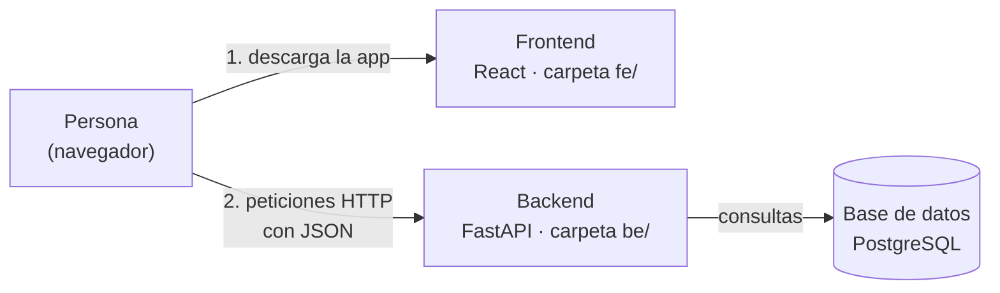
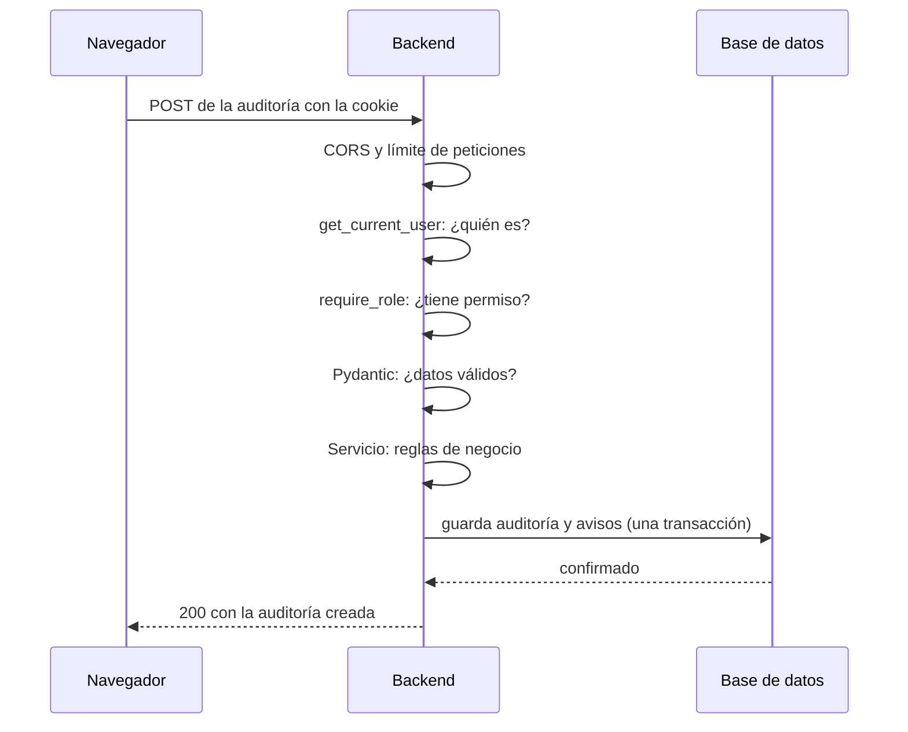
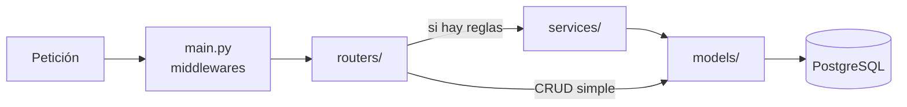
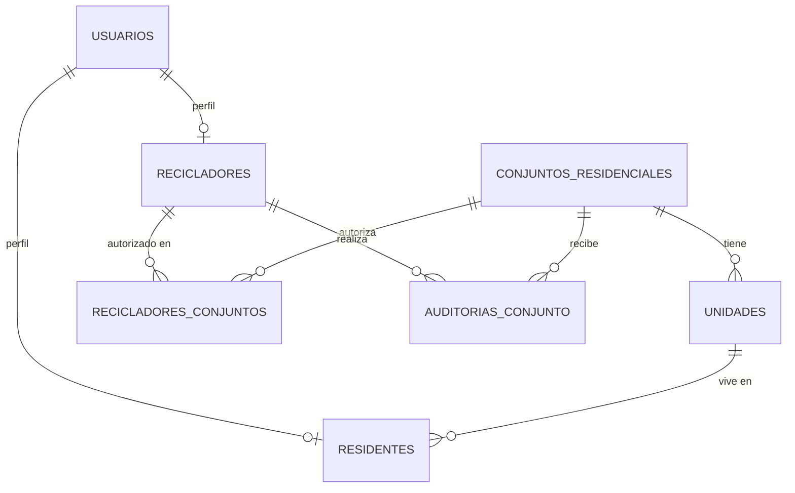

# Cómo funciona VerdeApp por dentro

<!-- resumen: Cómo está construida VerdeApp: las tres partes del sistema, qué pasa en cada petición, cómo se organiza el código, cómo se guardan los datos y por qué se eligió cada tecnología. -->

## Cómo leer este documento

El documento 1 explicó **qué hace** VerdeApp. Este explica **cómo está construida**: qué partes tiene, cómo se hablan entre sí, cómo se organiza el código y por qué usamos cada herramienta.

No supone que sepas programar. Cada término técnico se explica la primera vez que aparece, y al final hay un glosario. Los diagramas están como **resumen** de lo que ya explica el texto; si algo del diagrama no se entiende, la explicación está en el párrafo de arriba.

Orden del documento:

1. Las tres partes del sistema.
2. Qué pasa, paso a paso, cuando alguien hace algo en la aplicación.
3. Cómo está organizado el backend.
4. Cómo está organizado el frontend.
5. Cómo se guardan los datos.
6. Decisiones de diseño que se notan en la aplicación.
7. Las tecnologías y por qué se eligió cada una.

## 1. Las tres partes del sistema

VerdeApp se divide en tres partes que hacen trabajos distintos. A esta forma de dividir un sistema se le llama arquitectura **cliente-servidor en tres capas**. Una **capa** es una parte del sistema con una sola responsabilidad.

### 1.1 El frontend: lo que la persona ve

El **frontend** es la parte de VerdeApp que corre **dentro del navegador de la persona**. Son las pantallas, los botones, los formularios y las gráficas. Su código está en la carpeta `fe/`.

**Qué problema resuelve:** la persona necesita una forma cómoda de pedirle cosas al sistema sin saber nada de programación. El frontend es esa forma.

**Una limitación importante:** como el frontend corre en el computador de la persona, **la persona puede modificarlo** (cualquiera puede abrir las herramientas del navegador y cambiar lo que ve). Por eso el frontend **nunca** es el lugar donde se protegen las reglas: solo guía.

### 1.2 El backend: el que decide

El **backend** es un programa que corre en un servidor (en el equipo del proyecto, por ahora). Recibe las **peticiones** del frontend, aplica las reglas de VerdeApp y guarda o busca datos. Su código está en la carpeta `be/`.

Una **petición** es un mensaje que el frontend manda al backend para pedirle algo. Cada petición tiene tres partes importantes:

- **A dónde va:** una dirección, por ejemplo `/api/v1/auth/login`. Cada dirección concreta del backend se llama **endpoint**.
- **Qué quiere hacer:** un verbo. `GET` significa «dame datos», `POST` significa «crea algo nuevo», `PUT` significa «modifica esto» y `DELETE` significa «bórralo».
- **Con qué datos:** por ejemplo, el correo y la contraseña. Los datos viajan en un formato de texto llamado **JSON**, que se ve así: `{"nivel_desempeno": "REGULAR", "tema_educativo": "Pilas"}`.

El conjunto de todos los endpoints se llama **API**. La de VerdeApp tiene 104 endpoints. Es **REST** (un estilo de organizarla): cada dirección más su verbo equivale a una acción.

**Qué problema resuelve:** las reglas importantes (quién puede hacer qué, qué datos son válidos) deben estar en un lugar que la persona **no pueda modificar**. El servidor es ese lugar.

> **La regla de oro:** cualquiera puede mandarle peticiones al backend sin pasar por nuestras pantallas (por ejemplo, con una herramienta llamada `curl`). Por eso **todas las reglas que importan viven en el backend**. El frontend solo guía a la persona; el backend es el que protege.

### 1.3 La base de datos: donde queda todo guardado

La **base de datos** guarda la información de forma permanente, aunque se apague el programa. Está organizada en **tablas**. Cada fila de una tabla es un registro (un usuario, una auditoría) y cada columna es un dato (el correo, la fecha). VerdeApp usa **PostgreSQL**, un programa especializado en guardar y buscar datos, y tiene **30 tablas**.

**Qué problema resuelve:** el backend, por sí solo, olvida todo cuando se apaga. La base de datos es la memoria permanente del sistema.

**Regla:** **solo el backend toca la base de datos.** El frontend nunca habla con ella directamente. Si lo hiciera, cualquier persona podría leer o cambiar datos saltándose las reglas.

### 1.4 Cómo se conectan

Lo que dice el diagrama, en pasos:

1. La persona abre VerdeApp en el navegador. Un servidor web llamado **Nginx** le entrega los archivos del frontend (HTML, CSS y JavaScript: el texto, el estilo y el comportamiento de las pantallas).
2. Desde ese momento, es el navegador el que le manda las peticiones directamente al backend.
3. El backend consulta o guarda datos en la base de datos y le responde al navegador.

En desarrollo, el frontend corre con el comando `pnpm dev` (puerto 5173) y el backend con `uv run uvicorn` (puerto 8000). Un **puerto** es el «número de puerta» por donde un programa recibe conexiones en un computador. La base de datos y el servidor de correo de prueba corren en contenedores de Docker (se explica en la sección 7.3).

## 2. Qué pasa cuando alguien hace algo: el recorrido de una petición

Para entender cómo trabajan juntas las partes, sigamos un caso real: **un reciclador envía una auditoría.**

### 2.1 Cuatro palabras antes de empezar

- **Token:** un texto firmado que prueba quién es la persona que inició sesión. Si alguien lo modifica, la firma deja de coincidir y el backend lo rechaza.
- **Cookie:** un dato pequeño que el navegador guarda y manda **solo** con cada petición. En VerdeApp, la cookie contiene el token. Así la persona no escribe su contraseña cada vez.
- **Middleware:** un código que se ejecuta con **todas** las peticiones, antes de que lleguen al endpoint. Sirve para revisiones generales.
- **Servicio:** un archivo del backend donde viven las reglas de negocio. Una **regla de negocio** es algo que importa para VerdeApp, no solo para el programa (por ejemplo: «un reciclador no puede calificar el mismo conjunto dos veces en 24 horas»).

### 2.2 Los ocho pasos

**Paso 1. El reciclador pulsa «Enviar auditoría».**
El frontend arma una petición `POST` con el nivel, el tema, la descripción y las fotos, y la manda al backend. Con ella viaja la cookie que contiene el token.

**Paso 2. El backend revisa de dónde viene.**
En el archivo `be/app/main.py`, dos middlewares hacen revisiones generales. Primero, **CORS**: el navegador solo acepta respuestas de un backend si este le dice «acepto peticiones desde esa dirección»; VerdeApp tiene una lista explícita de direcciones permitidas (nunca «cualquiera»). Segundo, el **límite de peticiones**: si una misma persona manda demasiadas seguidas, el backend la corta. Esto frena a quien intente adivinar contraseñas probando miles de veces.

**Paso 3. El backend averigua quién es.**
La función `get_current_user` (en `be/app/dependencies.py`) lee el token de la cookie y comprueba cuatro cosas: que la **firma** sea válida, que no haya **vencido**, que no esté **cancelado** (cuando alguien cierra sesión, su token se anota como cancelado) y que sea del tipo correcto. Después busca a la persona en la base de datos y confirma que su cuenta siga activa. Sin este paso, el backend no sabría quién le pide algo.

**Paso 4. Comprueba que tenga permiso.**
La función `require_role` mira que el usuario sea Reciclador. Si fuera un Residente, el backend responde `403`, que significa «sé quién eres, pero no puedes hacer esto».

**Paso 5. Valida los datos.**
Una librería llamada **Pydantic** revisa que los datos tengan la forma esperada: que el nivel sea uno de los permitidos (Bueno, Regular o Malo), que los textos no sean más largos de lo que cabe en la base de datos. **Validar** es comprobar que lo que llega es correcto antes de usarlo. Si algo está mal, responde `422` («los datos no tienen la forma esperada»), y esto pasa **antes** de que corra el código de VerdeApp.

**Paso 6. El servicio aplica las reglas de negocio.**
La función `crear_auditoria` (en `be/app/services/auditoria_conjunto_service.py`) comprueba que el reciclador esté autorizado en ese conjunto, que no haya calificado ese mismo conjunto en las últimas 24 horas y que traiga entre 1 y 3 fotos. También abre cada foto para comprobar que de verdad es una imagen. Cada regla que falla devuelve un error con su mensaje (por ejemplo `400`: «la petición es válida, pero rompe una regla»).

**Paso 7. Guarda todo junto.**
El servicio guarda la auditoría y crea los avisos para residentes y administradores dentro de una **transacción**: un grupo de operaciones que se confirman **todas o ninguna**. Confirmar se llama `commit` y deshacer todo se llama `rollback`. Si falla algo a la mitad, no queda una auditoría sin avisos ni avisos sin auditoría.

**Paso 8. Responde.**
El backend devuelve la auditoría creada, pasándola antes por un **esquema de salida** que decide qué campos salen. Así no se mandan datos internos por descuido. Por último, un middleware agrega a la respuesta unas **cabeceras de seguridad** (se explican en el documento 3).

### 2.3 Los códigos de respuesta que usa VerdeApp

Cada respuesta del backend lleva un número que resume el resultado:

| Código | Significa | Ejemplo en VerdeApp |
|---|---|---|
| `200` | Todo bien | La auditoría se guardó |
| `400` | La petición es válida, pero rompe una regla de negocio | «El SHUT ya está marcado como lleno» |
| `401` | No hay una sesión válida | El token venció |
| `403` | Hay sesión, pero no tiene permiso | Un residente intenta entrar a una pantalla de administrador |
| `404` | No existe lo que pide | Una auditoría que no existe |
| `422` | Los datos no tienen la forma esperada | Un nivel de calificación inventado |
| `429` | Demasiadas peticiones seguidas | Mil intentos de inicio de sesión en un minuto |

### 2.4 Cuando el token vence

El token de acceso dura solo **15 minutos**. Si vence, el backend responde `401`. El frontend lo detecta, y en lugar de pedirle la contraseña a la persona, usa un segundo token, el de **renovación**, que dura **7 días**, para pedir uno nuevo, y repite la petición original. La persona no nota nada. Si dos pestañas lo piden a la vez, el frontend manda **una sola** renovación. Cada token de renovación sirve **una sola vez**. Los detalles de seguridad están en el documento 3.

## 3. Cómo está organizado el backend

### 3.1 La idea: separar por responsabilidades

El backend es un proyecto grande. Si todo el código estuviera mezclado en un solo lugar, cambiar una cosa rompería otra. Por eso se divide en **capas**, y cada capa tiene **una sola responsabilidad**:

Todo está dentro de la carpeta `be/app/`.

### 3.2 Los routers: reciben y responden

**Qué es:** un **router** es un archivo que agrupa los endpoints de un tema. Hay 17, uno por tema: `auth.py` (inicio de sesión y registro), `comunicados.py`, `auditoria_conjunto.py`, `notificaciones.py`, y así.

**Qué hace:** recibe la petición, comprueba permisos y validación (con las herramientas de los pasos 3 al 5 del recorrido) y **delega**: llama al servicio y devuelve la respuesta.

**Qué NO hace:** no toma decisiones de negocio. Si un router tuviera las reglas adentro, cambiar la forma de recibir las peticiones podría romper las reglas.

### 3.3 Los services: las reglas de negocio

**Qué es:** un **servicio** es un archivo donde viven las reglas de negocio de un tema. Hay 16: `auditoria_conjunto_service.py`, `comunicado_service.py`, `notificaciones_service.py`, `desvinculacion_service.py`, entre otros.

**Qué problema resuelve:** separar las reglas del resto tiene dos ventajas concretas. Primera: **las reglas se pueden probar sin levantar un servidor**, porque el servicio no sabe nada de peticiones HTTP; solo recibe datos y decide. Segunda: si mañana cambiara el frontend o la forma de recibir las peticiones, las reglas no se tocan.

**Un ejemplo:** la regla «un reciclador no puede avisar SHUT vaciado si antes no avisó su llegada» vive en `notificaciones_service.py`, no en el router.

### 3.4 Los models: la forma de las tablas

**Qué es:** un **modelo** es una clase de Python (un molde de datos) que describe **una tabla** de la base de datos. La clase `AuditoriaConjunto` (en `be/app/models/auditoria_conjunto.py`) es la tabla `auditorias_conjunto`: cada atributo de la clase es una columna. Hay un archivo por tabla.

**Qué problema resuelve:** el código de VerdeApp trabaja con objetos de Python (por ejemplo, «una auditoría») y no con texto SQL. La herramienta que traduce entre las dos formas se llama **ORM**; se explica en la sección 7.1.

### 3.5 Los schemas: la forma de lo que entra y sale

**Qué es:** un **schema** (esquema) describe la forma que debe tener un dato: qué campos, de qué tipo y con qué límites. Se escriben con Pydantic y están en `be/app/schemas/`. Hay dos tipos de esquema:

- **De entrada:** qué debe traer una petición. Por ejemplo, una contraseña debe tener mínimo 8 caracteres con una mayúscula, una minúscula y un número.
- **De salida:** qué campos se mandan en la respuesta. Esto se conoce como **DTO** («objeto de transferencia de datos»). Por ejemplo, el modelo `Usuario` tiene el hash de la contraseña, pero el esquema de respuesta no lo incluye: es **imposible** mandarlo por descuido.

### 3.6 dependencies.py: piezas que cualquier endpoint puede pedir

**Qué es una dependencia (en este contexto):** una función que un endpoint «pide» para que le entreguen algo ya preparado. En el código se escribe con `Depends(...)`; a esta técnica se le llama **inyección de dependencias**.

**Qué problema resuelve:** sin esto, cada endpoint tendría que repetir el código de «leer el token, verificarlo, buscar al usuario». Con esto, un endpoint solo declara `Depends(get_current_user)` y ya recibe al usuario listo.

Las dependencias del proyecto, en `be/app/dependencies.py`:

- `get_db`: entrega una conexión a la base de datos.
- `get_current_user`: entrega al usuario que hace la petición, ya verificado.
- `require_role(RolId.X, mensaje)`: exige un rol; si no coincide, responde `403`.
- `require_admin_conjunto(mensaje)`: exige el rol de Administrador de Conjunto y además entrega su perfil ya resuelto.

**Regla del proyecto:** para restringir un endpoint por rol se usan estas funciones, **nunca** un `if` escrito a mano. Así los permisos no dependen de que cada programador se acuerde de escribirlos.

### 3.7 Las demás carpetas

- **`utils/`:** piezas que usa todo el backend, sin pertenecer a un tema: seguridad (contraseñas y tokens), validación de imágenes, correo, generación de PDF, enlaces seguros y registro de eventos.
- **`config.py`:** lee las **variables de entorno** (valores de configuración que viven fuera del código, como la clave secreta o la dirección de la base de datos) y las valida **al arrancar**. Si falta una o está mal, el backend se niega a arrancar y dice cuál es el problema.
- **`database.py`:** crea la conexión a la base de datos.
- **`tests/`:** las pruebas automáticas (documento 3).
- **`seed.py` y `seed_demo.py`:** cargan en la base de datos los datos mínimos y los de demostración. «Sembrar» es llenar una base vacía.
- **`alembic/` (fuera de `app/`):** las **migraciones**, que explico en la sección 5.5.

### 3.8 Las reglas que cumple el diseño

1. **Un router no tiene reglas de negocio:** recibe, valida y delega.
2. **Los permisos no se escriben a mano:** se declaran con `Depends(require_role(...))`.
3. **La respuesta nunca es el modelo de la base:** pasa por un esquema de salida.
4. **El esquema de la base lo crean las migraciones**, nunca el código de la aplicación.

## 4. Cómo está organizado el frontend

### 4.1 Qué es React y cómo se construye una pantalla

El frontend está hecho con **React**, una librería (un conjunto de código ya hecho que usamos) para construir pantallas a partir de **componentes**. Un **componente** es una pieza reutilizable de pantalla: un botón, una ventana emergente, una tarjeta. Recibe datos y devuelve lo que se debe mostrar.

**Qué problema resuelve:** con React, la pantalla **se actualiza sola cuando cambian los datos**. Cuando llega un aviso nuevo, la campanita cambia sin recargar la página.

Una **pantalla** de VerdeApp se arma así, en pasos:

1. La **página** (un archivo de `fe/src/pages/`) necesita datos, por ejemplo la lista de comunicados.
2. Se los pide a un archivo de `fe/src/lib/` (por ejemplo `comunicadosApi.ts`). Hay un archivo por cada recurso del backend.
3. Ese archivo usa **un único cliente de peticiones**, `fe/src/api/axios.ts`, para llamar al backend.
4. La página recibe los datos y los muestra usando componentes de `fe/src/components/`.

**Regla:** ninguna página llama directamente a `axios`. Todo pasa por `lib/` y por el cliente único.

### 4.2 Las carpetas

- **`pages/`:** una vista por ruta (una **ruta** es una dirección del navegador, como `/comunicados`). Los cuatro paneles principales, uno por rol, están en `pages/dashboards/`.
- **`components/`:** piezas reutilizables. Las más comunes están en `components/ui/`: `Button`, `Modal` (ventana emergente), `Alert` (aviso de error o éxito) e `InputField` (campo de texto). Se reutilizan en los cuatro roles para que todo se vea y se comporte igual.
- **`lib/`:** los archivos `*Api.ts` (uno por recurso) y funciones de ayuda (por ejemplo, para dar formato a las fechas).
- **`api/`:** el cliente único de peticiones.
- **`context/` y `hooks/`:** explicados abajo.
- **`config/`:** datos de configuración, como los colores e ícono de cada rol.
- **`locales/`:** los textos en español y en inglés.

### 4.3 Decisiones del frontend que conviene saber explicar

**Cómo sabe toda la aplicación quién inició sesión.** Hay una pieza llamada `AuthContext` que guarda quién inició sesión, y cualquier componente puede pedírsela con `useAuth()`. Un **contexto** de React es una forma de compartir un dato con toda la aplicación sin pasarlo de componente en componente. Un **hook** es una función de React que le da una capacidad a un componente (como `useAuth`, que le da acceso a la sesión).

**Las dos guardas de ruta.** Una **guarda** es un componente que decide si una persona puede ver una pantalla. `ProtectedRoute` comprueba que haya sesión; `RoleGuard` comprueba que el rol sea el correcto. Así, si un residente escribe a mano la dirección del panel del administrador, lo redirige. **Pero:** esto protege solo la *navegación*. Como el frontend se puede modificar, la protección real está en el backend, que respondería `403` de todas formas.

**Los avisos llegan casi al instante, sin conexión permanente.** El hook `usePolling` hace que el frontend **le pregunte al backend cada 20 segundos** si hay notificaciones nuevas. Esa técnica se llama **polling**. Además, cuando una acción propia cambia algo (por ejemplo, la persona marca una notificación como leída), un evento de la ventana le avisa a la campanita para que se actualice de inmediato, sin esperar a los 20 segundos.

**Los colores no se escriben a mano.** Hay nombres de color definidos **una sola vez** en `fe/src/index.css`: `accent-*` para el verde de la marca y `night-*` para las superficies del modo oscuro. Ningún componente escribe un color suelto. Así el modo oscuro es consistente y cambiar la paleta es tocar un solo archivo.

**Los textos no están dentro de los componentes.** Cada texto de la pantalla es una *clave* (por ejemplo, `appShell.nav.agenda`) y el texto real vive en dos archivos: `locales/es/translation.json` y `locales/en/translation.json`. Toda pantalla nueva necesita su clave en **los dos**. Esto se llama **internacionalización**.

**La validación se hace en dos lugares.** El formulario valida cuando la persona sale de cada campo, para guiarla en el momento («este correo no tiene un formato válido»). Pero el backend **repite todas las reglas**, porque el frontend se puede saltar.

## 5. Cómo se guardan los datos

### 5.1 Tablas, llaves y relaciones

Una base de datos relacional guarda los datos en **tablas** y las **relaciona** entre sí. Para eso usa dos tipos de llave:

- **Llave primaria:** la columna que identifica **de forma única** cada fila de una tabla. En VerdeApp es la columna `id_...` de cada tabla.
- **Llave foránea:** una columna que **apunta a la fila de otra tabla**. Por ejemplo, la columna `id_reciclador` de `auditorias_conjunto` apunta a una fila de `recicladores`: dice «esta auditoría la hizo ese reciclador».

Las relaciones entre tablas pueden ser de tres tipos:

- **Uno a uno:** una fila de una tabla corresponde a una sola de otra. Un usuario tiene un solo perfil de residente.
- **Uno a muchos:** una fila de una tabla corresponde a muchas de otra. Un conjunto tiene muchas unidades (apartamentos).
- **Muchos a muchos:** muchas filas de una tabla se relacionan con muchas de otra. Un reciclador trabaja en varios conjuntos, y un conjunto tiene varios recicladores. Esta relación necesita una tabla en el medio, llamada **tabla de unión**.

### 5.2 Cómo está organizada la información de las personas

Los cuatro roles comparten unos datos (correo, contraseña, idioma, foto) y tienen otros propios (el residente tiene torre y apartamento; el reciclador, su asociación). Para no mezclar todo en una sola tabla con columnas vacías, VerdeApp usa:

- **Una tabla común, `usuarios`,** con lo que comparten los cuatro roles.
- **Una tabla por rol** (`residentes`, `recicladores`, `administradores_conjunto`) con lo propio de cada uno, enlazada a `usuarios` por la columna `id_usuario`.

**Qué problema resuelve:** no hay columnas que solo aplican a un rol y quedan vacías en los demás.

### 5.3 Las tablas de unión con historial

La relación «un reciclador trabaja en varios conjuntos» vive en la tabla `recicladores_conjuntos`. Además de unir las dos tablas, guarda la **fecha de autorización** y la **fecha de revocación**. Esto significa que **revocar no borra**: cierra el vínculo y deja el historial de quién estuvo autorizado y cuándo. La misma idea se usa con los administradores de conjunto.

### 5.4 Las llaves son UUID, no números

Las llaves primarias son **UUID versión 4**: identificadores largos y aleatorios, como `3f2b8c1e-...`, en lugar de números consecutivos (1, 2, 3). **Qué problema resuelve:** con números consecutivos, alguien podría probar a mano `1, 2, 3...` hasta encontrar los datos de otra persona. Con identificadores aleatorios, **no se pueden adivinar**. Las excepciones son las tablas `roles` y `localidades`, que son catálogos fijos y públicos.

### 5.5 Migraciones: cómo cambia la base de datos

**Qué es:** una **migración** es un archivo versionado que describe **un cambio en la estructura** de la base de datos (crear una tabla, agregar una columna) y cómo deshacerlo. La herramienta que las aplica en orden se llama **Alembic**. Están en `be/alembic/versions/` (hoy son 45).

**Qué problema resuelve:** los cuatro integrantes y cualquier servidor necesitan **exactamente la misma estructura** de base de datos. Si cada uno la modificara a mano, se desincronizarían. Con migraciones, cada cambio queda registrado en git, como cualquier otro código. El comando para ponerse al día es `uv run alembic upgrade head`.

**Por qué no se crean las tablas desde el código:** existe una instrucción (`create_all`) que crea las tablas que faltan, pero **no modifica una tabla que ya existe**. Sirve en un proyecto vacío, no para evolucionar una base con datos reales. En VerdeApp está prohibida.

### 5.6 Integridad: la base de datos también protege

Además del código, la **propia base de datos** impide guardar datos que rompen las reglas. Esto se llama **integridad**. Ejemplos reales: no deja guardar dos usuarios con el mismo correo, no deja guardar una auditoría de un conjunto que no existe, y no deja que un mismo conjunto tenga dos administradores activos (esto último con un *índice único* parcial). **Qué problema resuelve:** si el código tuviera un error, la base de datos lo frenaría igual.

### 5.7 Transacciones: todo junto o nada

Una **transacción** es un grupo de operaciones en la base de datos que se confirman **todas juntas** (`commit`) o **no se confirma ninguna** (`rollback`). Ejemplo real: cuando un reciclador guarda una auditoría, el servicio:

1. Agrega la auditoría.
2. La manda a la base **sin confirmarla todavía**, para obtener su identificador.
3. Crea el aviso «auditoría publicada» para residentes y administradores.
4. Si el nivel fue Regular o Malo, crea también el aviso «contenido recomendado».
5. Hace **un solo `commit`**.

Si algo falla entre el paso 1 y el 5, la base hace `rollback`: no queda una auditoría sin avisos, ni avisos de una auditoría que no existe.

## 6. Decisiones de diseño que se notan en la aplicación

1. **El estado del SHUT no se guarda: se calcula.** Un conjunto está «lleno» si **el último aviso** de tipo SHUT lleno o SHUT libre fue «lleno». *Ventaja:* no hay un dato que pueda quedar desactualizado. *Costo:* cada consulta debe leer el último aviso.
2. **Toda notificación pasa por una sola función**, `crear_notificacion` (en `notificaciones_helpers.py`). *Por qué:* si cambia la forma de guardar los avisos, se cambia en un solo lugar.
3. **Los listados que pueden crecer se paginan.** *Paginar* es mostrar los resultados por partes (por ejemplo, 10 por página) en lugar de traer miles de una vez. El backend responde `{"items": [...], "total": 245}` y el frontend usa el hook `usePaginacion`.
4. **Las fotos no viven en la base de datos.** Se guardan como archivos en la carpeta `be/app/uploads/` y la base solo guarda la **ruta** del archivo. *Por qué:* las fotos son pesadas y la base de datos trabaja mejor con datos pequeños. Una limpieza manual borra las fotos que ninguna fila usa.
5. **Un solo administrador activo por conjunto**, garantizado por la base de datos, no solo por el código.
6. **Los seeds se pueden repetir.** Correr `app.seed` dos veces no duplica datos.
7. **Los cambios en la base se hacen por etapas.** Cuando se cambió el tipo de las llaves primarias a UUID en tablas que ya tenían datos reales, se hizo así: primero se agrega la columna nueva, luego se llena, luego se reapuntan las referencias y recién al final se quita la vieja. *Por qué:* hacerlo de golpe habría perdido datos.

## 7. Las tecnologías y por qué se eligió cada una

Las versiones son las que fijan los archivos `be/pyproject.toml` y `fe/package.json` al 26 de noviembre de 2026; si una cambia, ese archivo manda. **Regla del proyecto:** toda dependencia lleva **versión exacta**, nunca un rango.

**Palabras que se repiten en esta sección:**

- **Librería:** un conjunto de código ya hecho que usamos en vez de escribirlo desde cero.
- **Framework:** como una librería, pero define la estructura del programa: tú pones tu código dentro de su forma.
- **Dependencia:** cualquier librería de terceros que usa el proyecto. Una **dependencia transitiva** es la que trae otra dependencia sin que nosotros la pidamos.

### 7.1 Backend

**Python 3.12**
- *Qué es:* el lenguaje de programación del backend.
- *Por qué:* es el lenguaje que domina el equipo y tiene librerías maduras para web, bases de datos y seguridad.

**FastAPI 0.162.2 y Uvicorn**
- *Qué es:* FastAPI es el **framework web** del backend: recibe las peticiones, decide qué función las atiende y arma la respuesta. Uvicorn es el servidor que ejecuta la aplicación y escucha en el puerto 8000.
- *Qué problema resuelve:* FastAPI **lee los tipos que escribimos en cada función** y con eso hace tres cosas sin trabajo extra. Primera, **valida** los datos que llegan (si el nivel de una auditoría llega como «REGULARISIMO», responde `422` sin ejecutar nuestro código). Segunda, **documenta la API sola**: genera la página `/docs` con todos los endpoints (en producción está apagada, porque ayuda a quien planea un ataque). Tercera, ofrece la **inyección de dependencias** (sección 3.6).
- *Dónde se ve:* `be/app/main.py` crea la aplicación; `be/app/routers/` tiene los endpoints.
- *Por qué no otro:* **Django** trae un sistema de plantillas y un panel de administración propios que no usaríamos, porque nuestro frontend es una aplicación aparte. **Flask** es más pequeño pero no valida ni documenta solo.

**Pydantic 2.14.3**
- *Qué es:* la librería que define y valida los esquemas (sección 3.5).
- *Qué problema resuelve:* sin ella habría que escribir a mano cada comprobación («¿este campo existe? ¿es un número? ¿tiene la longitud correcta?»), y es fácil olvidarse de una. También hace que un texto más largo que su columna en la base de datos se rechace con `422` y no rompa la base con un error `500` («error del servidor»).

**SQLAlchemy 2.1.8 (el ORM)**
- *Qué es:* un **ORM** (*Object-Relational Mapper*, «traductor de objetos a tablas»). Traduce entre las **filas de una tabla** y los **objetos de Python**. Guardar una auditoría es crear el objeto y hacer `db.add(...)`.
- *Qué problema resuelve:* que las consultas se escriban en Python, y que los valores viajen **separados** del texto SQL (se llaman *consultas parametrizadas*). **SQL** es el lenguaje con el que se le pide cosas a una base de datos. Si un texto del usuario se mezclara con la consulta, la base podría ejecutarlo como una orden: eso es una **inyección SQL**, un ataque muy conocido. Con el ORM, aunque alguien escriba `'; DROP TABLE usuarios; --` en un campo, se trata como un texto cualquiera.
- *Dónde se ve:* `be/app/models/` y `be/app/services/`.
- *Por qué no SQL a mano:* más código repetido y más riesgo de inyección.

**Alembic 1.20.1**
- *Qué es:* la herramienta que aplica las migraciones (sección 5.5).

**PostgreSQL 17**
- *Qué es:* la base de datos relacional de VerdeApp.
- *Qué problema resuelve:* **integridad** (sección 5.6) y **transacciones** (sección 5.7).
- *Por qué no otra:* **MongoDB** guarda documentos sin estructura fija; nuestros datos son muy relacionados (usuarios, conjuntos, unidades, auditorías) y necesitamos integridad. **SQLite o MySQL:** el proyecto fija PostgreSQL en **todos** los entornos, incluso en las pruebas locales, para probar exactamente lo mismo que va a correr.

**bcrypt 5.0.0 y PyJWT 2.15.1**
- *Qué son:* bcrypt guarda las contraseñas como huellas que no se pueden revertir; PyJWT firma los tokens de sesión. Se explican a fondo en el documento 3.

**slowapi, Pillow 13.0.0 y fpdf2 2.9.0**
- **slowapi:** limita cuántas peticiones puede hacer un cliente por minuto.
- **Pillow:** abre las imágenes que suben los usuarios para **comprobar que de verdad son imágenes** y que no superan los límites.
- **fpdf2:** genera en el servidor el PDF del historial de la agenda.

**uv (gestor de paquetes)**
- *Qué es:* la herramienta que instala las dependencias del backend a partir de `pyproject.toml` (lo que usamos) y `uv.lock` (la versión **exacta** de todo, incluidas las dependencias transitivas).
- *Qué problema resuelve:* un **entorno reproducible**: un `uv sync` en el computador de cualquier compañero, o en el servidor de integración continua, instala exactamente lo mismo. Así «en mi computador funciona» deja de ser un problema.

### 7.2 Frontend

**React 19.3.1**
- Se explicó en la sección 4.1.

**TypeScript 5.9.3**
- *Qué es:* JavaScript (el lenguaje del navegador) con **tipos**: cada variable y cada función declaran qué forma de dato aceptan.
- *Qué problema resuelve:* muchos errores se detectan **al escribir o al compilar**, no cuando el usuario los encuentra. Si una función espera un identificador de texto y le pasas un número, el chequeo (`tsc`) falla y el CI (documento 3) no deja avanzar.

**Vite 7.3.8**
- *Qué es:* la herramienta que **sirve el frontend en desarrollo** (con recarga instantánea al guardar un archivo) y lo **compila para producción**: junta y reduce todo el código en pocos archivos listos para publicar.

**Tailwind CSS 4.3.5**
- *Qué es:* una forma de dar estilo con **clases pequeñas** escritas directamente en el componente (`rounded-2xl`, `p-4`), en vez de archivos de estilo aparte.
- *Por qué no Bootstrap:* Tailwind permite un diseño propio con colores definidos una sola vez (sección 4.3), sin pelear con estilos prediseñados.

**React Router 7.18.5**
- *Qué es:* decide qué pantalla mostrar según la dirección del navegador. `App.tsx` define las rutas.

**Axios 1.21.1**
- *Qué es:* el cliente que hace las peticiones al backend. Un **interceptor** (código que se ejecuta en cada petición y respuesta) maneja la sesión vencida en un solo lugar.

**i18next 26.7.2**
- *Qué es:* el sistema de traducciones (sección 4.3).

**recharts 3.10.1, react-markdown 10.1.0 y lucide-react 0.577.0**
- **recharts:** dibuja la gráfica de desempeño semanal. Se carga **bajo demanda**, solo cuando alguien abre esa página, para no hacer pesada la primera carga.
- **react-markdown:** muestra el texto de las lecciones, que se escribe con formato simple (negritas, listas).
- **lucide-react:** los íconos; es la única fuente de íconos permitida.

**pnpm y Vitest 4.1.12**
- **pnpm:** el gestor de paquetes del frontend, equivalente a `uv`; su archivo `pnpm-lock.yaml` fija las versiones exactas.
- **Vitest:** ejecuta las pruebas del frontend (documento 3).

### 7.3 Infraestructura y herramientas

**Docker y Docker Compose**
- *Qué es:* Docker ejecuta cada programa en un **contenedor**: un proceso aislado, con sus propias librerías, creado a partir de una **imagen** (la receta del contenedor). Docker Compose describe varios contenedores y cómo se conectan en un solo archivo, `docker-compose.yml`.
- *Qué problema resuelve:* todos corremos la **misma versión** de PostgreSQL sin instalarla en el computador.
- *Dónde se ve:* cuatro servicios: `verde_db` (PostgreSQL), `verde_be` (el backend), `verde_fe` (Nginx con el frontend compilado) y `verde_mailpit` (correo de prueba), más una segunda base, `verde_db_test`, que usan solo las pruebas. Dos **volúmenes** (espacios que sobreviven al apagado) guardan lo que no se puede perder: `db_data` (la base) y `be_uploads` (las fotos).

**Nginx 1.27.5**
- *Qué es:* un servidor web muy rápido. En VerdeApp entrega los archivos del frontend ya compilado.

**Mailpit 1.31.6**
- *Qué es:* un servidor de correo **falso** para desarrollo: recibe los correos que la aplicación intenta enviar (verificación de cuenta, recuperación de contraseña, invitaciones) y los muestra en una página local, en lugar de mandarlos a internet. *Por qué:* así se prueba el envío de correos sin mandar correos reales.

**GitHub Actions y Dependabot**
- **GitHub Actions** es la **integración continua** (CI): en cada cambio que se sube, corre solo las revisiones y las pruebas. Se explica en el documento 3.
- **Dependabot** propone actualizaciones de dependencias cuando salen versiones nuevas o vulnerabilidades.

**Playwright 1.65.0**
- *Qué es:* controla un navegador real para recorrer un flujo completo, como lo haría una persona (pruebas de extremo a extremo; documento 3).

### 7.4 Otras alternativas que se descartaron

- **Node con Express** (el backend en JavaScript): no aporta algo que necesitemos, y Python tiene librerías maduras de seguridad y de datos.
- **WebSockets** (conexión permanente para mensajes en tiempo real): el *polling* cada 20 segundos es casi inmediato para este uso y no exige mantener conexiones abiertas.
- **Firebase** (servicio externo de datos): queremos control del modelo de datos y de la seguridad, y no mandar datos de personas a un tercero.

### 7.5 Una precisión honesta sobre «asíncrono»

Un programa **síncrono** hace una cosa a la vez: mientras espera (a la base de datos, a un correo), no hace nada más en ese hilo. Uno **asíncrono** puede dejar esa espera «en pausa» y atender otra petición. FastAPI está construido sobre el modelo asíncrono, y la propuesta técnica pedía una API asíncrona.

En el código real, los routers tienen **6 funciones `async def`** (las que usan el modelo asíncrono: invitaciones por correo, subida de archivos, contacto y auditoría) y **106 funciones normales `def`**. FastAPI ejecuta las normales en un grupo de hilos para que no bloqueen el servidor, y el driver de la base de datos (psycopg2) es síncrono. Es decir: el servidor aprovecha el modelo asíncrono, pero nuestras consultas a la base de datos esperan de forma síncrona. Es una decisión aceptable para esta escala y una mejora posible si el tráfico creciera.

## Lo que debes saber explicar

Después de leer este documento, deberías poder responder **sin mirar**:

1. ¿Cuáles son las tres capas del sistema y qué hace cada una?
2. ¿Qué pasa, paso a paso, cuando un reciclador envía una auditoría?
3. ¿Para qué sirven `routers/`, `services/` y `models/`, y por qué están separados?
4. ¿Cómo se relacionan `usuarios` y las tablas de cada rol?
5. ¿Qué es una transacción y dónde se ve en VerdeApp?
6. ¿Qué es una migración y por qué no se usa `create_all`?

### Preguntas que te pueden hacer

**¿Por qué FastAPI y no Django?**
Django trae plantillas y un panel de administración propios que no usaríamos, porque nuestro frontend es una aplicación aparte. FastAPI valida y documenta a partir de los mismos tipos que escribimos, y encaja con una API que consume un frontend React.

**¿Por qué PostgreSQL y no MongoDB?**
Nuestros datos están muy relacionados (usuarios, conjuntos, unidades, auditorías) y necesitamos integridad y transacciones. Eso es el punto fuerte de una base relacional.

**¿Por qué las reglas están en el backend y no en el frontend?**
Porque el frontend corre en el computador de la persona, y cualquiera puede modificarlo o llamar a la API sin pasar por él. Las reglas y la seguridad solo son confiables en el servidor.

**¿Qué es una migración y por qué no usan `create_all()`?**
Una migración es un archivo versionado que describe un cambio en la base de datos y cómo deshacerlo. `create_all()` solo crea las tablas que faltan, no modifica una que ya existe, así que no sirve para evolucionar una base con datos reales.

**¿Por qué los identificadores son UUID y no números?**
Para que nadie pueda adivinar el identificador de otro usuario o conjunto probando números consecutivos.

**¿El backend es asíncrono?**
En parte. FastAPI usa el modelo asíncrono, pero casi todas nuestras funciones son normales y la conexión a la base de datos es síncrona. Es suficiente para esta escala y está identificado como mejora posible.

**¿Cómo llegan los avisos a la campanita si no hay conexión permanente?**
El frontend pregunta cada 20 segundos (*polling*), y cuando una acción propia cambia algo, un evento de la ventana refresca la campanita al instante.

**¿Por qué una auditoría y sus avisos se guardan en una transacción?**
Para que se guarden todos o ninguno. Si fallara a la mitad, quedaría una auditoría sin avisos o avisos de una auditoría que no existe.

## Glosario

- **API:** lista de cosas que el backend sabe hacer, cada una con su dirección.
- **Capa:** parte del sistema con una sola responsabilidad.
- **Componente:** pieza reutilizable de pantalla (un botón, una ventana, una tarjeta).
- **Contenedor (Docker):** proceso aislado con sus propias librerías, creado a partir de una imagen.
- **Cookie:** dato pequeño que el navegador guarda y manda solo en cada petición.
- **DTO / esquema de salida:** descripción de qué campos se mandan en una respuesta.
- **Endpoint:** una dirección concreta de la API que hace una cosa.
- **Framework:** como una librería, pero define la estructura del programa.
- **Hook:** función de React que le da una capacidad a un componente.
- **Inyección de dependencias:** técnica para que un endpoint «pida» piezas ya preparadas con `Depends(...)`.
- **Integridad:** que la base de datos impida guardar datos que rompen las reglas.
- **JSON:** formato de texto para mandar datos entre frontend y backend.
- **Llave primaria / foránea:** columna que identifica una fila / columna que apunta a una fila de otra tabla.
- **Middleware:** código que se ejecuta con todas las peticiones, antes del endpoint.
- **Migración:** archivo versionado que describe un cambio en la estructura de la base de datos.
- **ORM:** traductor entre las filas de una tabla y los objetos de Python.
- **Paginar:** mostrar resultados por partes.
- **Petición:** mensaje del frontend al backend para pedirle algo.
- **Polling:** preguntar cada cierto tiempo si hay novedades.
- **Regla de negocio:** algo que importa para VerdeApp, no solo para el programa.
- **Router / Servicio / Modelo:** archivo de endpoints de un tema / archivo de reglas de un tema / clase que describe una tabla.
- **Token:** texto firmado que prueba quién inició sesión.
- **Transacción:** grupo de operaciones que se confirman todas o ninguna.
- **UUID:** identificador largo y aleatorio, imposible de adivinar.
- **Validar:** comprobar que un dato es correcto antes de usarlo.
- **Variable de entorno:** valor de configuración que vive fuera del código.
