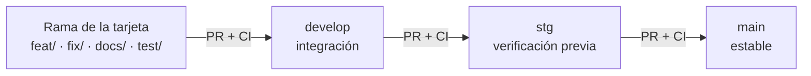

# Cómo trabajamos como equipo

<!-- resumen: Cómo organizamos el trabajo de cuatro personas: Scrum, tarjetas y tablero, estimación, informes semanales, uso de Git y GitHub, reparto real del trabajo y lo que aprendimos. -->

## Cómo leer este documento

Los documentos 1 a 3 explicaron **qué es** VerdeApp, **cómo está construida** y **cómo se protege y se prueba**. Este explica **cómo trabajamos** los cuatro integrantes para construirla: cómo organizamos las tareas, cómo estimamos cuánto toma cada una, cómo registramos el avance y cómo usamos Git y GitHub para no pisarnos el trabajo.

No supone que conozcas Scrum ni Git. Cada término se explica la primera vez que aparece, y al final hay un glosario. También incluye, con honestidad, **lo que no nos ha funcionado**, porque ante los profesores (que hacen de clientes) es mejor conocer los límites del proceso que ocultarlos.

Orden del documento:

1. Qué es Scrum y cómo lo aplicamos.
2. El backlog y el tablero.
3. Cómo estimamos las tareas.
4. Cómo funciona una semana de trabajo.
5. Cómo usamos Git y GitHub.
6. Cómo se repartió el trabajo realmente.
7. Qué funcionó, qué no, y qué acordamos mejorar.
8. La estimación original de costos.

## 1. Qué es Scrum y cómo lo aplicamos

### 1.1 Qué es Scrum

**Scrum** es una forma de organizar el trabajo de un equipo que desarrolla software. En vez de planear todo el proyecto de una vez y entregarlo al final, el trabajo se divide en **ciclos cortos** llamados *sprints*. Al final de cada ciclo se revisa qué se logró, qué salió mal y qué conviene cambiar.

**Qué problema resuelve:** en un proyecto de software, los requisitos y los errores se descubren **mientras se construye**. Planear todo al inicio sin poder corregir sería arriesgado. Con ciclos cortos, el equipo se entera pronto de sus errores y los corrige barato.

### 1.2 Las palabras de Scrum

- **Sprint:** un ciclo de trabajo de duración fija. En VerdeApp, **una semana**.
- **Backlog:** la lista de todo lo que falta por hacer, ordenada por importancia. En VerdeApp es la lista de *issues* de GitHub.
- **Issue:** una tarea escrita en GitHub, con su título, descripción y criterios para darla por terminada. Cada issue es una **tarjeta** del tablero.
- **Historia de usuario:** la descripción de algo que una persona quiere poder hacer, con la forma «como [rol], quiero [acción], para [beneficio]». VerdeApp tiene 53 (documento 1).
- **Scrum Master:** la persona que ayuda al equipo a seguir el proceso: asigna tareas, sigue el avance y quita obstáculos. En VerdeApp **rota cada semana** entre los cuatro integrantes.
- **Informe semanal:** el resumen escrito de lo que pasó en el sprint. El Scrum Master lo escribe.
- **Retrospectiva:** una revisión de cómo trabajó el equipo, para decidir qué mejorar.

### 1.3 Cómo se ve cada elemento en VerdeApp

| Elemento de Scrum | Cómo lo aplicamos | Dónde se ve |
|---|---|---|
| Backlog | Los issues de GitHub y el tablero «VerdeApp - Tablero de desarrollo» | Pestaña *Issues* del repositorio |
| Historias de usuario | 53 historias (HU-001 a HU-053), cada una en su archivo con prioridad y criterios de aceptación | `docs/requisitos/HUs/` |
| Sprint | Una semana. Cada integrante recibe un issue por semana | `docs/gestion-proyecto/informes-scrum/` |
| Scrum Master | Rota cada semana | Campo «Scrum Master» de cada informe |
| Puntuación | Importancia, complejidad, prioridad y tamaño por tarjeta | `docs/gestion-proyecto/prioridad-y-tamano.md` |
| Tareas asignadas | El Scrum Master asigna un issue a cada integrante al empezar la semana | Campo *Assignees* de cada issue |
| Cierre del sprint | Cada integrante deja un comentario de cierre en su issue y con eso se escribe el informe | `informes-scrum/_cierre-de-issue.md` |
| Retrospectiva | Se documenta en los informes y en `docs/gestion-proyecto/retrospectiva-equipo.md` | Sección 7 de este documento |

### 1.4 Los sprints originales y los sprints reales

La propuesta técnica planeó **4 sprints**, uno por bloque de funcionalidad:

| Sprint | Contenido |
|---|---|
| 1. Autenticación y perfil | Inicio de sesión, registro, actualizar perfil, cerrar sesión |
| 2. Contenido y directorios | Catálogo educativo, directorio, gestión de contenido y del directorio |
| 3. Lógica operativa (alertas) | Reporte de SHUT lleno, llegada del reciclador |
| 4. Auditoría y cierre | El semáforo de gestión de residuos |

En la práctica, el proyecto avanzó por entregas incrementales y creció de 11 historias generales a 53 historias detalladas. Desde octubre de 2026, el sprint es **semanal**, con una tarjeta por persona.

## 2. El backlog y el tablero

### 2.1 El backlog en GitHub

Todo el trabajo pendiente vive en **issues** de GitHub. Cada issue se crea con una **plantilla** (hay una en `.github/ISSUE_TEMPLATE/`) y debe estar escrito **en español y completo**. Partes obligatorias de un issue:

- **Contexto:** por qué existe esta tarea.
- **Qué debe pasar:** el resultado que se espera.
- **Alcance:** qué incluye y qué *no* incluye.
- **Criterios de aceptación:** una lista de condiciones verificables para darla por terminada.
- **Archivos relacionados** (solo las rutas), **documentación a actualizar**, **cómo probarlo**.
- **Importancia, complejidad y tamaño** (sección 3).
- **Guía para quien la trabaje:** explicación corta con «en palabras sencillas», «por dónde empezar» y «cómo saber que quedó bien».
- **Dependencias:** qué debe estar hecho antes.

Un issue **explica el problema y lo que se espera; no trae código pegado.**

**Tipos de tarjeta**, que se distinguen con etiquetas: `funcionalidad`, `error` (un defecto), `documentación` e `investigación`. Una **tarjeta de investigación** es un issue informativo cuyo entregable es un documento (`investigacion-<tema>.md`); si la conclusión implica construir algo, eso se abre como un issue aparte.

**Estado al 26 de noviembre de 2026:** 271 issues en total, 255 cerrados y 16 abiertos.

### 2.2 El tablero

El **tablero** «VerdeApp - Tablero de desarrollo» es una vista de GitHub que muestra los issues como tarjetas en columnas, con dos campos propios: `Priority` (P0, P1, P2) y `Size` (XS a XL). Los cuatro integrantes pueden editarlo. GitHub no permite limitar la edición por persona, así que **el acuerdo es que cada quien mueve y edita solo sus tarjetas**. Los issues se crean en GitHub, no desde herramientas automáticas.

## 3. Cómo estimamos las tareas

**Estimar** es calcular, antes de hacer una tarea, qué tan importante es, qué tan difícil es y cuánto va a tomar. Sirve para decidir qué hacer primero y para no prometer más de lo que el equipo puede hacer en una semana.

### 3.1 La puntuación original (planificación inicial)

Al empezar el proyecto, las historias del plan original se puntuaron con una escala de **1, 3, 5 y 8 puntos** (una secuencia de números de Fibonacci: cuanto más grande la tarea, más separados los números, porque es más difícil estimarla con precisión). Se calculó la capacidad del equipo (4 integrantes, 1 hora diaria cada uno) y la «velocidad» de cada historia. Por ejemplo:

| Historia | Puntos |
|---|---|
| Cerrar sesión | 1 |
| Actualizar perfil | 3 |
| Inicio de sesión | 5 |
| Reporte de SHUT lleno | 8 |

Este análisis está en `docs/gestion-proyecto/calculo-horas.md` y `matriz-prioridad.md`, y se conserva como referencia histórica.

> **Una precisión honesta:** *Planning poker* es una técnica de Scrum donde cada integrante propone en secreto un puntaje y luego se comparan. En los documentos del repositorio **no hay evidencia escrita** de que las estimaciones se hicieran con esa técnica; solo está el resultado del puntaje.

### 3.2 El método actual: cuatro datos por tarjeta

Desde octubre de 2026, cada issue lleva cuatro datos (`docs/gestion-proyecto/prioridad-y-tamano.md`):

| Dato | Valores | Qué responde |
|---|---|---|
| **Importancia** | Alta, Media, Baja | ¿Qué pasa si esto no se hace? |
| **Complejidad** | Alta, Media, Baja | ¿Qué tan difícil es hacerlo bien? |
| **Prioridad** | Must, Should, Could | ¿Qué se hace primero? Sale de la importancia |
| **Tamaño** | XS, S, M, L, XL | ¿Cuántas horas de trabajo son? |

**Importancia.** *Alta:* sin esto el sistema no cumple su propósito, o hay un error que afecta el uso real. *Media:* completa un flujo o mejora la experiencia, pero el sistema funciona sin ello. *Baja:* pulido o comodidad.

**Complejidad.** *Alta:* lógica de negocio pesada, concurrencia o integridad estricta. *Media:* operaciones estándar con validaciones. *Baja:* lecturas simples o formularios directos. **La complejidad no es lo mismo que el tamaño:** una tarjeta puede ser fácil y aun así tomar muchas horas porque toca muchos archivos.

**Prioridad.** Sale directamente de la importancia, con nombres de uso común en Scrum (*MoSCoW*):

| Importancia | Prioridad | Campo del tablero |
|---|---|---|
| Alta | **Must** (hay que hacerlo) | P0 |
| Media | **Should** (conviene hacerlo) | P1 |
| Baja | **Could** (si hay tiempo) | P2 |

Entre dos tarjetas de la misma prioridad, se empieza por la menos compleja.

**Tamaño.** La capacidad mínima del equipo es de **2 horas por día de lunes a viernes: 10 horas por semana por integrante**. La escala usa esa capacidad:

| Tamaño | Horas | Frente a una semana de 10 horas |
|---|---|---|
| XS | hasta 2 | Sobra tiempo |
| S | 3 a 5 | Cabe |
| M | 6 a 10 | Ocupa toda la semana |
| L | 11 a 20 | Puede pasar de una semana |
| XL | más de 20 | Pasa de una semana |

Una tarjeta L o XL se asigna entera a una persona; si no se termina en la semana, se **traspasa** (sección 4). Las estimaciones son **a ojo**: después de cada semana se comparan con las horas que de verdad se usaron para corregir la escala.

## 4. Cómo funciona una semana de trabajo

### 4.1 Al empezar la semana

El Scrum Master **asigna un issue a cada integrante**. Cada integrante crea **una rama** para su tarjeta (sección 5) y empieza a trabajar.

### 4.2 Durante la semana

- Cada quien trabaja solo en su tarjeta, en su propia rama. **Si aparece un hallazgo fuera de alcance, no se resuelve de paso:** se anota para una tarjeta aparte, para no mezclar tareas.
- Una tarjeta que no se puede avanzar porque espera algo de otra persona se anota como **bloqueada**, con el motivo y qué la desbloquea.

### 4.3 Al cerrar la semana: el comentario de cierre y el traspaso

Cada integrante deja un **comentario de cierre** en su issue con estas partes (plantilla `informes-scrum/_cierre-de-issue.md`): qué completó, qué falta, bloqueos, horas que usó de verdad y por dónde seguir.

Si **no terminó**, antes de cerrar la semana hace `push` de su rama (la sube a GitHub). Luego:

1. El Scrum Master de la semana siguiente **decide con el grupo quién continúa la tarjeta** y la reasigna en el tablero.
2. Quien la continúa **sigue en la misma rama**.
3. Quien no terminó recibe su issue normal de la semana siguiente.
4. La rotación del Scrum Master **no cambia** por esto.

### 4.4 El informe semanal

El Scrum Master escribe un informe con la plantilla `informes-scrum/_plantilla.md`. Los datos de ramas y Pull Requests salen del repositorio; las dificultades y los ánimos salen de lo que cada integrante le comenta. Cada informe tiene:

- **Resumen de la semana.**
- **Trabajo por integrante:** tarjeta, rama y PR, resultado, exploración, desarrollo, testing, archivos que tocó, dificultades y cómo se sintió.
- **Tarjetas bloqueadas.**
- **Cobertura al cierre** (documento 3).
- **Plan de la semana siguiente.**

Hay cuatro informes hasta hoy:

| Semana | Scrum Master | Archivo |
|---|---|---|
| 1 | Yilmer Hernández Camargo | `semana-01_yilmer.md` |
| 2 | Sin Scrum Master (la feria hizo olvidar la rotación) | `semana-02_sin-scrum-master.md`, escrito después con el historial de GitHub |
| 3 | Yordan Castro Guerrero | `semana-03_yordan.md` |
| 4 | Yordan Castro Guerrero | `semana-04_yordan.md` |

### 4.5 Un ejemplo real: la semana 4

Esta fue la semana del reto de «Pruebas de API» del bootcamp de testing. El informe registra, entre otras cosas:

- Se agregaron **26 pruebas de API nuevas**, repartidas en cuatro ángulos del reto, y la cobertura del backend quedó en 97,54 %.
- Una de las pruebas **sacó un hallazgo que se corrigió**: un error inesperado respondía 500 en texto plano y no en JSON.
- Una tarjeta no tuvo entrega de su responsable al cierre y **la asumió el Scrum Master** para no dejar un ángulo del reto sin cubrir.
- Los PR se integraron **después del cierre de la semana** (entre el 20 y el 24 de noviembre), por revisiones cruzadas pendientes.

Este ejemplo muestra el proceso funcionando (hallazgo, corrección, traspaso) y también sus límites (retrasos en las revisiones, una tarjeta sin entrega).

### 4.6 El bootcamp de testing corre en paralelo

Cada semana hay además un reto del *Bootcamp Testing ADSO* (documento 3, sección 8). Cada integrante trabaja una capa distinta de pruebas (Front, API, BD o E2E), y la rotación se registra en `docs/matriz-rotacion.md`. **No reemplaza al issue de la semana ni se cuenta como parte de él.**

## 5. Cómo usamos Git y GitHub

### 5.1 Qué son

- **Git:** un programa que guarda el **historial** de un proyecto. Cada vez que alguien guarda un avance, se registra qué cambió, quién lo hizo y cuándo. Permite volver atrás y trabajar varias personas sin pisarse.
- **GitHub:** un sitio web donde se guarda el proyecto en línea y donde el equipo lo comparte, lo revisa y lo discute. Allí viven los issues, el tablero y las revisiones.
- **Repositorio:** la carpeta del proyecto con todo su historial. El de VerdeApp es un **monorepo**: guarda el backend (`be/`), el frontend (`fe/`), las pruebas E2E (`e2e/`) y la documentación (`docs/`) en un solo lugar.
- **Commit:** un «guardado» del historial: un conjunto de cambios con un mensaje que dice qué se hizo.
- **Rama (*branch*):** una línea de trabajo independiente. Se puede cambiar el código en una rama sin afectar a las demás.
- **Pull Request (PR):** una solicitud para **juntar** los cambios de una rama con otra, abierta en GitHub. Antes de juntarlos, otros pueden revisarlos y el sistema corre las pruebas (el CI del documento 3).
- **Merge (fusión):** juntar los cambios de una rama en otra.

### 5.2 El modelo de ramas

Hay **tres ramas permanentes** y **una rama de trabajo por cada tarjeta**:

- **`develop`:** donde se integra todo el trabajo. Las ramas de trabajo **siempre salen de un `develop` actualizado**, y **nunca se trabaja directo sobre `develop`, `stg` o `main`**.
- **`stg`:** (de *staging*, «ensayo») solo recibe PR desde `develop`. Ahí se prueba el conjunto completo antes de pasarlo a producción.
- **`main`:** la rama estable. Solo recibe PR desde `stg`, y debería etiquetarse en cada entrega.
- **Un error hallado en `stg`** se corrige en una rama nueva desde `develop`, nunca directo en `stg`.

**Qué problema resuelve:** `main` siempre tiene lo que ya se probó y funciona. El trabajo a medias vive en ramas separadas y solo avanza hacia `main` después de pasar por `develop` y `stg`, con el CI corriendo en cada paso.

### 5.3 Nombres de rama y de commit

El **prefijo de la rama** dice qué tipo de cambio lleva. Cifras al 21 de noviembre de 2026, sobre los 371 PR de ese día hacia `develop`:

| Prefijo | Se usa para | PR fusionados |
|---|---|---|
| `feat/` | Funcionalidad nueva | 128 |
| `fix/` | Corregir un error | 107 |
| `docs/` | Solo documentación | 56 |
| `chore/` | Mantenimiento (dependencias, configuración) | 37 |
| `dependabot/` | Actualizaciones automáticas de dependencias | 20 |
| `test/` | Solo pruebas (retos del bootcamp) | 15 |

**Mensajes de commit.** Siguen una convención llamada **Conventional Commits**: `tipo: descripción en español`, y el tipo coincide con el prefijo de la rama. Ejemplos reales:

- `fix: agregar límites de longitud a los formularios de administración`
- `feat: reorganizar la página Mi perfil con bloques de igual altura según el rol`
- `test: agregar pruebas de API de puntos de acopio para 401, 422 y 404 (semana 4)`

**Qué problema resuelve:** con esta convención, quien lee el historial entiende de un vistazo qué tipo de cambio fue cada uno, y se distingue la construcción de funciones de la corrección de defectos. Al 21 de noviembre, **441 de los 446 commits reales cumplían el formato** (los últimos 300 lo cumplían todos).

### 5.4 Cómo entra un cambio, paso a paso

1. **Tarjeta.** El cambio sale de un issue creado con la plantilla.
2. **Rama.** Se crea desde `develop` actualizado, con el prefijo que corresponda.
3. **Commits** con el formato acordado.
4. **Pull Request hacia `develop`.** El **título va en inglés y la descripción en español**, con la plantilla del repositorio: qué cambia y por qué, issue relacionado, tipo de cambio, lista de comprobación y cómo probarlo.
5. **CI en GitHub Actions**, que corre las revisiones y las pruebas (documento 3).
6. **Fusión**, solo después de que el CI esté en verde.
7. **Entrega.** `develop` pasa a `stg` y de ahí a `main`, con el mismo CI en cada paso.

### 5.5 Otras piezas que cuidan el repositorio

- **Dependabot** abre solo los PR de actualización de dependencias (son los 20 PR de `dependabot/`).
- **`close-prs.yml`** cierra automáticamente un PR abierto desde un *fork* (una copia hecha por alguien externo) y nunca ejecuta su código.
- **Reglas de trabajo con herramientas de IA** (en `CLAUDE.md`): una rama por tarjeta, los comandos de Git que cambian el estado los ejecuta el integrante y no la herramienta, y no se agregan líneas de atribución en commits ni en PR.

### 5.6 Cifras actuales del repositorio

Medidas el 26 de noviembre de 2026 con `git` y `gh`:

| Qué | Cifra |
|---|---|
| Commits en `develop` | 892, de los cuales 473 son cambios reales y el resto son commits de fusión |
| Pull Requests fusionados | 415: 390 hacia `develop`, 5 hacia `stg` y 20 hacia `main` |
| Etiquetas de versión (*tags*) | 0 (ver los límites, sección 5.7) |

### 5.7 Límites de hoy en el uso de Git

Son cosas que el equipo reconoce que no están como la documentación las describe:

- **No hay etiquetas de versión.** El README dice que `main` «se etiqueta para cada entrega» (por ejemplo `v1.0.0`), pero hoy el repositorio no tiene ninguna. Queda como pendiente para la primera entrega.
- **Las protecciones de rama son parciales.** Solo `stg` exige una revisión antes de fusionar. En `main` y `develop` no se exige revisión, y ninguna rama obliga a que el CI esté en verde: que el CI deba pasar es un acuerdo del equipo, no algo que GitHub imponga.
- **Pocas revisiones registradas.** Solo 7 de los 394 PR fusionados (al 21 de noviembre) tienen una revisión registrada en GitHub. Las revisiones del bootcamp se hicieron corriendo y rompiendo el código del compañero, pero no siempre quedaron como revisión en el PR.
- **Quedan ramas ya fusionadas sin borrar.**

## 6. Cómo se repartió el trabajo realmente

Esta sección usa las cifras reales de GitHub del 26 de noviembre de 2026. Se presentan sin adornos porque son la evidencia principal del criterio de «trabajo dividido y asignación de tareas».

### 6.1 Tarjetas asignadas

La asignación de un issue por persona **empezó el 12 de octubre de 2026**. Antes de esa fecha, los issues del proyecto se crearon sin responsable asignado. Desde entonces:

| Integrante | Tarjetas asignadas | Cerradas |
|---|---|---|
| Yilmer Hernández Camargo | 76 | 74 |
| Yordan Castro Guerrero | 16 | 14 |
| Juan Carlos Barajas | 7 | 4 |
| José Guerrero | 4 | 1 |

### 6.2 Pull Requests fusionados (todo el proyecto)

| Quién | PR fusionados |
|---|---|
| Yilmer Hernández Camargo | 356 |
| Yordan Castro Guerrero | 28 |
| Juan Carlos Barajas | 10 |
| José Guerrero | 1 |
| Dependabot (automático) | 20 |

### 6.3 El bootcamp sí se repartió por igual

Las tarjetas de las semanas 3, 4 y 5 del bootcamp se repartieron **una por integrante y por semana**, con revisión cruzada de otra capa. Aun así, en algunas semanas una tarjeta la terminó otra persona (por ejemplo, en la semana 3 y en la 4), por reasignaciones tardías.

### 6.4 Cómo leer estas cifras

El trabajo **no se repartió por igual**: la mayoría de las tarjetas y de los PR son de una sola persona. Para leerlo con justicia:

- La asignación por persona empezó **tarde**, a mitad del trimestre.
- **El número de tarjetas y de commits no mide el esfuerzo**: las tarjetas varían mucho de tamaño.
- Según lo que cada integrante comentó en los informes, entre las causas hubo **falta de un equipo adecuado en casa** (por ejemplo, que el backend no corriera en su computador), **poco tiempo disponible** por trabajo y **dudas sobre qué le tocaba hacer** al cambiar la forma de trabajo. Los cuatro participan en las discusiones y en las reuniones, y aportan ideas.

## 7. Qué funcionó, qué no, y qué acordamos mejorar

(Fuente completa: `docs/gestion-proyecto/retrospectiva-equipo.md`.)

### 7.1 Qué funcionó

- **El método de prioridad y tamaño y la tarjeta semanal por persona** dieron un lenguaje común para repartir el trabajo.
- **Los informes semanales sacaron a la luz los bloqueos a tiempo.** El de la semana 3 mostró que dos tarjetas no avanzaban y permitió reasignarlas para cerrar la semana con las pruebas hechas.
- **La revisión cruzada de otra capa en el bootcamp**, que encontró errores reales (por ejemplo, un compañero corrió y rompió a propósito el código de un PR para comprobar que las pruebas lo detectaran).
- **La participación de todos en las discusiones**, incluso de quienes no han podido tomar tarjetas prácticas.

### 7.2 Qué no funcionó

- **La semana 2 se quedó sin Scrum Master.** Por la feria, el equipo olvidó la rotación y esa semana no hubo asignación, seguimiento ni informe en su momento (se reconstruyó después con el historial de GitHub).
- **El reparto fue desigual.** Pocas personas concentraron casi todas las tarjetas.
- **Las tarjetas se reasignaron tarde,** al final de la semana, cuando ya no había tiempo de que la nueva persona las trabajara con calma.
- **No se avisaba a tiempo cuando alguien no podía con su tarjeta.**
- **Acceso al entorno.** A quien no le corre el backend o no tiene un equipo adecuado no puede probar nada, y eso se descubrió recién al cerrar la semana.
- **Pocas revisiones registradas en GitHub.**
- **Las revisiones cruzadas tardaron varios días** y los PR se integraron fuera de la semana.

### 7.3 Acuerdos propuestos

Los dos primeros ya estaban en los informes; los otros dos se proponen en la retrospectiva. El equipo los confirma al revisarlos.

1. **Avisar a tiempo:** quien no pueda con su tarjeta lo dice el segundo día de la semana, no al cierre, para que se reasigne con tiempo.
2. **Anotar la rotación del Scrum Master en un lugar visible**, para que una semana especial (como la feria) no la haga olvidar.
3. **Comprobar el entorno el primer día:** cada integrante verifica que el backend y las pruebas le corren; si no, se resuelve esa semana con ayuda de otro.
4. **Registrar la revisión en el PR** (aprobar o comentar en GitHub), no solo hacerla por fuera.

## 8. La estimación original de costos

La propuesta técnica estimó el proyecto en **$14.575.000 pesos colombianos (COP)**. Es una **estimación de formación**: no hubo contratación ni despliegue pago.

| Categoría | Concepto | Costo estimado (COP) |
|---|---|---|
| Mano de obra | 4 integrantes × 120 horas × $25.000 la hora | $12.000.000 |
| Infraestructura | Hosting y base de datos (un servidor VPS) | $600.000 |
| Infraestructura | Dominio y certificado SSL | $150.000 |
| Licencias | Herramientas de gestión y diseño | $500.000 |
| Imprevistos | Fondo de contingencia del 10 % | $1.325.000 |
| **Total** | | **$14.575.000** |

Dos notas honestas: la estimación suponía 1 hora diaria por integrante (hoy la capacidad mínima es de 2 horas por día), y los costos de infraestructura (servidor, dominio) **no se han gastado**, porque VerdeApp todavía no está desplegada (documento 5).

## Lo que debes saber explicar

Después de leer este documento, deberías poder responder **sin mirar**:

1. ¿Qué es un sprint, un backlog y un Scrum Master, y cómo se ve cada uno en VerdeApp?
2. ¿Qué cuatro datos lleva cada tarjeta y qué significa cada uno?
3. ¿Qué pasa si un integrante no termina su tarjeta en la semana?
4. ¿Cuál es el camino de un cambio desde la rama hasta `main`?
5. ¿Por qué hay una rama por tarjeta y por qué no se trabaja directo sobre `develop`?
6. ¿Cómo se repartió el trabajo realmente y qué lo explica?
7. ¿Qué acordamos mejorar?

### Preguntas que te pueden hacer

**¿Cómo aplican Scrum con cuatro personas y poco tiempo?**
Con sprints semanales, una tarjeta por persona, un Scrum Master que rota cada semana y un informe al cierre. La capacidad mínima es de 2 horas por día por integrante, y las tarjetas se miden en tamaños de XS a XL según esas horas.

**¿Cómo estiman el trabajo?**
Cada tarjeta lleva importancia, complejidad, prioridad (Must, Should, Could) y tamaño en horas. Las estimaciones son a ojo y después de cada semana se comparan con las horas reales para corregir la escala.

**¿Por qué una rama por tarjeta?**
Para no mezclar tareas: si un cambio sale mal, se descarta su rama sin afectar a las demás. Y porque cada PR queda con un solo propósito, que es más fácil de revisar.

**¿Por qué existe `stg`?**
Es una rama de ensayo: ahí se prueba el conjunto completo antes de pasarlo a `main`. Un error hallado allí se corrige en una rama nueva desde `develop`.

**¿Por qué el reparto no fue igual?**
La asignación por persona empezó tarde (12 de octubre), y hubo limitaciones de equipo y de tiempo de algunos integrantes. Lo reconocemos como un punto a mejorar y proponemos acuerdos concretos: avisar a tiempo, comprobar el entorno el primer día y registrar las revisiones en el PR.

**¿Hacen revisión de código?**
Sí, pero con límites. En el bootcamp hay revisión cruzada de otra capa, y a veces se hizo corriendo y rompiendo el código del compañero; pero solo 7 de 394 PR tienen una revisión registrada en GitHub, y solo `stg` obliga a que haya una. Es un punto a mejorar.

**¿Por qué los commits tienen ese formato?**
Para que el historial sea legible: el tipo (`feat`, `fix`, `docs`, `test`) dice qué clase de cambio fue, y se distingue la construcción de funciones de la corrección de defectos.

## Glosario

- **Backlog:** lista de todo lo que falta por hacer, ordenada por importancia.
- **Commit:** guardado del historial de Git, con un mensaje de lo que cambió.
- **Conventional Commits:** convención para escribir mensajes de commit (`tipo: descripción`).
- **Fusión (merge):** juntar los cambios de una rama en otra.
- **Git:** programa que guarda el historial de un proyecto.
- **GitHub:** sitio donde se guarda y se revisa el proyecto en línea.
- **Historia de usuario:** descripción de algo que una persona quiere poder hacer.
- **Issue:** tarea escrita en GitHub; cada una es una tarjeta del tablero.
- **MoSCoW (Must, Should, Could):** forma de clasificar la prioridad.
- **Monorepo:** un solo repositorio con varias partes del proyecto (backend, frontend, pruebas, documentación).
- **Pull Request (PR):** solicitud para juntar los cambios de una rama con otra, con revisión.
- **Rama (branch):** línea de trabajo independiente dentro del repositorio.
- **Repositorio:** carpeta del proyecto con todo su historial.
- **Retrospectiva:** revisión de cómo trabajó el equipo, para decidir qué mejorar.
- **Scrum:** forma de organizar el trabajo en ciclos cortos (sprints).
- **Scrum Master:** persona que ayuda al equipo a seguir el proceso; en VerdeApp rota cada semana.
- **Sprint:** ciclo de trabajo de duración fija; en VerdeApp, una semana.
- **Tablero:** vista de GitHub que muestra los issues como tarjetas en columnas.
- **Traspaso:** continuar una tarjeta no terminada en la misma rama, por otra persona.
