# Guion de la feria — VerdeApp

<!--
  ¿Qué? Documento de estudio y de apoyo para presentar VerdeApp en la feria: qué es, para qué
        existe, cómo funciona cada rol, cómo está hecho por dentro y qué responder cuando el
        jurado pregunta.
  ¿Para qué? Que los cuatro integrantes sepan explicar TODO el proyecto, no solo su parte, y
            puedan relevarse en cualquier momento sin quedarse en blanco.
  ¿Impacto? Es solo documentación: no cambia código. Los números (tests, versiones, cantidad de
           historias) se tomaron del repositorio el 2026-10-25; si cambian, se actualizan en la
           tabla "Datos que cambian" de la sección 1.
-->

> **Integrantes:** Yilmer Hernández Camargo, Juan Barajas, Eisin Yordan Castro y Jose Guerrero.
> **Proyecto de formación:** SENA — Análisis y Desarrollo de Software (ADSO), 2026.
> **Regla del equipo:** todos nos aprendemos todo. No hay "esa parte es de otro": cualquiera
> puede tomar la palabra, y la sección 14 dice cómo nos apoyamos.

## Índice

1. [VerdeApp en una página](#1-verdeapp-en-una-página)
2. [Qué es VerdeApp (las definiciones de base)](#2-qué-es-verdeapp-las-definiciones-de-base)
3. [Problema y misión](#3-problema-y-misión)
4. [Alcance: lo que hace, lo que todavía no y el estado actual](#4-alcance-lo-que-hace-lo-que-todavía-no-y-el-estado-actual)
5. [Cómo cada funcionalidad cumple la misión](#5-cómo-cada-funcionalidad-cumple-la-misión)
6. [El proceso de cada rol, paso a paso](#6-el-proceso-de-cada-rol-paso-a-paso)
7. [Los flujos principales en diagramas](#7-los-flujos-principales-en-diagramas)
8. [Tecnologías: qué es cada una, por qué la elegimos y dónde se ve en VerdeApp](#8-tecnologías-qué-es-cada-una-por-qué-la-elegimos-y-dónde-se-ve-en-verdeapp)
9. [Arquitectura explicada pieza por pieza](#9-arquitectura-explicada-pieza-por-pieza)
10. [Seguridad explicada pieza por pieza](#10-seguridad-explicada-pieza-por-pieza)
11. [Calidad y pruebas](#11-calidad-y-pruebas)
12. [Cómo trabajamos como equipo](#12-cómo-trabajamos-como-equipo)
13. [Decisiones, límites honestos y qué haríamos con más tiempo](#13-decisiones-límites-honestos-y-qué-haríamos-con-más-tiempo)
14. [Cómo nos apoyamos durante la feria](#14-cómo-nos-apoyamos-durante-la-feria)
15. [Banco de preguntas del jurado con respuestas](#15-banco-de-preguntas-del-jurado-con-respuestas)
16. [Guion de la demostración (5 a 7 minutos)](#16-guion-de-la-demostración-5-a-7-minutos)
17. [Plan B si algo falla](#17-plan-b-si-algo-falla)
18. [Glosario](#18-glosario)
19. [Lista de verificación antes de abrir el stand](#19-lista-de-verificación-antes-de-abrir-el-stand)

---

## 1. VerdeApp en una página

**VerdeApp es una aplicación web para conjuntos residenciales de Bogotá que conecta a quienes
generan los residuos (residentes), a quienes los recogen (recicladores) y a quienes administran el
conjunto, para que el material aprovechable llegue limpio, separado y a tiempo.**

### Pitch de 30 segundos

> "En los conjuntos residenciales de Bogotá, residentes y recicladores casi no se comunican: el
> reciclador no sabe cuándo el cuarto de basuras está lleno, el residente no sabe cuándo llega el
> reciclador y nadie mide si se está separando bien. VerdeApp conecta a los dos con avisos casi
> inmediatos, le da al reciclador una calificación con foto de cómo viene la separación del
> conjunto, y le enseña al residente justo lo que le falta mejorar. Es una aplicación web con
> cuatro roles: Residente, Reciclador, Administrador de Conjunto y Administrador del Sistema."

### Pitch de 2 minutos

1. **El problema.** La gestión de residuos en los conjuntos es deficiente. Hay falta de
   comunicación entre residentes y recicladores, lo que hace ineficiente la recolección, y hay
   desinformación sobre cómo reciclar bien.
2. **La solución.** Una plataforma web donde cada uno tiene su propio panel:
   - El **residente** avisa con un botón que el cuarto de basuras está lleno, recibe los avisos
     de llegada del reciclador y los comunicados de su administración, y estudia en
     "Aprende a reciclar".
   - El **reciclador** avisa que llegó, avisa si el cuarto de basuras quedó vacío y **califica la
     separación del conjunto** (Bueno, Regular o Malo) con de 1 a 3 fotos de evidencia.
   - El **administrador de conjunto** decide qué recicladores trabajan en su conjunto, publica
     comunicados, lleva la agenda del comité y ve cómo evoluciona el conjunto semana a semana.
   - El **administrador del sistema** supervisa la plataforma: invita administradores, gestiona
     usuarios, publica novedades y contenido educativo y atiende el soporte técnico.
3. **El ciclo de mejora.** Si una calificación sale Regular o Mala, la app recomienda a los
   residentes de ese conjunto la lección del tema que falló. Así la medición (auditoría) y la
   educación (catálogo) quedan conectadas.
4. **Dónde estamos.** Las 53 historias de usuario y los 21 requisitos funcionales están
   implementados; el backend tiene 871 pruebas automáticas y el frontend 736. Lo que no está
   (aplicación móvil nativa, chat en tiempo real, calificar al reciclador) está descartado *por
   ahora*, con su razón escrita, y podría venir más adelante.

### Datos que cambian (revisar antes de la feria)

| Dato | Valor al 2026-10-25 | Dónde se comprueba |
| --- | --- | --- |
| Pruebas del backend | 871 pasan, cobertura 97,06 % (el mínimo exigido es 96 %) | `cd be` → `uv run pytest -q` |
| Pruebas del frontend | 736 (68 archivos de prueba) | `cd fe` → `pnpm test` |
| Historias de usuario (HU) | 53, todas con Estado "Implementada" | `docs/requisitos/HUs/` |
| Requisitos funcionales (RF) | 21, todos "Implementado" | `docs/requisitos/RFs/` |
| Requisitos no funcionales (RNF) | 6: 4 implementados y 2 parciales (disponibilidad y tiempo de respuesta) | `docs/requisitos/RNFs/` |
| Tablas de la base de datos | 27 | `docs/referencia-proyecto/diagramas-UML/diagrama-er.md` |
| Pull Requests integrados | 313 | `gh pr list --state merged --limit 2000 --json number --jq length` |
| Cuentas de prueba | las 4 de `README.md` (contraseña `AdminVerde2026*`) | `README.md`, "Usuarios de Prueba" |

---

## 2. Qué es VerdeApp (las definiciones de base)

Antes de explicar qué hace, conviene dejar claro **qué es**. Estas definiciones son las que se
usan en todo el documento.

### 2.1 VerdeApp como producto

- **Es un sistema de información web.** Se abre desde el navegador (Chrome, Edge, Firefox…), sin
  instalar nada. Se adapta a computador, tablet y celular (RNF-003, Usabilidad y Adaptabilidad).
  No es una aplicación móvil nativa de iOS o Android.
- **Es una plataforma de coordinación.** No recoge basura ni procesa material. Su trabajo es
  **que las personas involucradas se comuniquen y se enteren a tiempo**, que se **mida** cómo se
  separa en cada conjunto y que se **eduque** a quien necesita mejorar.
- **Es un proyecto de formación.** Lo desarrollamos cuatro aprendices de ADSO del SENA durante
  2026, con metodología Scrum, en un repositorio de GitHub con integración continua.
- **Está escrita en español y en inglés.** El usuario elige el idioma y la preferencia se guarda
  en su cuenta (RQF-017).

### 2.2 VerdeApp como sistema (sus tres partes)

| Parte | Qué es | Dónde vive en el repositorio |
| --- | --- | --- |
| **Frontend** | La pantalla que ve la persona: botones, formularios, gráficas. Corre en el navegador. | `fe/` |
| **Backend** | El programa que recibe las peticiones del frontend, aplica las reglas de negocio y habla con la base de datos. Expone una **API REST** (una lista de direcciones HTTP, por ejemplo `/api/v1/auditorias`, a las que el frontend hace peticiones y recibe datos en formato JSON). | `be/` |
| **Base de datos** | Donde quedan guardados todos los datos de forma permanente: usuarios, conjuntos, auditorías, comunicados, notificaciones. Es PostgreSQL. | contenedor Docker `verde_db` |

El frontend **nunca** toca la base de datos directamente: todo pasa por el backend. Eso es lo que
permite que las reglas y la seguridad estén en un solo lugar.

### 2.3 Los cuatro roles

Un **rol** es un tipo de usuario con permisos distintos. En VerdeApp hay cuatro:

| Rol | Quién es en la vida real | Qué lo distingue |
| --- | --- | --- |
| **Residente** | Una persona que vive en un apartamento de un conjunto | Se registra solo, indicando su conjunto, torre y apartamento |
| **Reciclador** | Un reciclador de oficio (recoge y comercializa material aprovechable) | Se registra solo, pero solo puede trabajar en los conjuntos donde un administrador lo autorice |
| **Administrador de Conjunto** | Quien administra uno o más conjuntos | No tiene registro público: se crea por invitación del Administrador del Sistema |
| **Administrador del Sistema** | El equipo que opera la plataforma | No tiene registro público: es una cuenta sembrada |

En el código, los roles son los números de `RolId` (`be/app/models/rol.py`): Administrador del
Sistema = 1, Residente = 2, Reciclador = 3, Administrador de Conjunto = 4. Los datos propios de
cada rol viven en su propia tabla (`residentes`, `recicladores`, `administradores_conjunto`),
enlazada a la tabla común `usuarios`.

### 2.4 Palabras del negocio que se repiten

- **Conjunto residencial:** agrupación de torres o casas con una administración común. VerdeApp
  trae cargados los conjuntos reales de Bogotá desde un archivo de datos abiertos (más de 14.500).
- **SHUT:** el cuarto o ducto de basuras del edificio, donde los residentes dejan sus bolsas. Es
  el punto desde donde el reciclador recoge. En la app, "SHUT lleno" es el aviso del residente y
  "SHUT vaciado" el del reciclador.
- **Separación en la fuente:** separar los residuos en cada hogar antes de entregarlos. En Bogotá
  se usan tres bolsas: **blanca** para el material aprovechable limpio y seco, **verde** para
  orgánicos y **negra** para lo que ya no se puede aprovechar. Es lo que VerdeApp quiere mejorar.
- **Reciclador de oficio:** persona que recoge, transporta y comercializa el material aprovechable.
  Su actividad está reconocida como servicio público (lo explica el módulo "Economía circular y
  aprovechamiento" del catálogo educativo).
- **Auditoría (o semáforo):** la calificación que el reciclador le da al conjunto después de
  recoger: **Bueno, Regular o Malo**, con tema, descripción y de 1 a 3 fotos. Califica **al
  conjunto entero**, no a cada residente, porque no hay forma de saber qué apartamento entregó
  qué bolsa.
- **Punto de acopio / ECA:** lugar donde se entrega material. ECA es Estación de Clasificación y
  Aprovechamiento. VerdeApp tiene un directorio de puntos de acopio por localidad.

---

## 3. Problema y misión

### 3.1 El problema

Tomado de la propuesta técnica (`docs/gestion-proyecto/propuesta-tecnica.md`):

> La gestión de residuos en los conjuntos residenciales de Bogotá es deficiente. La falta de
> comunicación entre residentes y recicladores genera ineficiencia en la recolección y
> desinformación sobre el reciclaje.

Dicho con situaciones concretas:

1. El reciclador llega y **no sabe si el SHUT está lleno**, o llega cuando nadie lo espera.
2. El residente **no sabe cuándo pasa el reciclador**, así que no sabe cuándo sacar el material.
3. **Nadie mide** si el conjunto separa bien. Sin medición no hay forma de saber si se mejora.
4. Aunque se sepa que se separa mal, **nadie le explica al residente qué hacer distinto**.
5. La administración **no tiene un canal oficial** para avisar a residentes y recicladores.

### 3.2 La misión

> **Incentivar, coordinar y optimizar la separación de residuos en la fuente dentro de los
> conjuntos residenciales de Bogotá.**

Las tres palabras clave, y qué significan en el producto:

| Palabra | Qué significa en VerdeApp | Funcionalidades principales |
| --- | --- | --- |
| **Incentivar** | Que el residente tenga motivos y herramientas para separar mejor | Calificación semanal visible, gráfica de desempeño, catálogo educativo, "Tu semana" |
| **Coordinar** | Que residentes, recicladores y administración se enteren a tiempo de lo que les importa | SHUT lleno/vaciado, aviso de llegada, comunicados, notificaciones, invitaciones, agenda |
| **Optimizar** | Que la recolección sea más eficiente: menos viajes en vano, menos material perdido | Avisos de llenado, auditoría con evidencia, recomendación educativa automática |

### 3.3 Objetivos del proyecto

- **General:** desarrollar un sistema de información web para automatizar la gestión de residuos
  y la educación ambiental en conjuntos residenciales.
- **Específicos:**
  1. Diseñar el modelo relacional de base de datos para usuarios, roles y conjuntos.
  2. Construir una API robusta y asíncrona con FastAPI para alertas y usuarios.
  3. Implementar pruebas unitarias y funcionales para asegurar la estabilidad antes del despliegue.

---

## 4. Alcance: lo que hace, lo que todavía no y el estado actual

### 4.1 Lo que hace hoy

La propuesta técnica original comprometía **16 funcionalidades**. Durante el desarrollo el
proyecto creció hasta **53 historias de usuario** y **21 requisitos funcionales**, todos con
Estado "Implementado". Los grupos son:

- **Cuenta y sesión:** registro con verificación de correo, inicio y cierre de sesión seguros,
  recuperación y cambio de contraseña, edición de perfil, cambio de idioma.
- **Avisos operativos:** SHUT lleno y vaciado, llegada y salida del reciclador.
- **Medición:** auditoría con semáforo y fotos, historial, desempeño semanal en gráfica.
- **Educación:** catálogo "Aprende a reciclar", recomendación por auditoría, lecciones vistas.
- **Comunicación:** comunicados del conjunto, novedades de la plataforma, notificaciones.
- **Organización:** invitaciones, autorización y revocación de recicladores, desvinculación de
  administradores, agenda del comité con historial descargable en PDF y CSV.
- **Administración:** usuarios, puntos de acopio, contenido educativo, soporte técnico.

### 4.2 Lo que todavía NO hace (y por qué)

Cada exclusión tiene una razón. Ninguna es un "no para siempre": son decisiones de alcance de
este trimestre, y varias podrían venir en una etapa futura.

| Qué | Estado | Por qué no está hoy | ¿Podría venir? |
| --- | --- | --- | --- |
| **Aplicación móvil nativa** (iOS / Android) | No por ahora (exclusión 1 de la propuesta técnica) | La web ya se adapta a computador, tablet y celular (RNF-003), y mantener un solo código es lo que el equipo puede sostener | Sí: el backend ya es una API, así que una app móvil podría consumirla sin rehacer las reglas de negocio |
| **Chat en tiempo real** entre personas | Descartado por ahora | La investigación (#521) concluyó que un chat solo sirve si alguien contesta al momento y el equipo son cuatro personas con 10 horas por semana cada una; además la infraestructura de hoy no está preparada para conexiones continuas (WebSocket). Se propuso en su lugar mostrar ayuda escrita dentro del formulario de soporte | Sí, si hubiera quién lo atienda en un horario fijo |
| **Calificación del reciclador por el residente** | Descartada por ahora | Riesgo de calificaciones maliciosas sin motivo (issue #11); el semáforo existente ya mide lo que importa: cómo llega el material | Sí, con salvaguardas definidas antes de programarla |
| **Pasarela de pagos** | No prevista | VerdeApp no cobra ni intermedia dinero | Solo si el modelo de negocio cambiara |
| **Cámaras y sensores IoT** en el SHUT | Fuera del alcance | Requiere hardware; hoy el aviso lo da una persona con un botón | Sí, como evolución |
| **Nómina de recicladores** y **reportes financieros** | Fuera del alcance | No es un problema de coordinación de residuos | No es prioridad |
| **Auditoría por residente** | No se hace | No hay forma de saber qué apartamento entregó qué bolsa; la auditoría es del conjunto | Solo con otra forma de identificar la bolsa |
| **Chatbot / inteligencia artificial** | Descartado por ahora | Lo descartó el equipo por costo, seguridad y calidad de las respuestas. Además lo que escribe el usuario saldría a un servicio externo, y eso es tratamiento de datos personales (Ley 1581 de 2012) y exigiría autorización del titular | Sí, como evaluación futura, con proveedor y política de datos claros |

### 4.3 Estado actual del proyecto (2026-10-25)

| Aspecto | Estado |
| --- | --- |
| Historias de usuario | 53 de 53 implementadas |
| Requisitos funcionales | 21 de 21 implementados |
| Requisitos no funcionales | 4 implementados (seguridad, usabilidad, accesibilidad, mantenibilidad) y **2 parciales**: disponibilidad (meta del 99,9 %) y tiempo de respuesta (meta de 2 segundos) *no se han medido en un servidor de producción* |
| Despliegue | La aplicación corre en Docker en nuestros equipos (desarrollo y sustentación); **todavía no hay un servidor público en producción**, y ninguna decisión asume que lo haya (`docs/requisitos/restricciones.md`) |
| Pendientes conocidos | Confirmar con la UAESP las 9 ECA del directorio (#500), ampliar el contenido educativo (#519), que el Administrador de Conjunto atienda las consultas de soporte de su conjunto (parte de #520) |

---

## 5. Cómo cada funcionalidad cumple la misión

Se pueden agrupar las funcionalidades en cinco ideas. Cada una responde a un punto del problema
de la sección 3.1.

### 5.1 Comunicarse (problemas 1, 2 y 5)

| Funcionalidad | Qué hace | Qué problema resuelve |
| --- | --- | --- |
| **SHUT lleno** (HU-003) | El residente lo reporta con un botón, de forma anónima. Le llega a los recicladores autorizados y a los administradores del conjunto | El reciclador deja de llegar sin saber el estado del SHUT |
| **SHUT vaciado** (HU-004) | El reciclador avisa que ya lo vació; el estado vuelve a "libre" | Evita reportes repetidos y deja el historial claro |
| **Llegada del reciclador** (HU-007) | El reciclador avisa que llegó y que ya se va; les llega a residentes y administradores | El residente sabe cuándo sacar el material |
| **Comunicados** (HU-027 a HU-031) | El Administrador de Conjunto publica avisos de 5 tipos (informativo, urgente, convocatoria, mantenimiento, reciclaje) dirigidos a residentes, recicladores o ambos | La administración tiene un canal oficial |
| **Novedades** (HU-032 a HU-035) | El Administrador del Sistema informa a toda la plataforma o a un rol | Se comunican cambios de la app y temas ambientales |
| **Notificaciones** | Campanita con avisos por conjunto, con hora y estado | Nada importante se pierde |

### 5.2 Medir (problema 3)

| Funcionalidad | Qué hace |
| --- | --- |
| **Auditoría con semáforo** (HU-010) | El reciclador califica al conjunto: Bueno, Regular o Malo, con tema, descripción y de 1 a 3 fotos **obligatorias** como evidencia |
| **Historial** (HU-011) | El residente ve las auditorías anteriores de su conjunto |
| **Desempeño semanal** (HU-052 y HU-053) | Una gráfica de 8 semanas por conjunto, con tendencia, y el tema que más conviene reforzar |

### 5.3 Educar (problema 4)

| Funcionalidad | Qué hace |
| --- | --- |
| **Catálogo "Aprende a reciclar"** (HU-005) | Seis módulos con texto, video, guía oficial y portada (separación en la fuente, preparación de materiales, Ecopuntos, economía circular, residuos de construcción y consumo responsable) |
| **Recomendación automática** (HU-025 y HU-026) | Si una auditoría sale Regular o Mala, los residentes del conjunto reciben el aviso "el reciclador recomienda contenido educativo" y llegan directo a la lección del tema calificado |
| **"Tu semana" y lecciones vistas** | El catálogo le dice al residente cómo salió la última auditoría y qué lección repasar, y guarda qué lecciones ya abrió y su avance |

### 5.4 Organizar (apoyo a los puntos 1, 2 y 5)

| Funcionalidad | Qué hace |
| --- | --- |
| **Invitación de administradores** (HU-018 y HU-019) | El Administrador del Sistema invita a quien administra un conjunto; esa persona acepta por correo |
| **Autorización de recicladores** (HU-020, HU-021 y HU-038) | El Administrador de Conjunto invita a un reciclador, este responde, y el administrador puede revocarle el acceso. Solo quien está autorizado puede avisar y auditar |
| **Desvinculación** (HU-022 y HU-023) | Un administrador pide dejar un conjunto y el Administrador del Sistema lo aprueba o rechaza |
| **Agenda del comité** (HU-046 y HU-049) | Temas por tratar, archivar los resueltos y descargar el historial en PDF o CSV |

### 5.5 Cuidar la plataforma

| Funcionalidad | Qué hace |
| --- | --- |
| **Gestión de usuarios** (HU-039 a HU-045) | El Administrador del Sistema consulta, ordena, activa y desactiva cuentas |
| **Soporte técnico** (HU-047 y HU-048) | Cualquier usuario escribe una consulta eligiendo un motivo; cada motivo tiene prioridad (alta, media o baja), estado (nueva, en revisión, resuelta) y respuesta al autor |
| **Directorio y puntos de acopio** (HU-006, HU-015 a HU-017) | Búsqueda de puntos de acopio por localidad y administración del directorio |
| **Idioma** (HU-036 y HU-037) | Español e inglés, con la preferencia guardada por usuario |

### 5.6 El ciclo completo (por qué todo encaja)

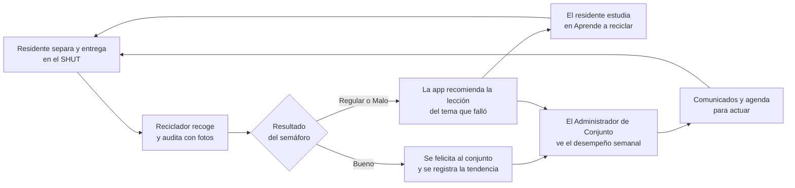

---

## 6. El proceso de cada rol, paso a paso

Para cada rol: cómo entra, qué ve en el menú, qué hace paso a paso y qué reglas aplica el
sistema por detrás. Las reglas de esta sección salen del código real (`be/app/services/`).

### 6.1 Residente

**Cómo entra.** Se registra solo: elige el rol Residente, su localidad, su conjunto, su torre y
su número de apartamento. El código de acceso del conjunto es opcional (lo reparte el
administrador). Debe **verificar su correo** antes de poder iniciar sesión.

**Menú:** Panel Principal · Comunicados · Soporte técnico · Aprende a Reciclar · Directorio
General · Mi Perfil · Seguridad.

**Proceso:**
1. Entra a su panel y ve primero lo nuevo: la última auditoría del conjunto, los avisos y los
   comunicados recientes, cada uno con el nombre del conjunto, cuánto hace que llegó y su estado.
2. **Cuando el SHUT se llena**, pulsa "Reportar". El reporte es anónimo y le llega a los
   recicladores autorizados y a los administradores de su conjunto.
3. **Abre la auditoría nueva** con el botón "Ver": ve el nivel (Bueno, Regular o Malo), las fotos
   de evidencia, el tema, la descripción y quién la hizo.
4. **Si salió Regular o Malo**, le llega el aviso "el reciclador recomienda contenido educativo" y
   abre la lección del tema que falló en *Aprende a reciclar*. La lección queda marcada como
   **Visto** y se actualiza su avance.
5. En *Mi conjunto* mira cómo va el conjunto: auditorías del período, porcentaje calificado
   Bueno, tema a reforzar y gráfica de 8 semanas.
6. Si algo no funciona, escribe a **Soporte técnico** eligiendo un motivo.

**Reglas que aplica el sistema:**
- El residente solo puede enviar el aviso "SHUT lleno"; no puede enviar los de llegada ni de
  vaciado.
- Si el SHUT de su conjunto ya está marcado como lleno, el sistema rechaza un segundo reporte
  (error 400) para no duplicar avisos. El estado "lleno" o "libre" se calcula con el último aviso
  de ese conjunto.
- Solo ve las auditorías y los comunicados **de su propio conjunto**.

### 6.2 Reciclador

**Cómo entra.** Se registra solo con sus datos (localidad y asociación opcional) y verifica su
correo. **Al registrarse todavía no trabaja en ningún conjunto**: un Administrador de Conjunto
debe invitarlo y él aceptar la invitación.

**Proceso:**
1. **Acepta o rechaza** la invitación de un conjunto (HU-021). Desde ese momento está autorizado
   allí, hasta que el administrador le revoque el acceso.
2. **Avisa su llegada** con el botón "Llegué al conjunto" y elige el conjunto. Le llega a los
   residentes y a los administradores.
3. **Si el SHUT estaba lleno y lo vació**, pulsa "SHUT ya está libre"; el estado del conjunto
   vuelve a "libre". También puede avisar él mismo que "SHUT está lleno".
4. **Avisa que ya terminó** con "Finalicé separación".
5. **Califica la separación del conjunto** desde el aviso "Auditoría semanal pendiente" (botón
   "Auditar ahora"): elige el nivel (Bueno, Regular o Malo), el tema, escribe una descripción
   opcional y sube de 1 a 3 fotos. **Las fotos son obligatorias.** Antes de enviar, la app le
   pide confirmar, porque **una auditoría enviada no se puede editar**.
6. Al guardar, el sistema **avisa a los residentes y administradores** del conjunto. Si fue
   Regular o Malo, además **recomienda la lección** a los residentes.

**Reglas que aplica el sistema:**
- Los avisos de SHUT lleno, SHUT libre y finalización **solo se pueden enviar si antes avisó su
  llegada** y no ha avisado su salida. Así los avisos corresponden a una presencia real.
- No puede avisar "llegué" si ya está presente, y hay una espera de **2 horas** entre dos avisos
  de llegada al mismo conjunto. Los demás avisos tienen una espera de **5 minutos**.
- El aviso "Auditoría semanal pendiente" aparece para un conjunto **solo si nunca se ha
  auditado o si su última auditoría tiene 7 días o más**. Se calcula al abrir el panel, sin
  ningún proceso programado en segundo plano.
- Solo puede actuar en conjuntos donde su autorización siga vigente (sin fecha de revocación).
- Solo ve el detalle de las auditorías que **él mismo** envió, no las de otro reciclador del
  mismo conjunto.
- Cada foto se valida por su contenido real: máximo 5 MB, máximo 25 millones de píxeles y solo
  JPG, PNG o WEBP.

### 6.3 Administrador de Conjunto

**Cómo entra.** No hay registro público. El Administrador del Sistema lo invita por correo con
los conjuntos que va a administrar, y él acepta la invitación y crea su contraseña. Si es una
persona nueva que quiere administrar un conjunto, la pantalla de registro le explica cómo pedir
la cuenta: enviar por correo el certificado de representación legal de la propiedad horizontal y
la copia de la cédula.

**Menú:** Panel Principal · Comunicados · Agenda · Desempeño · Soporte técnico · Mi Perfil ·
Seguridad.

**Proceso:**
1. En su panel ve los **avisos nuevos**, y cada conjunto que administra como una tarjeta con su
   porcentaje de apartamentos registrados, el NIT, la cantidad de apartamentos y su **código de
   acceso**, que puede regenerar.
2. **Comparte el código de acceso** con los residentes para que se registren en su conjunto.
3. **Invita recicladores** a su conjunto escribiendo el correo de un reciclador que ya esté
   registrado, y puede **revocarles** el acceso.
4. **Publica comunicados** dirigidos a residentes, recicladores o ambos, de 5 tipos: informativo,
   urgente, convocatoria, mantenimiento y reciclaje. Cada uno tiene fecha de expiración.
5. **Lleva la agenda del comité:** agrega temas por tratar con texto y foto opcional, los archiva
   cuando se resuelven y **descarga el historial en PDF o CSV**.
6. En **Desempeño** ve la gráfica semanal de cada conjunto y el tema a reforzar.
7. Puede **pedir otro conjunto** o **solicitar desvinculación** de uno; el Administrador del
   Sistema decide.

**Reglas que aplica el sistema:**
- Un conjunto solo puede tener **un administrador activo** a la vez (índice único
  `ux_admin_conjunto_activo` en la base de datos).
- Si un administrador deja de administrar un conjunto, **deja de ver sus auditorías**.
- Un comunicado vencido no se borra: deja de mostrarse a los residentes, pero queda en el
  historial del administrador.

### 6.4 Administrador del Sistema

**Cómo entra.** No hay registro público: es una cuenta sembrada en la base de datos.

**Menú:** Panel Principal · Puntos de Acopio · Crear Novedades · Contenido Educativo ·
Seguridad.

**Proceso:**
1. **Invita administradores de conjunto** y **asigna conjuntos adicionales** a los existentes.
2. **Gestiona usuarios:** consulta residentes, recicladores y administradores, los ordena, abre
   su perfil y puede **desactivar o activar** una cuenta.
3. **Atiende la bandeja de solicitudes**, separada en **Soporte técnico** (consultas con
   prioridad, estado y respuesta al autor) y **Desvinculaciones** (aprobar o rechazar).
4. **Publica novedades** para toda la plataforma o para un rol; puede editarlas y archivarlas.
5. **Gestiona el contenido educativo** (crear, editar, eliminar, con portada e imágenes dentro
   de la lección) y el **directorio de puntos de acopio**.
6. **Revisa las calificaciones** de las auditorías con filtros por localidad, conjunto y fecha.

**Reglas que aplica el sistema:**
- Cada motivo de soporte técnico define una **prioridad**: **alta** para fallos de ingreso, fallos
  de la aplicación, problemas del reciclador con su conjunto o su auditoría y problemas con el
  código de acceso; **media** para cuenta, notificaciones, unidad, SHUT y datos o apartamentos del
  conjunto; **baja** para consultas de información y sugerencias.
- El autor recibe un aviso cuando cambia el estado de su consulta (nueva, en revisión o
  resuelta).

---

## 7. Los flujos principales en diagramas

### 7.1 Registro de un residente

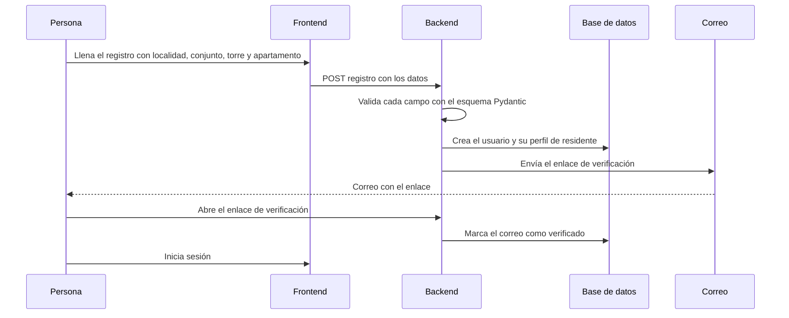

### 7.2 Invitación de un Administrador de Conjunto

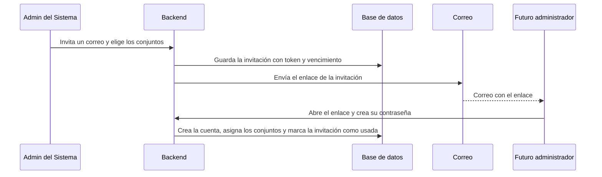

### 7.3 Del aviso de SHUT lleno a SHUT vaciado

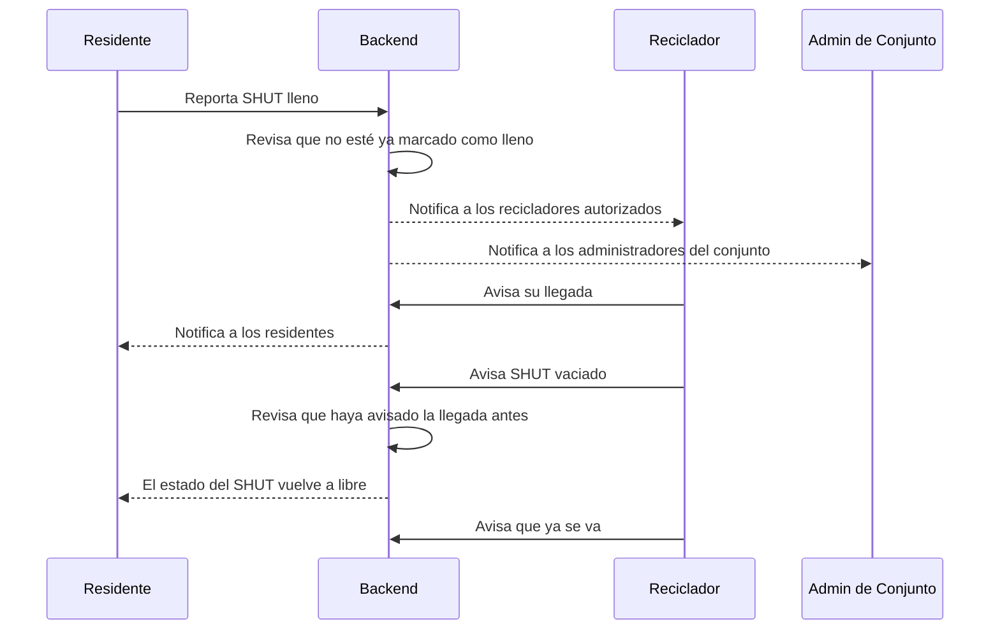

### 7.4 De la auditoría a la lección

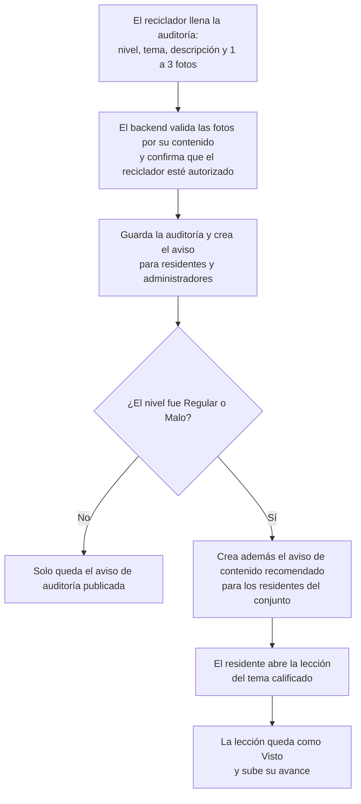

Todo lo anterior ocurre en **una sola transacción**: si falla el aviso, no se guarda la
auditoría (se explica en la sección 8.5).

### 7.5 Ciclo de vida de una consulta de soporte técnico

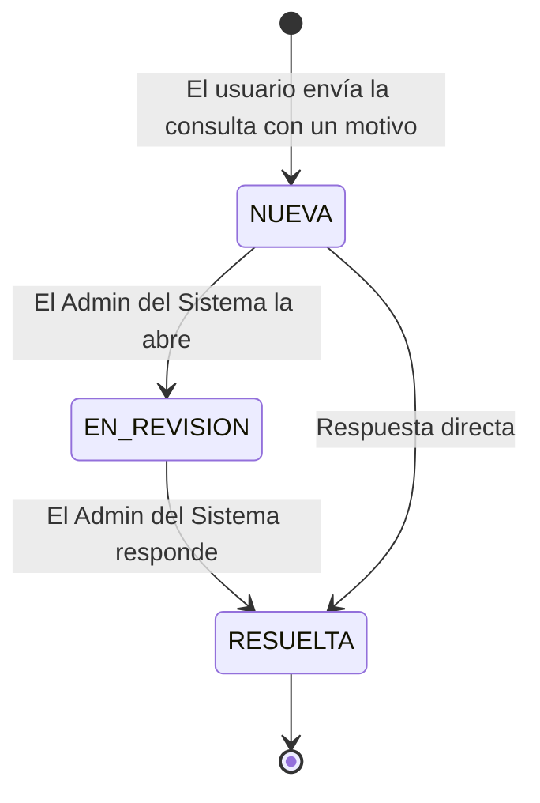

El motivo define la prioridad (alta, media o baja) y, cada vez que cambia el estado, el autor
recibe un aviso.

### 7.6 Desvinculación de un Administrador de Conjunto

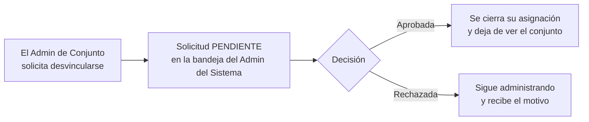

---

## 8. Tecnologías: qué es cada una, por qué la elegimos y dónde se ve en VerdeApp

**Cómo leer esta sección.** Cada tecnología trae cuatro cosas: **qué es** (definición), **qué
problema resuelve en VerdeApp**, **dónde se ve en el repositorio** y **por qué no otra**. Las
versiones son las fijadas en `be/pyproject.toml` y `fe/package.json` el 2026-10-25; si una
cambia, ese archivo manda.

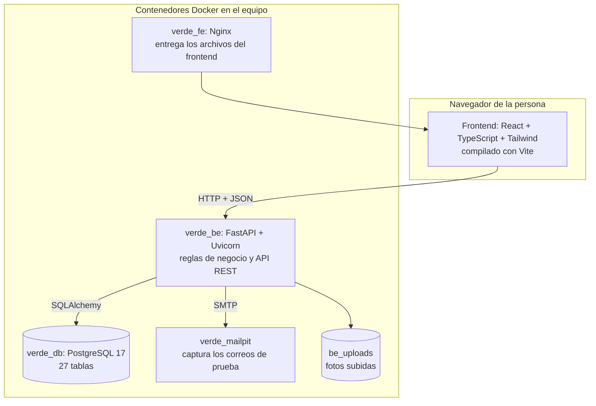

### 8.1 Conceptos que se usan en todo el resto

- **API REST.** Una forma de organizar un backend como una lista de direcciones HTTP. Cada
  dirección más un verbo (`GET` leer, `POST` crear, `PUT`/`PATCH` modificar, `DELETE` borrar)
  equivale a una acción. En VerdeApp todas cuelgan de `/api/v1/…` (por ejemplo, crear una
  auditoría es un `POST` a la ruta de auditorías). Hay un archivo por tema en `be/app/routers/`.
- **JSON.** El formato de texto con el que frontend y backend se intercambian datos
  (`{"nivel_desempeno": "REGULAR", "tema_educativo": "…"}`).
- **Códigos de respuesta HTTP** que usa VerdeApp: `200` todo bien; `400` la petición es válida
  pero rompe una regla de negocio (por ejemplo, "el SHUT ya está marcado como lleno"); `401` no
  hay sesión válida; `403` hay sesión pero no tiene permiso (por ejemplo, un residente intentando
  entrar a otro conjunto); `404` no existe; `422` los datos no cumplen la forma esperada; `429`
  demasiadas peticiones seguidas.
- **Síncrono y asíncrono.** Un programa **síncrono** hace una cosa y, mientras espera (la base de
  datos, un correo, un archivo), no hace nada más en ese hilo. Uno **asíncrono** puede dejar esa
  espera "en pausa" y usar ese tiempo para atender otra petición. En Python se escribe con
  `async def` y `await`.
- **Dependencia.** Una librería de terceros que el proyecto usa. **Dependencia transitiva:** la
  que trae otra dependencia sin que nosotros la pidamos.
- **Entorno reproducible.** Que cualquier computador, hoy o dentro de un año, instale
  **exactamente las mismas versiones** de todo y por eso el programa se comporte igual. Se logra
  con archivos de bloqueo (ver 8.2, `uv`, y 8.5, `pnpm`).

### 8.2 Backend

#### Python 3.12
- **Qué es:** el lenguaje del backend.
- **Dónde se ve:** todo `be/app/`. La imagen Docker usa Python 3.12.
- **Por qué:** es el lenguaje que domina el equipo y tiene librerías maduras para web, bases de
  datos y seguridad.

#### FastAPI 0.143.0 + Uvicorn
- **Qué es FastAPI:** un *framework* web. Un framework es un conjunto de piezas ya hechas que
  recibe las peticiones HTTP, decide qué función las atiende y arma la respuesta. FastAPI además
  **lee los tipos que escribimos en cada función** y con eso hace tres cosas gratis:
  1. **Validación automática.** *Validar* es comprobar que los datos que llegan tienen la forma
     esperada antes de usarlos. Si en el formulario de auditoría llega `nivel_desempeno =
     "REGULARISIMO"`, FastAPI responde `422` con el detalle del error **sin ejecutar ni una línea
     de nuestra lógica**. La forma esperada se declara una sola vez, en un esquema Pydantic
     (`be/app/schemas/`).
  2. **Documentación automática.** Genera una página (`/docs`) con todos los endpoints y sus
     datos, sin escribirla a mano. Está **apagada cuando `ENVIRONMENT=production`**, porque
     facilita el reconocimiento previo a un ataque.
  3. **Inyección de dependencias.** Una función declara lo que necesita (la sesión de base de
     datos, el usuario autenticado, el rol exigido) y FastAPI se lo entrega. Se ve en
     `be/app/dependencies.py` (`get_db`, `get_current_user`, `require_role`).
- **Qué es Uvicorn:** el servidor que ejecuta la aplicación FastAPI y escucha en el puerto 8000.
- **Sobre "asíncrono" (honesto):** FastAPI está construido sobre el estándar asíncrono (ASGI),
  y la propuesta técnica pedía una API asíncrona. En el código real, los routers tienen **6
  funciones `async def`** (invitaciones por correo, subida de archivos, contacto y auditoría) y
  **cerca de 100 funciones normales `def`**. FastAPI ejecuta las normales en un grupo de hilos
  para que no bloqueen el servidor, y el driver de la base de datos (psycopg2) es síncrono.
  Es decir: el servidor aprovecha el modelo asíncrono, pero nuestras consultas a la base de datos
  esperan de forma síncrona. Es una decisión aceptable para esta escala y una mejora posible si
  el tráfico creciera.
- **Dónde se ve:** `be/app/main.py` (crea la aplicación, el CORS, las cabeceras de seguridad y
  el limitador de peticiones) y `be/app/routers/`.
- **Por qué no Django o Flask:** Django trae todo en un paquete (incluido su propio sistema de
  plantillas y administrador) que no íbamos a usar porque el frontend es una aplicación aparte;
  Flask es más pequeño pero no valida ni documenta solo. FastAPI nos da validación y
  documentación a partir de los mismos tipos y encaja con una API que consume un frontend React.

#### Pydantic 2.14.1
- **Qué es:** la librería que define y valida los **esquemas**: clases que describen la forma de
  los datos de entrada y de salida.
- **Qué resuelve:** dos cosas.
  1. **Validación de entrada.** Un nombre solo admite letras, espacio, apóstrofe, punto o guion;
     una contraseña exige 8 caracteres con mayúscula, minúscula y número; un texto no puede ser
     más largo que su columna en la base de datos (así llega un `422` y no un error `500`).
  2. **DTO (objeto de transferencia de datos).** El esquema de **respuesta** decide qué campos
     salen al cliente. El modelo `Usuario` tiene el hash de la contraseña, pero el esquema de
     respuesta no lo incluye: es imposible devolverlo por descuido.
- **Dónde se ve:** `be/app/schemas/` (por ejemplo `user.py`, `auditoria_conjunto.py`).

#### SQLAlchemy 2.1.4 (el ORM)
- **Qué es:** un **ORM** (*Object-Relational Mapper*). Traduce entre las **filas de una tabla** y
  los **objetos de Python**. La clase `AuditoriaConjunto` (`be/app/models/auditoria_conjunto.py`)
  es la tabla `auditorias_conjunto`; cada atributo es una columna; guardar una auditoría es crear
  el objeto y hacer `db.add(...)`.
- **Qué resuelve:** que las consultas se escriban en Python y que los valores viajen **separados**
  del texto SQL (consultas parametrizadas). Eso evita la **inyección SQL**: aunque alguien
  escriba `'; DROP TABLE usuarios; --` en un campo, se trata como un texto cualquiera.
- **Dónde se ve:** `be/app/models/` (una clase por tabla) y `be/app/services/` (las consultas).
- **Por qué no SQL a mano:** más código repetido y más riesgo de inyección. Queda un poco de SQL
  directo, por ejemplo en el seed y en una vista del panel del Administrador del Sistema.

#### Alembic 1.20.0 (migraciones)
- **Qué es:** una **migración** es un archivo versionado que describe un cambio en el esquema de
  la base de datos (crear una tabla, agregar una columna) **y cómo deshacerlo**. Alembic las
  aplica en orden y recuerda cuál fue la última.
- **Qué resuelve:** que los cuatro integrantes, y cualquier servidor, tengan **exactamente el
  mismo esquema**. Cada cambio de tabla queda en el historial de git como cualquier otro código.
- **Dónde se ve:** `be/alembic/versions/` (unas 40 migraciones). Por ejemplo, una migración
  creó la tabla `contenido_educativo_vistos` (lecciones vistas) y otra agregó la columna
  `url_imagen` (portada de una lección). El comando es `uv run alembic upgrade head`.
- **Por qué no `create_all()`:** `Base.metadata.create_all()` solo **crea las tablas que faltan**:
  no modifica una tabla que ya existe, así que no sirve para evolucionar una base con datos.
  Está prohibido en este proyecto.

#### PostgreSQL 17
- **Qué es:** una **base de datos relacional**: los datos viven en **tablas** (filas y columnas)
  y se relacionan entre sí por **llaves**. La *llave primaria* identifica una fila; la *llave
  foránea* apunta a la fila de otra tabla (por ejemplo `auditorias_conjunto.id_reciclador` apunta
  a `recicladores`).
- **Qué resuelve:**
  - **Integridad.** La base **no deja** guardar datos que rompan las reglas: un correo repetido,
    una auditoría de un conjunto que no existe, o un segundo administrador activo en el mismo
    conjunto (índice único `ux_admin_conjunto_activo`).
  - **Transacciones** (sección 8.4).
- **Dónde se ve:** contenedor `verde_db` (imagen `postgres:17-alpine`); el esquema tiene **27
  tablas** (`docs/referencia-proyecto/diagramas-UML/diagrama-er.md`).
- **Por qué no SQLite o MySQL:** el proyecto fija PostgreSQL en **todos** los entornos, incluso
  para pruebas locales, para que lo que se prueba sea lo mismo que corre.

#### PyJWT 2.15.1 y bcrypt 5.0.0
- **Qué son:** *bcrypt* convierte una contraseña en un **hash** (una huella irreversible) para
  guardarla sin que nadie pueda leerla; *PyJWT* firma los **tokens JWT** con los que se mantiene
  la sesión. Se explican a fondo en la sección 10.

#### slowapi 0.1.10, Pillow 13.0.0 y fpdf2 2.8.9
- **slowapi:** limita cuántas peticiones puede hacer un cliente por minuto (frena ataques de
  fuerza bruta; sección 10).
- **Pillow:** abre las imágenes que suben los usuarios para **comprobar que de verdad son
  imágenes** (no solo confiar en la extensión) y que no pasan los límites de tamaño.
- **fpdf2:** genera en el servidor el PDF del historial de la agenda del conjunto.

#### Calidad del código: pytest 9.1.1 y ruff 0.17.0
- **pytest** ejecuta las pruebas automáticas; **ruff** revisa estilo y errores comunes del código
  sin ejecutarlo (*lint*). Ver sección 11.

#### uv (gestor de paquetes)
- **Qué es:** la herramienta que instala las dependencias del backend a partir de
  `pyproject.toml` y `uv.lock`.
- **Qué resuelve:** el **entorno reproducible**. `pyproject.toml` lista lo que usamos y
  `uv.lock` **fija la versión exacta de todo, incluidas las dependencias transitivas**. Así, un
  `uv sync` en el computador de cualquier compañero, o en el servidor de integración continua,
  instala **exactamente lo mismo**. Reemplazó a `pip` más `requirements.txt` porque resuelve
  más rápido y de forma reproducible.
- **Regla del proyecto:** toda dependencia lleva versión exacta (`==`), nunca un rango.

### 8.3 Frontend

#### React 19.3.0
- **Qué es:** una librería para construir interfaces a partir de **componentes**: piezas
  reutilizables (un botón, un modal, una tarjeta) que reciben datos y devuelven pantalla.
- **Qué resuelve:** que la pantalla **se actualice sola cuando cambian los datos**. Cuando
  llega un aviso nuevo, la campanita cambia sin recargar la página.
- **Dónde se ve:** `fe/src/components/` (piezas compartidas como `Button`, `Modal`, `Alert`) y
  `fe/src/pages/` (una vista por ruta; los cuatro paneles están en `pages/dashboards/`).

#### TypeScript 5.9.3 (modo estricto)
- **Qué es:** JavaScript con **tipos**. Cada variable y cada función declaran qué forma de dato
  aceptan.
- **Qué resuelve:** muchos errores se detectan **al escribir o al compilar**, no cuando el
  usuario los encuentra. Si una función espera un `id` de texto y le pasas un número, `tsc`
  falla y el CI no deja avanzar.
- **Dónde se ve:** todo `fe/src/`; el chequeo corre en el CI (`tsc`).

#### Vite 7.3.7
- **Qué es:** la herramienta que **sirve el frontend en desarrollo** (con recarga instantánea al
  guardar un archivo) y que lo **compila para producción**: junta y minimiza todo el código en
  unos pocos archivos estáticos.
- **Dónde se ve:** `pnpm dev` (puerto 5173) y `pnpm build`.

#### TailwindCSS 4.3.3
- **Qué es:** una forma de dar estilo con **clases pequeñas** escritas directamente en el
  componente (`rounded-2xl`, `p-4`), en lugar de archivos CSS aparte.
- **Qué resuelve:** un diseño consistente. VerdeApp define **colores por token** (`accent-*` para
  el verde de marca, `night-*` para las superficies del modo oscuro) **una sola vez**, en
  `fe/src/index.css`; nadie escribe un color a mano en un componente. Por eso el modo oscuro y la
  paleta cambian en un solo lugar.

#### React Router 7.18.4
- **Qué es:** la librería que decide **qué pantalla mostrar según la dirección** del navegador.
- **Dónde se ve:** `fe/src/App.tsx` define las rutas; `ProtectedRoute` exige sesión y
  `RoleGuard` exige el rol correcto. Si un residente escribe a mano la dirección del panel del
  administrador, lo redirige.

#### Axios 1.20.0
- **Qué es:** el cliente que hace las peticiones HTTP del frontend al backend.
- **Dónde se ve:** `fe/src/api/axios.ts`. Un **interceptor** (código que se ejecuta en cada
  petición y respuesta) maneja la sesión vencida en un solo lugar.

#### i18next 26.4.4 y react-i18next 17.0.16 (idioma)
- **Qué es:** el sistema de traducciones. Cada texto de la pantalla es una **clave**; los textos
  reales viven en dos archivos, `es` y `en`.
- **Dónde se ve:** `fe/src/locales/es/translation.json` y `en/translation.json`. Toda pantalla
  nueva necesita su clave en **los dos**.

#### recharts 3.10.1, react-markdown 10.1.0 y lucide-react 0.577.0
- **recharts:** dibuja la gráfica de desempeño semanal. Se carga **bajo demanda** (`React.lazy`),
  solo cuando alguien abre esa página, para no hacer pesada la primera carga.
- **react-markdown:** muestra el texto de las lecciones (que se escribe con formato simple).
- **lucide-react:** los íconos; es la única fuente de íconos permitida.

#### pnpm (gestor de paquetes) y vitest 4.1.12
- **pnpm:** lo mismo que `uv` para el frontend: `pnpm-lock.yaml` fija las versiones exactas.
- **vitest** ejecuta las pruebas del frontend; **Testing Library** las escribe pensando en lo que
  ve el usuario; **ESLint** y **Prettier** revisan el estilo.

### 8.4 Qué es una transacción (con un ejemplo real)

Una **transacción** es un grupo de operaciones en la base de datos que se **confirman todas
juntas o no se confirma ninguna**. Confirmar es `commit`; deshacer todo es `rollback`.

Ejemplo real: cuando un reciclador guarda una auditoría
(`be/app/services/auditoria_conjunto_service.py`), el servicio hace, en este orden:

1. Agrega la auditoría a la sesión.
2. Hace `flush` (la manda a la base **sin confirmarla** todavía, para obtener su identificador).
3. Crea el aviso "auditoría publicada" para residentes y administradores.
4. Crea, si el nivel fue Regular o Malo, el aviso "contenido recomendado".
5. Hace **un solo `commit`**.

Si algo falla entre el paso 1 y el 5 (un error al armar un aviso, por ejemplo), la base hace
`rollback` y **no queda una auditoría sin avisos ni avisos sin auditoría**. Lo mismo ocurre con el
seed de demostración: cuando falló por una regla de la base, quedó en cero filas, no a medias.

### 8.5 Infraestructura y herramientas de equipo

#### Docker y Docker Compose
- **Qué es:** Docker ejecuta cada programa en un **contenedor**: un proceso aislado con sus
  propias librerías, creado a partir de una **imagen**. Docker Compose describe varios
  contenedores y cómo se conectan en un solo archivo (`docker-compose.yml`).
- **Qué resuelve:** que "en mi computador funciona" deje de ser un problema. Todos corremos la
  **misma versión de PostgreSQL** sin instalarla.
- **Dónde se ve:** cuatro servicios: `verde_db` (PostgreSQL), `verde_be` (el backend),
  `verde_fe` (Nginx con el frontend compilado) y `verde_mailpit`. Dos **volúmenes** guardan lo
  que no se puede perder al apagar los contenedores: `db_data` (la base) y `be_uploads` (las
  fotos). Los cuatro servicios comparten una red propia, `verde_network`, y se llaman entre sí por su nombre.
- **Cómo se usa en el día a día:** solemos levantar solo la base y el correo
  (`docker compose up -d verde_db verde_mailpit`) y correr el backend y el frontend en consola
  para tener recarga al guardar.

#### Nginx 1.27.5
- **Qué es:** un servidor web muy rápido. En VerdeApp **entrega los archivos del frontend
  compilado** (la imagen `verde_fe` usa Node para compilar y Nginx para servir el resultado).

#### Mailpit v1.31.5
- **Qué es:** un servidor de correo **falso** para desarrollo: recibe los correos que la app
  intenta enviar (verificación de cuenta, recuperación de contraseña, invitaciones) y los muestra
  en una página local (puerto 8025) en lugar de mandarlos a internet.

#### GitHub Actions y Dependabot
- **GitHub Actions** (`.github/workflows/ci.yml`) es la **integración continua**: en cada push y
  cada pull request corre automáticamente dos trabajos. **Backend:** revisión de estilo (ruff),
  pruebas (pytest) y auditoría de dependencias (pip-audit). **Frontend:** tipos (tsc), estilo
  (eslint), pruebas (vitest), compilación de producción (vite build) y auditoría (pnpm audit).
  Un cambio que no pase esto no se integra.
- **Dependabot** propone actualizaciones de dependencias cuando salen versiones nuevas o
  vulnerabilidades; las revisamos y fijamos con versión exacta.

#### Playwright 1.64.0 (pruebas de extremo a extremo)
- **Qué es:** controla un navegador real para recorrer un flujo completo como lo haría una
  persona. Está en la carpeta `e2e/` (hoy cubre el ingreso con credenciales correctas e
  incorrectas).

### 8.6 "¿Por qué no usaron …?" — respuestas cortas

| Alternativa | Respuesta |
| --- | --- |
| **Django** | Trae un sistema de plantillas y administrador propios que no usaríamos; nuestro frontend es una aplicación aparte. FastAPI valida y documenta a partir de los tipos |
| **Node + Express** | Habría sido JavaScript en los dos lados, pero no aporta nada que necesitemos; Python tiene librerías maduras de seguridad (bcrypt, JWT) y de datos |
| **MongoDB** | Nuestros datos son muy relacionales (usuarios, conjuntos, unidades, auditorías) y necesitamos integridad y transacciones; eso es el punto fuerte de PostgreSQL |
| **SQLite / MySQL** | El proyecto fija PostgreSQL en todos los entornos para que lo probado sea lo que corre |
| **Angular / Vue** | React tiene la comunidad más grande y muchísimas librerías; con cualquiera de los tres el resultado final habría sido equivalente |
| **Bootstrap** | Tailwind permite un diseño propio con tokens de color (marca y modo oscuro) sin pelear contra estilos prediseñados |
| **App móvil nativa** | Fuera del alcance de este trimestre; la web ya se adapta al celular y el backend es una API reutilizable |
| **WebSockets / tiempo real** | Hoy el frontend **consulta los avisos cada 20 segundos** (técnica llamada *polling*), lo que es casi inmediato para este uso y no exige una conexión permanente; el chat se descartó por ahora (sección 4.2) |
| **Firebase u otro servicio externo** | Queremos control del modelo de datos y de la seguridad, y evitar enviar datos de personas a un tercero |

---

## 9. Arquitectura explicada pieza por pieza

### 9.1 Vista general: cliente–servidor en tres capas lógicas

VerdeApp sigue una arquitectura **cliente–servidor**:

1. **Frontend (React):** la interfaz. No guarda datos de negocio en el servidor ni habla con la
   base de datos.
2. **Backend (FastAPI):** la lógica de negocio. Expone una API REST bajo `/api/v1/`.
3. **Base de datos (PostgreSQL):** la persistencia. **Solo el backend** puede tocarla.

La comunicación es siempre **HTTP + JSON**. Poner la lógica y la seguridad solo en el backend
tiene una razón concreta: cualquiera puede llamar a la API sin pasar por nuestro formulario (con
una herramienta como `curl`), así que **las reglas que importan no pueden vivir en el
frontend**. El frontend solo guía al usuario; el backend es el que protege.

### 9.2 Qué pasa cuando alguien hace una petición (paso a paso)

Ejemplo real: un reciclador envía una auditoría.

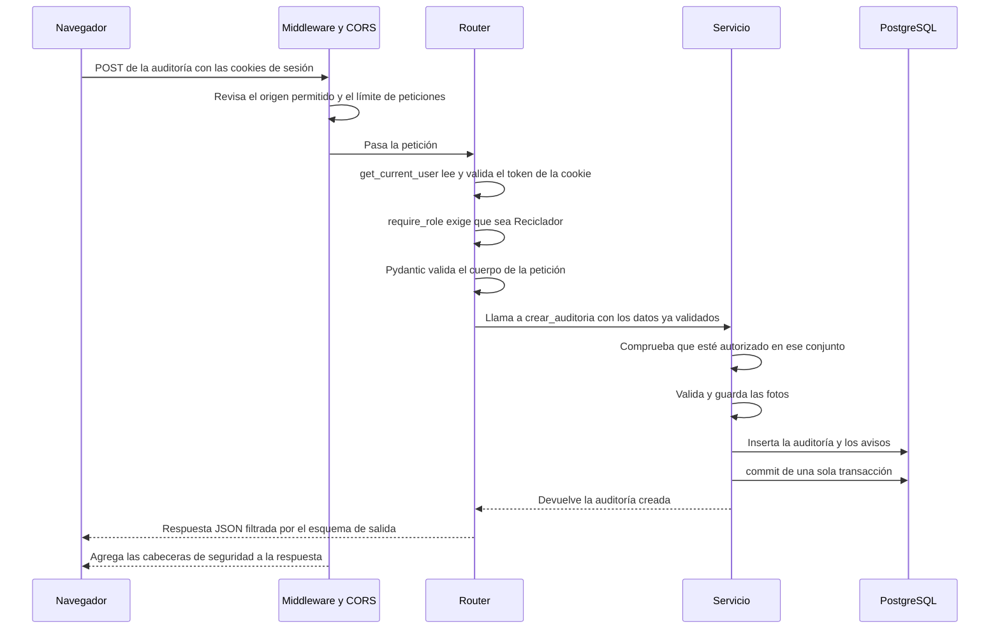

Cada paso tiene una razón:

1. **Middleware y CORS** (`be/app/main.py`): CORS solo permite que el navegador acepte
   respuestas para los orígenes de la lista del proyecto (nunca "cualquiera"); el limitador
   corta a quien hace demasiadas peticiones; al salir, un middleware agrega las cabeceras de
   seguridad.
2. **`get_current_user`** (`be/app/dependencies.py`): toma el token de la cookie `access_token`,
   comprueba la firma y la vigencia, que sea de tipo *access* y no *refresh*, que **no esté
   revocado** y que la **versión de sesión** coincida; después carga al usuario y verifica que
   su cuenta esté activa y habilitada.
3. **`require_role`**: rechaza con `403` si el rol no corresponde. Es una dependencia
   reutilizable: ningún endpoint compara el número del rol "a mano".
4. **Pydantic:** valida el cuerpo antes de que lo vea nuestro código; si falla, `422`.
5. **El servicio** (`be/app/services/`) decide: que el reciclador esté autorizado **en ese
   conjunto**, que las fotos sean reales, que se guarde todo junto.
6. **La respuesta** pasa por un esquema de salida que decide qué campos se envían.

### 9.3 El backend: capas y qué carpeta hace qué

```
be/app/
├── main.py            Crea la aplicación: CORS, cabeceras, limitador, routers, carpeta /uploads
├── config.py          Lee las variables de entorno y valida (por ejemplo, la SECRET_KEY)
├── database.py        Motor y sesión de SQLAlchemy
├── dependencies.py    get_db, get_current_user, require_role, require_admin_conjunto
├── routers/           CAPA HTTP: un archivo por tema; recibe la petición y delega
├── services/          CAPA DE NEGOCIO: las reglas, un archivo por dominio
├── models/            CAPA DE DATOS: una clase por tabla (SQLAlchemy)
├── schemas/           Esquemas de entrada y salida (Pydantic)
├── utils/             Piezas transversales: seguridad, imágenes, correo, registro de eventos, ids
├── tests/             Las pruebas automáticas
├── seed.py            Siembra roles, localidades, conjuntos reales y las 4 cuentas de prueba
└── seed_demo.py       Siembra los datos de demostración para presentar
```

**Por qué dividir en capas.** Cada capa solo habla con la de abajo, y cada una tiene **una
responsabilidad**:

- El **router** no decide nada: recibe, delega y responde. Si mañana el frontend cambiara, las
  reglas no se tocan.
- El **servicio** contiene la regla (por ejemplo, "un reciclador no avisa SHUT vaciado si no
  avisó su llegada"). Como no sabe nada de HTTP, se puede probar sin levantar un servidor.
- El **modelo** solo describe tablas.

**Una función por tema.** Hay un servicio por dominio: `auditoria_conjunto_service.py`,
`comunicado_service.py`, `desvinculacion_service.py`, `notificaciones_service.py`, etc.

**Dos dependencias propias del proyecto:**
- `require_role(RolId.X, mensaje)` exige un rol; `require_admin_conjunto(mensaje)` además
  devuelve el perfil de administrador ya resuelto. Para restringir un endpoint por rol se usan
  estas dos, nunca un `if` a mano.
- La regla de pertenencia ("eres residente **de este** conjunto") se aplica dentro del servicio.

### 9.4 El frontend: cómo está organizado

```
fe/src/
├── main.tsx / App.tsx     Arranque y rutas; todo lo autenticado va dentro de ProtectedRoute
├── pages/                 Una vista por ruta; los 4 paneles en pages/dashboards/
├── components/            Piezas reutilizables (ui/ para Button, Modal, Alert, InputField…)
├── api/axios.ts           Cliente HTTP con el interceptor de sesión
├── lib/*Api.ts            Un archivo por recurso del backend (auditorías, comunicados, …)
├── context/ y hooks/      AuthContext (sesión global) y hooks reutilizables (usePolling…)
├── config/                Datos de configuración, como el tema por rol
└── locales/es y en        Textos en los dos idiomas
```

**Cómo se arma una pantalla:** la *página* pide datos a un archivo de `lib/*Api.ts`, este usa
`api/axios.ts` para llamar al backend, y la página los muestra con componentes de
`components/`. Ninguna página llama a `axios` directamente.

**Decisiones del frontend que vale la pena saber explicar:**

- **Sesión global sin pasar datos de mano en mano:** `AuthContext` guarda quién inició sesión y
  `useAuth()` lo entrega a cualquier componente.
- **Guardas de ruta:** `ProtectedRoute` (¿hay sesión?) y `RoleGuard` (¿es el rol correcto?)
  protegen **la navegación**, pero la protección real está en el backend: si alguien se salta el
  guarda, el backend igual responde `403`.
- **Avisos casi inmediatos con *polling*:** el hook `usePolling` consulta las notificaciones
  **cada 20 segundos**. Cuando una acción propia cambia algo, un evento de `window` le avisa a
  la campanita para que se actualice de inmediato sin esperar ese ciclo.
- **Tema visual por tokens:** los colores no se escriben a mano; se usan `accent-*` y `night-*`
  definidos una sola vez. Así el modo oscuro es obligatorio y consistente.
- **Textos en dos idiomas:** ninguna pantalla trae texto escrito dentro del componente; todo
  sale de las claves de `locales/`.
- **Validación en el frontend y en el backend:** el formulario valida al salir de cada campo para
  guiar a la persona, pero el backend repite **todas** las reglas.

### 9.5 El modelo de datos

La base tiene **27 tablas**. Este diagrama muestra las relaciones principales (el detalle
completo está en `docs/referencia-proyecto/diagramas-UML/diagrama-er.md`):

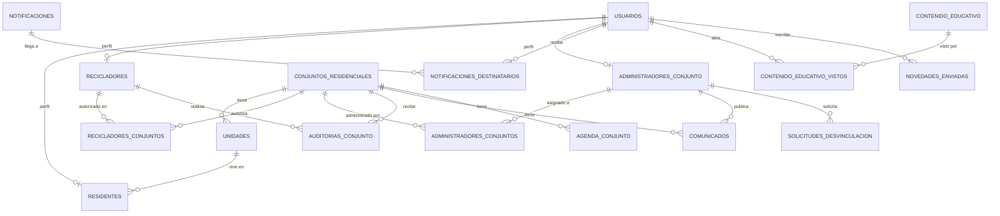

**Cómo leerlo:**

- **Tabla común y tablas por rol.** `usuarios` guarda lo que comparten los cuatro roles (correo,
  contraseña, rol, idioma, foto). Los datos propios viven en `residentes`, `recicladores` y
  `administradores_conjunto`, enlazadas por `id_usuario`. Así no hay columnas vacías que solo
  aplican a un rol.
- **Tablas de unión con historial.** Un reciclador puede trabajar en varios conjuntos y un
  conjunto puede tener varios recicladores. Esa relación (muchos a muchos) vive en
  `recicladores_conjuntos`, que además guarda **fecha de autorización y de revocación**: revocar
  no borra, cierra el vínculo, y queda el historial. Lo mismo hace `administradores_conjuntos`.
- **La auditoría pertenece al conjunto, no al residente.** `auditorias_conjunto` apunta al
  reciclador y al conjunto, nunca a un residente.
- **Identificadores UUID versión 4.** Todas las llaves primarias son UUID aleatorios y no números
  consecutivos, para que nadie pueda adivinar un identificador probando `1, 2, 3…`. Las
  excepciones son `roles` y `localidades`: son catálogos fijos y públicos.
- **Los avisos por conjunto.** `notificaciones` guarda el aviso y `notificaciones_destinatarios`
  guarda a quién le llegó y si lo leyó.

### 9.6 Decisiones de diseño que explican cosas que se ven en la app

1. **El estado del SHUT no se guarda en una columna: se calcula.** Un conjunto está "lleno" si
   **el último aviso** de tipo SHUT lleno o SHUT libre fue "lleno". La ventaja es que no hay un
   dato que pueda quedar desactualizado; el costo es que cada consulta lee el último aviso.
2. **Toda notificación pasa por una sola función** (`crear_notificacion`, en
   `notificaciones_helpers.py`). Si cambia cómo se guardan los avisos, se cambia en un lugar.
3. **Los listados que pueden crecer se paginan.** El backend responde `{"items": …, "total": …}`
   y el frontend usa el hook `usePaginacion` y el componente `<Paginacion>`.
4. **Las fotos no viven en la base de datos.** Se guardan como archivos en `be/app/uploads/`
   (cada tipo en su subcarpeta) y la base solo guarda la **ruta**. El backend las sirve en
   `/uploads`. Una limpieza manual (`app.limpiar_adjuntos`) borra las que ninguna fila usa.
5. **Migración de llaves primarias a UUID sin perder datos.** Cambiar el tipo de las llaves de
   20 tablas con datos reales se hizo por etapas (*expand/contract*): se agrega la columna nueva,
   se llena, se reapuntan las referencias y recién al final se quita la vieja.
6. **Los seeds se pueden repetir.** `app.seed` revisa cada sección por separado antes de
   sembrar, y `app.seed_demo` se reconoce a sí mismo por el dominio `@demo.verdeapp.com`.
7. **Un solo administrador activo por conjunto**, garantizado por la base de datos con un índice
   único parcial, no solo por el código.

### 9.7 Patrones que aplica el proyecto (los nombres técnicos)

El documento `docs/conceptos/patrones-arquitectonicos.md` los desarrolla con código real. En
resumen: arquitectura en capas, DTO (esquemas de salida), inyección de dependencias, JWT sin
estado, Context/Provider, hooks personalizados, interceptor, SPA con guardas de ruta, monorepo
(`be/`, `fe/` y Docker en un repositorio), API REST, servicio por dominio, migración
*expand/contract*, siembra de datos con guardas independientes e internacionalización.

---

## 10. Seguridad explicada pieza por pieza

**Dos conceptos antes de empezar:**

- **Autenticación:** comprobar **quién eres** (usuario y contraseña, o el token de sesión).
- **Autorización:** comprobar **qué puedes hacer** una vez que sabemos quién eres (tu rol, y a
  qué conjunto perteneces).

Cada punto responde cuatro preguntas: **qué ataque o riesgo es**, **cómo lo evitamos**,
**dónde está** y **cómo se puede demostrar**. La referencia más completa es
`docs/conceptos/owasp-top-10.md`.

### 10.1 Contraseñas (bcrypt)

- **Riesgo:** que la base de datos se filtre y alguien lea las contraseñas.
- **Qué es un hash:** una operación que convierte la contraseña en una **huella** de texto de la
  que no se puede recuperar la contraseña original. Para comprobar un ingreso se calcula la
  huella de lo que escribió la persona y se compara con la guardada.
- **bcrypt** es un algoritmo de hash hecho **a propósito lento** y con **sal** (un dato
  aleatorio distinto por contraseña, así dos personas con la misma contraseña tienen huellas
  distintas). Nuestras huellas empiezan con `$2b$12$…`: el `12` es el **costo**, que determina
  cuánto tarda cada intento y por tanto cuánto cuesta probar millones de contraseñas.
- **Reglas de contraseña:** mínimo 8 caracteres con mayúscula, minúscula y número. Por el límite
  de bcrypt (72 bytes) se controla el largo máximo.
- **Nunca** se guarda ni se registra una contraseña en texto plano.
- **Dónde:** `be/app/utils/security.py`.

### 10.2 Sesión: tokens JWT y cookies

- **Qué es un JWT:** un texto con tres partes (encabezado, contenido y **firma**). El contenido
  dice quién es el usuario y cuándo vence; la firma, hecha con una clave secreta que solo conoce
  el servidor, **permite comprobar que nadie lo modificó**. Por eso el servidor no necesita
  guardar una sesión por cada usuario: le basta verificar la firma. A esto se le llama sesión
  **sin estado** (*stateless*).
- **Dos tokens:**

  | Token | Dura | Para qué |
  | --- | --- | --- |
  | `access_token` | 15 minutos | Autenticar cada petición |
  | `refresh_token` | 7 días | Pedir un `access_token` nuevo sin volver a escribir la contraseña |

  Que el de acceso dure poco limita el daño si alguien lo robara. El servidor **rechaza usar un
  `refresh_token` como si fuera de acceso**.
- **Dónde viaja:** en **cookies `httpOnly`** y `SameSite=Strict`:
  - **`httpOnly`:** ningún JavaScript, ni siquiera el nuestro, puede leer la cookie. Si alguien
    lograra inyectar código en la página (un ataque XSS), no podría robar el token.
  - **`SameSite=Strict`:** el navegador **no envía** la cookie en peticiones que se originan en
    otro sitio. Es la defensa contra **CSRF** (que un sitio malicioso haga peticiones a
    VerdeApp con tu sesión).
  - **`Secure`:** fuera del entorno de desarrollo la cookie solo viaja cifrada (HTTPS). En
    desarrollo se apaga porque corre sobre `http://`.
  - La cookie de renovación solo se envía a la ruta de renovación, no a toda la API.
- **Cerrar sesión de verdad.** Un token firmado no se puede "des-firmar", así que cada token lleva
  un identificador único (`jti`) y, al cerrar sesión, ese identificador se guarda en la tabla
  `tokens_revocados`; el servidor la consulta en cada petición. Es **la única parte con estado**,
  y es una decisión consciente: sacrifica algo de "pureza" para que cerrar sesión funcione.
- **Versión de sesión.** Cada token lleva la versión de sesión del usuario. Al **cambiar o
  restablecer la contraseña** esa versión sube, y **todos los tokens anteriores quedan
  inválidos** al instante.
- **Dónde:** `be/app/utils/security.py`, `be/app/routers/auth.py`, `be/app/dependencies.py`.

### 10.3 Control de acceso (la vulnerabilidad más frecuente)

- **Riesgo:** que alguien vea o haga lo que no le corresponde (que un residente vea otro
  conjunto, o un reciclador revoque a otro).
- **Cómo lo evitamos:**
  1. El usuario se identifica **siempre por su token firmado**, nunca por un identificador que
     llegue en la URL o en el cuerpo de la petición.
  2. Cada endpoint exige un **rol** (`require_role`).
  3. Además se comprueba la **pertenencia**: un residente solo ve su propio conjunto; un
     administrador solo tiene acceso mientras su asignación esté activa (sin fecha de
     desvinculación); un reciclador solo ve las auditorías **que él mismo envió**.
- **Cómo se demuestra:** iniciar sesión como residente y pedir a mano la auditoría de otro
  conjunto: responde `403` o `404`.
- **Observación honesta:** cada router comprueba el rol con su propia función; funciona, pero
  depende de que cada desarrollador lo recuerde. Un candidato de mejora sería centralizarlo.

### 10.4 Validación de entrada, inyección SQL y XSS

- **Validación (Pydantic):** nada entra sin pasar por un esquema; los campos de texto tienen
  **el mismo máximo que su columna** en la base, así un texto muy largo se rechaza con `422` y no
  rompe la base con un error `500`. Los nombres solo admiten letras y signos normales.
- **Inyección SQL:** ocurre cuando un texto del usuario se mezcla con la consulta y la base lo
  ejecuta como código. SQLAlchemy envía los valores **separados** del texto SQL, así que no se
  ejecutan.
- **XSS (inyección de scripts):** ocurre cuando la página muestra texto del usuario como si fuera
  código. React **escapa** el texto por defecto. Además, los enlaces y las imágenes que vienen de
  datos solo se muestran si son archivos de VerdeApp (`/uploads/…`) o enlaces `https://`; si no,
  el frontend no los muestra (`fe/src/lib/enlaceSeguro.ts`), y el backend aplica las mismas
  reglas. Se bloquea incluso la ruta disfrazada `/uploads/%2e%2e/…`.

### 10.5 Fuerza bruta, bloqueo de cuenta y enumeración de usuarios

- **Fuerza bruta:** probar muchas contraseñas hasta acertar. Hay **dos defensas que se
  complementan**:
  1. **Límite por dirección IP** (`slowapi`): por ejemplo **10 intentos por minuto** en el inicio
     de sesión y **5 por minuto** en registro, recuperar contraseña, verificar correo y cambio
     de contraseña. Al pasarse responde `429`.
  2. **Bloqueo por cuenta:** **5 intentos fallidos seguidos** contra el mismo correo bloquean esa
     cuenta **15 minutos**, vengan de una o de mil IP distintas.
- **Enumeración de usuarios:** descubrir qué correos están registrados. El mensaje al fallar es
  siempre el mismo ("Credenciales incorrectas"), sin importar si falla el correo o la contraseña.
- **Ataque de temporización:** aun con el mismo mensaje, si el sistema tardara menos cuando el
  correo no existe, se podría deducir cuáles existen midiendo el tiempo. El código **siempre
  ejecuta la comparación de bcrypt**, aunque el usuario no exista (contra una huella de relleno),
  así ambos casos tardan lo mismo. Fue un hueco real encontrado en una auditoría propia y
  corregido.

### 10.6 Fotos y archivos subidos

- **Riesgo:** que alguien suba un archivo peligroso con extensión de imagen, o llene el servidor.
- **Qué hacemos:**
  - **Se comprueba el contenido real** con Pillow, no solo el nombre ni el tipo declarado.
  - **Máximo 5 MB** y **25 millones de píxeles**; solo JPG, PNG o WEBP. Un PNG con datos
    dañados responde `400`, no se cae el servidor.
  - **Cuota por usuario** (por minuto y por día), contada en la tabla `archivos_subidos`.
  - Los documentos se sirven **como descarga** (`Content-Disposition: attachment`) y con una
    política de seguridad que les prohíbe ejecutar nada.
- **Dónde:** `be/app/utils/imagenes.py` y `be/app/services/cuota_subidas_service.py`.

### 10.7 Cabeceras de seguridad, CORS y configuración

- **Cabeceras** que agrega el backend a todas las respuestas:

  | Cabecera | Evita |
  | --- | --- |
  | `X-Content-Type-Options: nosniff` | Que el navegador "adivine" que un archivo subido es otra cosa |
  | `X-Frame-Options: DENY` | *Clickjacking*: que otro sitio muestre VerdeApp en un marco invisible |
  | `Referrer-Policy` | Que se filtren direcciones completas hacia otros sitios |
  | `Permissions-Policy` | Acceso a cámara, micrófono o ubicación (VerdeApp no los usa) |

- **CORS:** el backend solo acepta peticiones desde una **lista explícita** de orígenes, nunca
  `*`.
- **Secretos:** contraseñas, `SECRET_KEY` y credenciales de correo viven en `.env`, nunca en el
  repositorio. La `SECRET_KEY` debe tener **al menos 32 caracteres**, o la aplicación ni
  arranca.
- **`/docs` apagado en producción:** la documentación automática de la API se desactiva.

### 10.8 Registro de eventos de seguridad (logs)

- **Riesgo:** que un ataque ocurra y nadie se entere.
- **Qué hacemos:** `be/app/utils/audit_log.py` registra inicios de sesión exitosos y fallidos,
  cambios de contraseña y accesos denegados, en **JSON, una línea por evento**, con el correo
  **enmascarado** (`re***@correo.com`). Antes de esa auditoría no existía ningún registro de
  seguridad.

### 10.9 Dependencias y datos personales

- **Dependencias:** todas con versión exacta, auditoría automática (`pip-audit`, `pnpm audit`) en
  cada integración continua y Dependabot. En las últimas semanas se actualizaron, por ejemplo,
  Pillow, `pypdf`, `undici` y `zod` por avisos de seguridad.
- **Datos personales:** el contacto del Administrador de Conjunto se pide por un correo con dos
  documentos (certificado de representación legal y cédula) que se **eliminan al terminar la
  revisión**. La Política de Privacidad de la app describe este tratamiento y la investigación del
  chat de soporte analizó la **Ley 1581 de 2012** (protección de datos personales).
- **"Reporte anónimo" del SHUT:** el aviso que reciben los demás **no muestra quién lo envió**;
  internamente el sistema guarda el emisor para evitar avisos repetidos.

### 10.10 Resumen frente al OWASP Top 10

OWASP es una fundación internacional que publica la lista de las 10 vulnerabilidades más
frecuentes y críticas en aplicaciones web.

| # | Categoría | Estado en VerdeApp |
| --- | --- | --- |
| A01 | Control de acceso roto | Token firmado + rol + pertenencia por endpoint |
| A02 | Fallos criptográficos | bcrypt, JWT firmado, `SECRET_KEY` de 32 caracteres o más |
| A03 | Inyección | ORM con consultas parametrizadas + validación Pydantic |
| A04 | Diseño inseguro | Límite de peticiones (se corrigió que no estaba conectado del todo) |
| A05 | Mala configuración | CORS explícito, `/docs` apagado en producción, cabeceras agregadas |
| A06 | Componentes vulnerables | Versiones fijadas, auditorías y Dependabot |
| A07 | Fallos de autenticación | Bloqueo de cuenta, mismo mensaje y mismo tiempo de respuesta |
| A08 | Integridad de datos | Tokens firmados |
| A09 | Falta de registro | Registro de eventos en JSON, creado desde cero |
| A10 | SSRF | No aplica: el backend no pide direcciones controladas por el usuario |

### 10.11 Lo que NO tenemos (honesto)

- **No hay autenticación de dos factores.**
- **No hay HTTPS propio:** corremos en HTTP local; en un despliegue real habría que poner
  certificados (la cookie ya está preparada para exigir `Secure` fuera de desarrollo).
- **La firma de los JWT es simétrica (HS256):** una sola clave firma y verifica; es suficiente
  para un backend único.
- **No hay una prueba de penetración profesional**: hicimos auditorías propias contra el OWASP
  Top 10 y las documentamos.

---

## 11. Calidad y pruebas

### 11.1 Qué es una prueba automática y por qué importa

Una **prueba automática** es un programa que ejecuta una parte de VerdeApp y comprueba que el
resultado sea el esperado. Sirve para que un cambio nuevo no rompa algo que ya funcionaba, sin
tener que probarlo todo a mano. En este proyecto, **toda funcionalidad nueva lleva sus pruebas
antes de darse por terminada**.

### 11.2 Los tipos de prueba que tenemos

| Tipo | Herramienta | Qué comprueba | Cantidad hoy |
| --- | --- | --- | --- |
| **Backend** (API contra la base real) | pytest | Que cada endpoint responda lo correcto y respete las reglas y los permisos | 871 pruebas |
| **Frontend** (componentes y páginas) | vitest + Testing Library | Que cada pantalla muestre lo esperado y reaccione a lo que hace el usuario | 736 pruebas en 68 archivos |
| **Extremo a extremo (E2E)** | Playwright | Que un flujo completo funcione en un navegador real, de la pantalla a la base | 2 archivos (ingreso correcto e incorrecto) |

- **Pruebas de backend contra la base real.** Usan una base aparte, `verdeapp_test_db`, que se
  crea limpia en cada corrida. Se usa PostgreSQL de verdad, no una base falsa, para que las
  restricciones (llaves únicas, llaves foráneas) se comprueben igual que en producción.
- **Cobertura.** Es el porcentaje de líneas de código que las pruebas ejecutan. El backend está
  en **97,06 %** y el proyecto **falla si baja de 96 %**; el frontend exige al menos **78 % de
  líneas**. La regla del equipo es que **el umbral solo sube, nunca baja**.

### 11.3 Revisión automática en cada cambio (integración continua)

Cada vez que se sube un cambio, GitHub Actions ejecuta solo:

- **Backend:** ruff (estilo), pytest (pruebas) y pip-audit (vulnerabilidades en dependencias).
- **Frontend:** tsc (tipos), eslint (estilo), vitest (pruebas), vite build (que compile para
  producción) y pnpm audit.

Si algo falla, el cambio **no se integra**.

### 11.4 Bootcamp de testing

Durante el trimestre seguimos el *Bootcamp Testing ADSO* (ficha 3228970): cada semana un reto de
pruebas se resuelve en una rama `test/semana-NN`. Los integrantes **rotan de capa** (Front, API,
BD, E2E) hasta haber pasado por las cuatro, y quien revisa un PR de pruebas debe haber trabajado
en otra capa. Lo registramos en `docs/matriz-rotacion.md`.

### 11.5 Otras revisiones que documentamos

Además de las pruebas, hicimos y dejamos por escrito auditorías propias en
`docs/gestion-proyecto/`: coherencia entre modo claro y oscuro, contraste de colores,
adaptación a tablet, escritorio y distintos navegadores, indicadores de carga, elementos
clicables, dependencias y seguridad frente al OWASP Top 10.

### 11.6 Cómo se comprueba en vivo (por si el jurado lo pide)

```bash
cd be
uv run pytest -q
```

```bash
cd fe
pnpm test
```

La suite del backend tarda unos **7 a 8 minutos**: si se va a mostrar, conviene correr un solo
archivo, por ejemplo `uv run pytest app/tests/test_auth.py -q --no-cov`.

---

## 12. Cómo trabajamos como equipo

### 12.1 Metodología: Scrum

- **Scrum** es un marco de trabajo en ciclos cortos (*sprints*) con planificación, desarrollo,
  pruebas y revisión. La propuesta técnica planeó **4 sprints**; el proyecto avanzó por entregas
  incrementales: primero el núcleo de identidad (registro, ingreso, perfil), luego la operación
  crítica (avisos de SHUT y llegada, semáforo) y luego información y administración (catálogo
  educativo, directorio, paneles).
- **Scrum Master rotativo.** Cada semana un integrante cumple ese rol: asigna un issue a cada
  uno, sigue el avance y escribe el informe semanal (`docs/gestion-proyecto/informes-scrum/`).
- **Cierre de semana y traspaso.** Quien no termina su tarjeta deja un comentario de cierre
  (qué completó, qué falta, bloqueos y por dónde seguir) y sube su rama; el Scrum Master de la
  semana siguiente decide quién la continúa.

### 12.2 Cómo se organiza el trabajo

- **Tablero "VerdeApp - Tablero de desarrollo"** en GitHub, con una tarjeta por issue.
- **Prioridad:** Must (P0), Should (P1) y Could (P2), más **tamaño** de XS a XL en horas.
- **Capacidad:** mínimo **2 horas por día de lunes a viernes**, es decir 10 horas por semana por
  integrante. Una tarjeta grande puede pasar de una semana y se traspasa.
- **Issues** escritos en español y completos: contexto, qué debe pasar, alcance, criterios de
  aceptación, cómo probarlo.
- **Tarjetas de investigación:** issues informativos cuyo entregable es un documento
  (`investigacion-*.md`); si la conclusión implica construir algo, se abre otro issue.

### 12.3 Cómo se integra el código

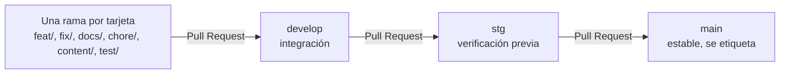

- **Una rama por tarjeta**, siempre creada desde `develop` actualizado.
- **Commits** con *Conventional Commits* en español: `feat:`, `fix:`, `docs:`… y el tipo coincide
  con el prefijo de la rama.
- **Pull Request:** título en inglés y descripción en español, con la plantilla del repositorio.
- **`stg` solo recibe de `develop`, y `main` solo recibe de `stg`.** Un error hallado en `stg` se
  corrige en una rama desde `develop`, nunca directo en `stg`.
- **Más de 310 Pull Requests** integrados hasta hoy (313 al 2026-10-25).

### 12.4 Estimación original de costos

La propuesta técnica estimó el proyecto en **$14.575.000 COP**: mano de obra (4 integrantes ×
120 horas × $25.000 la hora = $12.000.000), infraestructura, licencias y un 10 % de contingencia
para imprevistos. Es una **estimación de formación**: no hubo contratación ni despliegue pago.

---

## 13. Decisiones, límites honestos y qué haríamos con más tiempo

Esta sección existe para responder con tranquilidad cuando el jurado pregunta "¿y esto por
qué?" o "¿qué le falta?". **Reconocer un límite con su razón** se ve mejor que esquivarlo.

### 13.1 Decisiones importantes y su razón

| Decisión | Qué se decidió | Por qué |
| --- | --- | --- |
| **Auditoría del conjunto, no del residente** (issue #5) | La calificación es global al conjunto | No hay forma de saber qué apartamento entregó qué bolsa; calificar a una persona sería injusto e inexacto |
| **No calificar al reciclador** (issue #11) | El residente no califica al reciclador | Riesgo de calificaciones maliciosas sin motivo; se prefiere medir cómo llega el material. **Puede reabrirse con salvaguardas** |
| **Chat y chatbot descartados por ahora** (issue #521) | Se muestra ayuda escrita al elegir un motivo de soporte | Un chat solo sirve si alguien responde al momento, y la IA tiene costo, calidad y manejo de datos personales por resolver |
| **Llaves primarias UUID versión 4** (issue #167) | Identificadores aleatorios en vez de números consecutivos | Un número consecutivo se puede adivinar probando `1, 2, 3…`; el cambio se hizo sin perder datos reales |
| **Sesión en cookies `httpOnly`** | Los tokens no viajan en un encabezado que el JavaScript maneje | Un ataque XSS no puede robarlos; se compensa con `SameSite=Strict` contra CSRF |
| **Avisos por consulta cada 20 segundos** | No usamos conexión permanente | Es casi inmediato para este uso y mucho más simple de operar |
| **Un correo visible en una sola pantalla** (issue #457) | La solicitud de cuenta de Administrador de Conjunto muestra una dirección | El formulario de contacto no puede llevar archivos adjuntos y se piden dos documentos. Es una cuenta dedicada solo a ese trámite y **es la única excepción** a la regla de no mostrar correos. **Está pendiente confirmarla con el profesor** |
| **Quitar el nivel "Excelente"** (issue #437) | La calificación quedó en tres niveles | Ya no se ofrecía en la interfaz; una migración convirtió las filas viejas a "Bueno" |
| **Las 9 ECA del directorio** (issues #460 y #500) | Se aclara en la pantalla que vienen de un conjunto de datos de 2020 | La investigación halló que solo 2 de las 9 coinciden con una ECA activa del inventario actual de la UAESP y que ninguna tiene teléfono en fuentes oficiales. **Se está confirmando con la UAESP** |

### 13.2 Límites actuales (lo que decimos si preguntan)

1. **No hay servidor público.** Corre en Docker en nuestros equipos; el despliegue en producción
   no está hecho.
2. **Disponibilidad y tiempo de respuesta no están medidos en producción.** Los requisitos
   RNF-002 (99,9 % de disponibilidad) y RNF-004 (menos de 2 segundos) figuran como **parciales**.
3. **El contenido educativo son 6 módulos.** Ampliarlo exige investigar y redactar con fuentes
   oficiales.
4. **Los avisos no son instantáneos**: tardan hasta 20 segundos en aparecer.
5. **Sin autenticación de dos factores** y sin prueba de penetración externa.
6. **No hay aplicación móvil nativa**: la web se adapta al celular.

### 13.3 Qué haríamos con más tiempo (ya en la lista de tarjetas)

- **Seguimiento educativo:** confirmar que el conjunto leyó la lección y un cuestionario corto
  cuando la auditoría salga Regular o Mala.
- **Ayuda escrita en Soporte técnico**, con pasos para resolver cada motivo solo y un aviso
  "¿esto resolvió tu duda?".
- **Que el Administrador de Conjunto atienda las consultas de soporte de su conjunto.**
- **Fichas completas de puntos de acopio** (foto, coordenadas, teléfono) y la guía "¿Dónde llevo
  cada cosa?"; importar las ECA activas del inventario de la UAESP por etapas, con verificación.
- **Más del desempeño:** descargar el desempeño semanal en PDF y un mapa de temas por semana.
- **Política de retención de las fotos de evidencia** (cuánto tiempo se guardan).
- **Medir disponibilidad y velocidad en un servidor real**, desplegar, y evaluar autenticación de
  dos factores y una aplicación móvil.

---

## 14. Cómo nos apoyamos durante la feria

El stand lo atienden dos personas a la vez, con relevo, y **los cuatro nos sabemos todo**, así
que cualquiera puede responder cualquier cosa. Estas reglas existen para que nadie se quede en
blanco.

1. **Cada pregunta tiene una voz principal, y el otro completa.** Responde quien recibió la
   pregunta o quien la entendió primero. El compañero espera a que termine y, si falta algo,
   agrega **una frase** ("y además…"), sin corregir en público.
2. **Si no sabes algo, no inventes.** Usa esta frase: *"Ese detalle exacto no lo tengo ahora,
   pero está documentado en el repositorio y se lo muestro."* Después abres la sección
   correspondiente de este documento. Reconocer un límite pesa menos que una respuesta falsa.
3. **Pasar la palabra es normal.** Frase de relevo: *"Mi compañero lo explica mejor, porque él
   trabajó en eso."* Funciona también si te bloqueas.
4. **Una persona maneja el computador y la otra explica.** Se cambian cuando el relevo entra, sin
   interrumpir la demostración. Quien explica no toca el teclado.
5. **El relevo vigila el tiempo y los datos.** Que las cuentas estén listas, que Docker siga en
   pie, que la sesión no haya vencido y que el reloj de la demo (5 a 7 minutos) se cumpla.
6. **Cada uno prepara dos preguntas difíciles de las partes que menos domina.** Nos las hacemos
   entre nosotros antes de abrir el stand (simulacro de la sección 19).
7. **Si el público es de otro perfil, ajustamos el nivel.** Con estudiantes, el recorrido por los
   roles y la demostración; con profesores, la arquitectura, la seguridad y las pruebas.

---

## 15. Banco de preguntas del jurado con respuestas

**Cómo usarlo.** Son 97 preguntas agrupadas por tema. Cada respuesta es corta (2 o 3 frases) para
decirla en voz alta; si el jurado profundiza, se abre la sección indicada. Las respuestas sobre
experiencia personal (F5 a F8) son **sugerencias**: cada uno las ajusta a lo que de verdad
vivió. Regla general: **si no sabes, no inventes** (sección 14).

### Bloque A — El proyecto, el problema y el alcance

**A1. ¿Qué es VerdeApp en una frase?**
Una aplicación web que conecta a residentes, recicladores y administradores de conjuntos
residenciales de Bogotá para que la separación de residuos en la fuente mejore, con avisos,
una calificación semanal con foto y lecciones para corregir lo que falla.

**A2. ¿Qué problema resuelve?**
La falta de comunicación entre residentes y recicladores, que vuelve ineficiente la recolección,
más la falta de medición y de información sobre cómo reciclar bien (sección 3).

**A3. ¿Quién la usa y para qué?**
Cuatro roles: el residente avisa y aprende; el reciclador avisa, recoge y califica; el
administrador de conjunto organiza y comunica; el administrador del sistema supervisa la
plataforma (sección 6).

**A4. ¿En qué se diferencia de una app que solo muestra dónde reciclar?**
VerdeApp no es un mapa de puntos de reciclaje (aunque tiene un directorio de puntos de acopio).
Su centro es la **coordinación dentro de un conjunto**: quién avisa qué, quién recoge, cómo salió
la separación y qué lección sigue.

**A5. ¿Por qué solo conjuntos residenciales de Bogotá?**
Es el contexto donde existe el problema que estudiamos y donde pudimos cargar datos reales:
trae más de 14.500 conjuntos de Bogotá de un archivo de datos abiertos y sus 20 localidades.
Para otra ciudad habría que cargar sus conjuntos y su contenido local.

**A6. ¿Por qué cuatro roles y no menos?**
Cada rol tiene permisos y responsabilidades distintas: quien genera los residuos, quien los
recoge, quien administra el conjunto y quien opera la plataforma. Separarlos es lo que permite
que cada uno vea solo lo que le corresponde.

**A7. ¿Cómo se beneficia el reciclador?**
Sabe cuándo el SHUT está lleno antes de ir, recibe material mejor separado porque el residente
aprende y es medido, y su trabajo queda registrado con evidencia. El administrador de cada
conjunto decide a qué recicladores autoriza.

**A8. ¿Qué pasa si el reciclador no usa la app?**
Es un riesgo real de adopción: VerdeApp coordina a las personas, no las obliga. Por eso el flujo
del reciclador es de pocos botones y funciona desde el celular. No lo hemos medido con usuarios
reales; sería el primer paso de una prueba piloto.

**A9. ¿Cómo mide VerdeApp si la separación mejora?**
Con la auditoría semanal (Bueno, Regular o Malo, con fotos) y la gráfica de desempeño de las
últimas 8 semanas por conjunto, que muestra la tendencia y el tema que más conviene reforzar.

**A10. ¿Por qué califica el reciclador al conjunto y no a cada residente?**
Porque no hay forma de saber qué apartamento entregó cada bolsa; calificar a una persona sería
injusto e inexacto. La auditoría es del **conjunto entero** (decisión del issue #5).

**A11. ¿Y si un reciclador califica de mala fe?**
Hay varias barreras: solo un reciclador **autorizado** puede calificar, la foto de evidencia es
obligatoria, una auditoría enviada no se puede editar y el administrador del conjunto puede
revocarle el acceso. Todo queda registrado con fecha.

**A12. ¿Por qué no pueden los residentes calificar al reciclador?**
Lo evaluamos y lo descartamos por ahora: existía el riesgo de calificaciones maliciosas sin
motivo y no teníamos salvaguardas definidas (issue #11). El semáforo ya mide lo que importa, que
es cómo llega el material. Podría reabrirse con reglas claras.

**A13. ¿Los datos de la demostración son reales?**
Los conjuntos y localidades son reales (de datos abiertos). Los residentes, recicladores,
auditorías y fotos de la demostración son **inventados o de ejemplo**, sembrados con un script
(`seed_demo.py`) solo para poder mostrar la aplicación con datos.

**A14. ¿Qué impacto ambiental real tiene?**
Hoy medimos la **calidad de la separación**, no la cantidad de material. No tenemos kilos
recuperados; es una medición que podría agregarse. Lo que sí hace la app es crear el ciclo
medir, educar y volver a medir.

**A15. ¿Cómo se sostendría económicamente?**
No definimos un modelo de negocio: es un proyecto de formación y no hay pagos en la plataforma.
La propuesta técnica estimó el costo del desarrollo en 14.575.000 COP y la operación futura
dependería de, por ejemplo, convenios con administraciones.

**A16. ¿Qué es lo más original de la propuesta?**
Conectar tres cosas que normalmente van separadas: el aviso operativo (SHUT y llegada), la
medición con evidencia (semáforo) y la educación dirigida (la lección se recomienda según lo que
falló).

### Bloque B — Funcionalidades y reglas

**B1. ¿El reporte de SHUT lleno es anónimo?**
Para quien lo recibe, sí: el aviso no muestra quién lo envió. Internamente el sistema guarda el
emisor para evitar avisos repetidos.

**B2. ¿Cómo evitan avisos falsos o repetidos?**
Si el SHUT ya está marcado como lleno, el sistema rechaza otro reporte (error 400). El reciclador
solo puede avisar SHUT libre o finalización si antes avisó su llegada, y hay esperas entre avisos
iguales (2 horas para la llegada, 5 minutos para los demás).

**B3. ¿Por qué el reciclador debe avisar su llegada antes de marcar el SHUT como libre?**
Para que cada aviso corresponda a una presencia real en el conjunto; sin esa regla cualquiera
podría marcar "libre" desde cualquier lugar.

**B4. ¿Cómo se registra un administrador de conjunto?**
No hay registro público. El administrador del sistema lo invita por correo y la persona acepta
con un enlace que tiene vencimiento. Quien quiere pedir la cuenta envía un certificado de
representación legal y su cédula, que se eliminan al terminar la revisión.

**B5. ¿Qué es el código de acceso del conjunto?**
Un código que el administrador reparte a los residentes para que se registren en su conjunto; lo
puede regenerar si se filtra.

**B6. ¿Qué pasa cuando un administrador deja un conjunto?**
Solicita la desvinculación, el administrador del sistema la aprueba o rechaza, y si se aprueba
**deja de ver** ese conjunto y sus auditorías. Un conjunto solo puede tener un administrador
activo a la vez.

**B7. ¿Qué diferencia hay entre un comunicado y una novedad?**
El **comunicado** lo escribe el administrador de un conjunto para ese conjunto (residentes,
recicladores o ambos). La **novedad** la escribe el administrador del sistema para toda la
plataforma o para un rol.

**B8. ¿Qué es el Soporte técnico?**
Un formulario donde cualquier usuario escribe una consulta eligiendo un **motivo**; cada motivo
tiene una prioridad, y el administrador del sistema la responde. El autor recibe un aviso cuando
cambia el estado de su consulta.

**B9. ¿Cómo funciona la recomendación educativa?**
Cada auditoría guarda un tema con el mismo nombre que un módulo del catálogo. Si sale Regular o
Malo, los residentes del conjunto reciben el aviso y llegan directo a esa lección.

**B10. ¿De dónde sale el contenido educativo?**
De fuentes oficiales de Bogotá (por ejemplo, la Alcaldía y la UAESP), redactado como lecciones
con video y guía. Hoy son 6 módulos; ampliar el contenido es una tarjeta pendiente.

**B11. ¿Qué es "Tu semana"?**
Un bloque en "Aprende a reciclar" que le dice al residente cómo salió la última auditoría de su
conjunto y, si fue Regular o Malo, qué lección le conviene repasar.

**B12. ¿Qué es la agenda del conjunto?**
Una lista de temas por tratar del comité de administración; se archivan al resolverse y el
historial se descarga en PDF o CSV.

**B13. ¿La aplicación funciona en inglés?**
Sí, español e inglés. La preferencia se guarda por usuario y se restaura al iniciar sesión.

**B14. ¿Qué pasa si pulso "SHUT lleno" dos veces?**
La segunda vez el sistema responde que el SHUT de tu conjunto ya está reportado como lleno, y no
envía un segundo aviso.

### Bloque C — Preguntas técnicas

**C1. ¿Qué es una API REST?**
Una forma de organizar el backend como una lista de direcciones HTTP; cada dirección con un verbo
(`GET`, `POST`…) es una acción, y los datos viajan en JSON (sección 8.1).

**C2. ¿Por qué FastAPI?**
Valida los datos y genera la documentación de la API a partir de los tipos que escribimos, y
encaja con un frontend aparte en React. Era además lo que pedía la propuesta técnica (sección
8.2).

**C3. ¿La API es realmente asíncrona?**
Parcialmente, y lo decimos con honestidad: FastAPI es asíncrono, pero nuestros endpoints que
consultan la base son funciones normales que FastAPI ejecuta en hilos, porque el driver de la
base (psycopg2) es síncrono. Solo unas pocas funciones (invitaciones por correo, subida de
archivos, contacto y auditoría) son `async`.

**C4. ¿Qué es la validación automática?**
Cada endpoint declara la forma esperada de sus datos con un esquema Pydantic; si algo no cumple,
FastAPI responde `422` antes de ejecutar nuestro código.

**C5. ¿Qué es un ORM y por qué lo usan?**
SQLAlchemy traduce entre filas de tablas y objetos de Python, y envía los valores separados del
SQL, lo que evita la inyección SQL.

**C6. ¿Qué es una migración?**
Un archivo versionado que describe un cambio del esquema y cómo deshacerlo. Garantiza que los
cuatro integrantes y cualquier servidor tengan el mismo esquema (Alembic).

**C7. ¿Por qué PostgreSQL y no MongoDB?**
Nuestros datos son muy relacionados y necesitamos integridad (llaves únicas y foráneas) y
transacciones. Por ejemplo, la base impide dos administradores activos en el mismo conjunto.

**C8. ¿Qué es una transacción?**
Un grupo de operaciones que se confirman todas juntas o ninguna. Una auditoría y sus avisos se
guardan en una sola transacción: si algo falla, no queda nada a medias (sección 8.4).

**C9. ¿Qué es Docker y para qué lo usan?**
Ejecuta cada programa en un contenedor aislado. Los cuatro tenemos la misma versión de
PostgreSQL sin instalarla, y la base, el backend, el frontend y el correo de prueba se levantan
con un comando.

**C10. ¿Qué es `uv` y qué significa "reproducible"?**
Es el gestor de dependencias del backend. `uv.lock` fija la versión exacta de todo, incluidas
las dependencias transitivas, así que cualquier computador instala lo mismo y el programa se
comporta igual.

**C11. ¿Por qué React y TypeScript?**
React actualiza la pantalla cuando cambian los datos y permite piezas reutilizables;
TypeScript detecta errores de tipos al compilar, antes de que los encuentre un usuario.

**C12. ¿Por qué Tailwind?**
Permite un diseño propio con colores definidos una sola vez como tokens (`accent-*`, `night-*`),
por lo que el modo oscuro y la paleta cambian en un solo lugar.

**C13. ¿Cómo hacen que los avisos lleguen "en tiempo real"?**
No es tiempo real estricto: el frontend consulta los avisos **cada 20 segundos** (*polling*).
Es casi inmediato para este uso y evita mantener una conexión permanente.

**C14. ¿Por qué usan UUID en vez de números 1, 2, 3?**
Un número consecutivo se puede adivinar probando valores. Los UUID versión 4 son aleatorios. Se
migraron las llaves de 20 tablas sin perder datos reales (issue #167).

**C15. ¿Cómo mandan correos?**
El backend usa un servidor SMTP. En desarrollo es Mailpit, que captura los correos en una página
local en vez de enviarlos a internet.

**C16. ¿Cómo generan el PDF de la agenda?**
En el servidor, con la librería `fpdf2` (Python puro, sin programas externos).

**C17. ¿Cómo manejan las fotos?**
Se guardan como archivos en `be/app/uploads/` (no en la base) y la base solo guarda la ruta. El
backend comprueba el contenido real con Pillow, limita el tamaño y aplica una cuota por usuario.

**C18. ¿Cómo funciona el modo oscuro?**
Con tokens de color `night-*` definidos una sola vez y variantes `dark:` de Tailwind; es
obligatorio y se probó en todas las pantallas.

**C19. ¿Qué pasa si el backend se cae mientras alguien usa la app?**
El frontend muestra un aviso de servidor no disponible (RNF-002) en lugar de quedarse en blanco.
La disponibilidad del 99,9 % es una meta que aún no medimos en producción.

**C20. ¿Qué es un middleware?**
Código que se ejecuta en cada petición o respuesta. El nuestro agrega las cabeceras de seguridad
a todas las respuestas.

### Bloque D — Seguridad

**D1. ¿Cómo guardan las contraseñas?**
Con bcrypt: se guarda una huella irreversible, con sal y un costo de 12; nunca la contraseña en
texto plano (sección 10.1).

**D2. ¿Qué es un JWT y por qué lo usan?**
Un token firmado con el que el servidor reconoce al usuario sin guardar una sesión por persona.
Dura 15 minutos y se renueva con un segundo token de 7 días (sección 10.2).

**D3. ¿Por qué el token va en una cookie `httpOnly`?**
Para que ningún JavaScript, ni siquiera el de la app, pueda leerlo: si alguien lograra inyectar
código, no podría robar la sesión.

**D4. ¿Qué es CSRF y cómo se defienden?**
Que otro sitio haga peticiones a VerdeApp con tu sesión. La cookie es `SameSite=Strict`: el
navegador no la envía en peticiones que vienen de otro sitio.

**D5. ¿Cómo cierran sesión de verdad si el token está firmado?**
Cada token tiene un identificador único; al cerrar sesión se guarda en una lista de tokens
revocados que el servidor consulta. Es la única parte con estado, a propósito.

**D6. ¿Qué pasa con las sesiones si cambio mi contraseña?**
Cada token lleva una versión de sesión; al cambiar o restablecer la contraseña esa versión sube y
todos los tokens anteriores dejan de servir.

**D7. ¿Cómo evitan la fuerza bruta?**
Con un límite por dirección IP (10 intentos por minuto en el ingreso) y con un bloqueo por cuenta
(5 fallos seguidos bloquean la cuenta 15 minutos). Son controles complementarios.

**D8. ¿Cómo evitan que se sepa qué correos están registrados?**
El mensaje de error es siempre el mismo y, además, el tiempo de respuesta también: el sistema
ejecuta la comparación de bcrypt aunque el usuario no exista.

**D9. ¿Qué es la inyección SQL y cómo la evitan?**
Cuando un texto del usuario se ejecuta como parte de la consulta. SQLAlchemy envía los valores
separados del SQL y Pydantic valida la forma de cada dato.

**D10. ¿Y XSS?**
React escapa el texto por defecto. Además, los enlaces e imágenes que vienen de datos solo se
muestran si son archivos de VerdeApp o enlaces `https://`.

**D11. ¿Cómo evitan que un residente vea otro conjunto?**
El usuario se identifica por su token, nunca por un identificador de la URL, y cada consulta
comprueba rol **y pertenencia**. Si pide algo ajeno, recibe `403` o `404`.

**D12. ¿Qué es OWASP?**
Una fundación que publica el Top 10 de vulnerabilidades más comunes en aplicaciones web. Hicimos
una auditoría propia contra esas 10 categorías y corregimos lo que encontramos.

**D13. ¿Tienen HTTPS?**
En desarrollo corremos en HTTP. Para un despliegue real habría que poner certificados; la cookie
ya está preparada para exigir `Secure` fuera de desarrollo.

**D14. ¿Qué hacen con los datos personales?**
Los documentos de la solicitud de cuenta de administrador se eliminan al terminar la revisión,
el correo se enmascara en los registros de seguridad y la Política de Privacidad de la app
explica el tratamiento. La Ley 1581 de 2012 es el marco colombiano de protección de datos
personales.

**D15. ¿Qué pasa si suben un archivo malicioso?**
Se valida el contenido real con Pillow, el tamaño y la cantidad de píxeles; solo JPG, PNG o WEBP;
hay una cuota por usuario y los documentos se sirven como descarga con una política que impide
ejecutar nada.

**D16. ¿Se podría hackear VerdeApp?**
Ningún sistema es invulnerable. Cubrimos el OWASP Top 10 y mantenemos las dependencias
auditadas, pero no hicimos una prueba de penetración externa ni tenemos autenticación de dos
factores (sección 10.11).

### Bloque E — Calidad y pruebas

**E1. ¿Cuántas pruebas tienen?**
871 en el backend (con 97,06 % de cobertura) y 736 en el frontend, más pruebas de extremo a
extremo con Playwright.

**E2. ¿Qué es la cobertura y por qué importa?**
El porcentaje de líneas de código que ejecutan las pruebas. Un porcentaje alto no garantiza que
no haya errores, pero un porcentaje bajo sí indica zonas sin vigilar. Nuestro umbral solo sube.

**E3. ¿Qué prueban los E2E?**
Un flujo completo en un navegador real, de la pantalla a la base de datos. Hoy cubren el ingreso
correcto e incorrecto.

**E4. ¿Cómo saben que un cambio nuevo no rompe lo anterior?**
Cada cambio dispara la integración continua: estilo, tipos, pruebas, compilación y auditoría de
dependencias. Si algo falla, no se integra.

**E5. ¿Probaron en distintos navegadores y dispositivos?**
Sí, hay auditorías documentadas de adaptación a tablet, escritorio y distintos navegadores, y de
contraste de colores en los dos modos (`docs/gestion-proyecto/`).

**E6. ¿Y la accesibilidad?**
Es un requisito implementado (RNF-005): se auditó con criterios WCAG y se documentó en
`docs/conceptos/accesibilidad-aria-wcag.md`.

**E7. ¿Qué es el bootcamp de testing?**
Un programa semanal en el que cada integrante rota de capa (Front, API, BD, E2E) y resuelve un
reto de pruebas en una rama `test/semana-NN`.

### Bloque F — Gestión y equipo

**F1. ¿Cómo se organizaron?**
Con Scrum: un tablero de GitHub, un Scrum Master que rota cada semana, tarjetas con prioridad y
tamaño, y un informe semanal.

**F2. ¿Cómo evitan que se pisen el código?**
Una rama por tarjeta, siempre desde `develop`, con Pull Request y revisión automática. `stg` solo
recibe de `develop` y `main` solo de `stg`.

**F3. ¿Cuánto tiempo dedicaron?**
El mínimo acordado fue de 2 horas por día de lunes a viernes por integrante, 10 horas por
semana.

**F4. ¿Cómo repartieron el trabajo?**
Por tarjetas del tablero, asignadas cada semana. El historial de GitHub muestra quién hizo cada
cambio.

**F5. ¿Usaron inteligencia artificial?**
Sugerencia de respuesta honesta: *"Sí, usamos asistentes de IA como herramienta de apoyo. Las
reglas de colaboración están escritas en el repositorio: la IA no integra cambios sola, nosotros
decidimos el alcance, revisamos y probamos todo, y cada integrante responde por lo que entrega."*
Pónganse de acuerdo antes de la feria en cómo responder esta pregunta.

**F6. ¿Qué fue lo más difícil? (sugerencias)**
Migrar las llaves primarias a UUID sin perder datos; diseñar la seguridad de la sesión
(cookies, revocación, versión de sesión); y mantener el diseño coherente en modo claro y
oscuro.

**F7. ¿Qué aprendieron? (sugerencias)**
Que las reglas deben vivir en el backend, que las pruebas dan confianza para cambiar código, y
que documentar una decisión evita discutirla de nuevo.

**F8. ¿Qué harían distinto?**
Medir disponibilidad y tiempos desde el principio, probar con usuarios reales antes y definir
antes el modelo de despliegue.

**F9. ¿Cómo manejaron los errores y los hallazgos?**
Se registran como tarjetas o se corrigen en la rama siguiente. Las auditorías de seguridad
dejaron correcciones documentadas (límite de peticiones, cabeceras, registro de eventos).

### Bloque G — Decisiones y preguntas incómodas

**G1. En la propuesta dicen "API asíncrona", pero usan `def`. ¿Por qué?**
Ver C3: el framework es asíncrono, nuestras consultas a la base son síncronas por el driver.
Para este volumen no es un problema y la mejora está identificada.

**G2. ¿Está desplegada en internet?**
No: corre en Docker en nuestros equipos para desarrollo y sustentación. El despliegue es un
siguiente paso y por eso los requisitos de disponibilidad y tiempo de respuesta figuran como
parciales.

**G3. Tienen una regla de no mostrar correos, pero la app muestra uno. ¿Por qué?**
Es la única excepción: la solicitud de cuenta de administrador pide dos documentos adjuntos y el
formulario de contacto no puede llevarlos. Es una cuenta dedicada solo a ese trámite y está
documentada; **queda pendiente confirmarla con el profesor**.

**G4. ¿Por qué solo 6 módulos educativos?**
Cada módulo exige investigar y redactar con fuentes oficiales. Es una tarjeta pendiente (#519) que
el equipo priorizó por debajo de lo operativo.

**G5. ¿Por qué hay solo 9 puntos de acopio?**
Son las ECA de un conjunto de datos de 2020. La investigación mostró que solo 2 de las 9
coinciden con una ECA activa en el inventario actual y que ninguna tiene teléfono en fuentes
oficiales, así que se aclaró en pantalla y se está confirmando con la UAESP.

**G6. ¿Qué pasaría con 10.000 usuarios?**
La sesión sin estado permite correr varias copias del backend y los listados que crecen se
paginan. Los puntos a revisar serían el *polling* cada 20 segundos (más carga en el servidor), el
límite de peticiones, que hoy se guarda en la memoria de cada proceso, y que no hicimos pruebas de
carga ni medimos tiempos de respuesta (RNF-004 figura como parcial).

**G7. ¿Qué hace la app si no hay internet?**
En local funciona sin internet; lo que sí necesita conexión son los videos de YouTube y los
enlaces externos de las lecciones.

**G8. ¿Por qué no hicieron una app móvil?**
Está fuera del alcance de la propuesta. La web ya se adapta al celular y el backend es una API
que una app móvil podría reutilizar.

**G9. ¿Qué es lo que NO funciona o falta?**
Despliegue público, medición de disponibilidad, autenticación de dos factores, chat (descartado
por ahora), calificación del reciclador (descartada por ahora), más contenido educativo
(sección 13).

**G10. ¿Cómo garantizan que un conjunto real existe y está verificado?**
Los conjuntos vienen de un archivo de datos abiertos y solo los conjuntos **verificados** admiten
registros. El administrador del sistema asigna a cada administrador a sus conjuntos.

### Bloque H — Sobre la demostración

**H1. ¿Pueden mostrar cómo se ve para el reciclador?**
Sí: se entra con la cuenta del reciclador de prueba y se muestran "Llegué al conjunto", "SHUT ya
está libre" y "Auditar ahora" (sección 16).

**H2. ¿Por qué no puedo avisar mi llegada otra vez?**
Porque hay una espera de 2 horas entre dos avisos de llegada al mismo conjunto y porque, si ya
estás presente, primero hay que avisar que terminaste.

**H3. ¿Por qué no aparece el aviso de auditoría pendiente?**
Porque ese aviso solo sale si el conjunto no se ha auditado en los últimos 7 días.

**H4. ¿Puedo registrarme y probarla yo?**
Sí, en la pantalla de registro con un correo de prueba; la verificación llega al servidor de
correo de desarrollo, no a un correo real, así que se usan las cuentas de prueba.

**H5. ¿Por qué tarda en aparecer un aviso?**
El frontend consulta los avisos cada 20 segundos.

---

## 16. Guion de la demostración (5 a 7 minutos)

### 16.1 Antes de empezar: preparación

**Cuentas** (todas con la contraseña `AdminVerde2026*`):

| Rol | Correo | Qué muestra |
| --- | --- | --- |
| Residente | `residente.prueba@verdeapp.com` | Vive en Quintas de Aranjuez |
| Reciclador | `reciclador.prueba@verdeapp.com` | Autorizado en Aranjuez y en Urapan |
| Administrador de Conjunto | `admin.conjunto.prueba@verdeapp.com` | Administra Aranjuez y Urapan |
| Administrador del Sistema | `admin@verdeapp.com` | Ve toda la plataforma |

**Cuatro ventanas, una por rol.** La sesión vive en cookies del navegador, así que **dos roles
en la misma ventana se pisan la sesión**. Usa perfiles distintos o ventanas de incógnito
(por ejemplo: Chrome normal, Chrome en incógnito, Edge y Edge en InPrivate). Deja cada una ya
iniciada en su panel y rotulada.

**Datos y fotos.** Los datos salen de `uv run python -m app.seed_demo` (sección 19). Para la
auditoría en vivo, las fotos están en `be/app/data/demo/fotos/`: usa `regular-1.jpg` y
`regular-2.jpg`.

**Tres reglas del sistema que pueden estorbar la demostración:**

1. **Llegada del reciclador:** solo una cada 2 horas por conjunto. Si ya ensayaste, alterna entre
   Aranjuez y Urapan o reinicia los datos.
2. **SHUT:** si ya está "lleno" no deja reportarlo otra vez; si ya está "libre", no deja marcarlo
   libre.
3. **Auditoría pendiente:** el botón "Auditar ahora" solo aparece para un conjunto que no se ha
   auditado en 7 días. La demostración está pensada para que **Aranjuez** lo tenga pendiente
   (verifica esto en la lista de la sección 19).

### 16.2 El recorrido, minuto a minuto

| Min | Ventana | Qué haces | Qué dices (una frase) |
| --- | --- | --- | --- |
| 0:00 | Pantalla de inicio | Muestras el inicio, cambias a inglés y activas el modo oscuro | "VerdeApp está en español e inglés y tiene modo oscuro; tiene cuatro roles y esta es la historia de un reciclaje completo." |
| 0:30 | **Residente** | Muestras el panel (avisos, comunicados, última auditoría) y pulsas **Reportar** en "Reportar SHUT lleno" | "El residente avisa con un botón que el cuarto de basuras está lleno; el reporte es anónimo y le llega al reciclador y al administrador." |
| 1:15 | **Reciclador** | En "Notificaciones recibidas" aparece el aviso (puede tardar hasta 20 s). Pulsas **Llegué al conjunto**, eliges Aranjuez y **Enviar aviso** | "Recibe el aviso y avisa que llegó; la app le avisa al residente. Solo puede avisar si está autorizado en ese conjunto." |
| 2:00 | **Reciclador** | Pulsas **SHUT ya está libre** y luego **Finalicé separación** | "Cada aviso exige haber avisado la llegada antes: así corresponden a una presencia real." |
| 2:30 | **Reciclador** | En "Auditoría semanal pendiente" pulsas **Auditar ahora**: nivel **Regular**, un tema, una descripción breve y 2 fotos (`regular-1.jpg` y `regular-2.jpg`). Confirmas el envío | "Califica el conjunto con evidencia: la foto es obligatoria y una auditoría enviada no se puede editar." |
| 3:30 | **Residente** | Aparecen el aviso de auditoría y el de contenido recomendado. Abres la auditoría con **Ver** y luego vas a **Aprende a Reciclar**: "Tu semana" y la lección recomendada | "Como salió Regular, la app le recomienda la lección del tema que falló; queda como Visto y sube su avance." |
| 4:30 | **Administrador de Conjunto** | Muestras sus conjuntos y el código de acceso; abres **Desempeño** (gráfica de 8 semanas con la barra nueva) y **Agenda → descargar PDF** | "El administrador ve la tendencia semana a semana y organiza al comité; la agenda se descarga en PDF o CSV." |
| 5:30 | **Administrador del Sistema** | Muestras los totales, **Solicitudes pendientes** (Soporte técnico y Desvinculaciones), usuarios y **Contenido Educativo** con portadas | "El administrador del sistema supervisa la plataforma, atiende soporte, invita administradores y publica contenido." |
| 6:30 | Cualquiera | Cierras con los números | "53 historias de usuario implementadas, 871 pruebas en el backend, seguridad auditada contra el OWASP Top 10, y un camino claro de qué sigue." |

### 16.3 Si el tiempo es corto (versión de 3 minutos)

Residente reporta SHUT lleno (0:30) → Reciclador avisa llegada y audita (1:15) → Residente ve la
auditoría y la lección (2:15) → Administrador de Conjunto muestra la gráfica (2:45).

### 16.4 Si el público es técnico (cosas para mostrar si preguntan)

- **La documentación automática de la API** en `http://localhost:8000/docs` (solo en desarrollo).
- **Una prueba corriendo:** `uv run pytest app/tests/test_auth.py -q --no-cov`.
- **El diagrama ER** y la sección 9 de este documento.
- **El historial de Pull Requests** y el tablero en GitHub.

---

## 17. Plan B si algo falla

| Qué pasa | Qué hacer |
| --- | --- |
| La página no carga o el login da "error de CORS" | **No suele ser CORS.** Revisa `docker ps`: ¿`verde_db` está `healthy`? Si la base cayó, el backend responde 500 sin cabeceras y el navegador lo reporta como bloqueo de CORS |
| La base no está arriba | `docker compose up -d verde_db verde_mailpit` y esperar a que `docker ps` muestre `healthy` |
| El puerto 8000 o 5173 está ocupado | Cerrar el otro proceso. Si levantaste el backend en Docker **y** en consola, compiten por el 8000: deja uno solo |
| "Database verdeapp_test_db does not exist" al correr pruebas | Crear esa base (comando en `CLAUDE.md`, sección Arquitectura) |
| Los datos de la demostración quedaron "gastados" después de un ensayo | Reiniciar el volumen y sembrar de nuevo (sección 19) |
| La sesión venció | Iniciar sesión otra vez; el token de acceso dura 15 minutos y se renueva solo mientras haya uno de renovación válido |
| No hay internet | Todo corre en local; solo los videos de YouTube y los enlaces externos de las lecciones necesitan conexión |
| El aviso no llega | Esperar hasta 20 segundos (consulta periódica) y recargar la página si pasan más |
| Nada funciona | Mostrar las **capturas o el video de respaldo** (grábenlos antes: un recorrido por cada rol) y explicar con las secciones 5, 6 y 9 |

---

## 18. Glosario

| Término | Significado |
| --- | --- |
| **ADSO** | Análisis y Desarrollo de Software, el programa de formación del SENA |
| **API** | Conjunto de direcciones y reglas con las que un programa (el frontend) le pide cosas a otro (el backend) |
| **Autenticación / Autorización** | Comprobar quién eres / comprobar qué puedes hacer |
| **Backend / Frontend** | La parte del servidor y las reglas / la parte que ve el usuario |
| **bcrypt** | Algoritmo para guardar contraseñas como una huella irreversible, lento a propósito |
| **CCR** | Centro de Cuidado al Reciclador, un tipo de punto del sistema de aseo de Bogotá |
| **CI (integración continua)** | Revisión automática que corre en cada cambio (estilo, pruebas, compilación) |
| **Contenedor / Docker** | Proceso aislado con sus propias librerías, creado desde una imagen |
| **Cookie `httpOnly`** | Cookie que ningún JavaScript puede leer |
| **Cobertura** | Porcentaje de código que las pruebas ejecutan |
| **CORS** | Regla del navegador que decide desde qué sitios puede aceptar respuestas de una API |
| **CSRF** | Ataque en el que otro sitio hace peticiones a tu cuenta aprovechando tu sesión |
| **DTO** | Esquema que decide qué campos salen en una respuesta |
| **E2E** | Prueba de extremo a extremo: recorre un flujo completo en un navegador real |
| **ECA** | Estación de Clasificación y Aprovechamiento |
| **Ecopunto** | Punto temporal de la UAESP para entregar muebles, colchones y escombros pequeños |
| **Endpoint** | Una dirección concreta de la API (por ejemplo, la de crear una auditoría) |
| **Framework** | Conjunto de piezas ya hechas para construir un tipo de programa |
| **Hash** | Huella irreversible de un dato |
| **HU / RF / RNF** | Historia de usuario / requisito funcional / requisito no funcional |
| **JSON** | Formato de texto para intercambiar datos |
| **JWT** | Token firmado con el que el servidor reconoce a un usuario sin guardar sesión |
| **Middleware** | Código que se ejecuta en cada petición o respuesta |
| **Migración** | Archivo versionado que cambia el esquema de la base de datos |
| **ORM** | Traductor entre filas de tablas y objetos de un lenguaje |
| **OWASP** | Fundación que publica el Top 10 de vulnerabilidades web |
| **Pydantic** | Librería que define y valida los esquemas de datos |
| **Polling** | Consultar cada cierto tiempo si hay algo nuevo (en VerdeApp, cada 20 s) |
| **RAEE** | Residuos de aparatos eléctricos y electrónicos |
| **RCD** | Residuos de construcción y demolición |
| **Rate limiting** | Límite de peticiones por minuto para frenar la fuerza bruta |
| **Reciclador de oficio** | Persona que recoge, transporta y comercializa material aprovechable |
| **Rol** | Tipo de usuario con permisos propios |
| **Scrum / sprint** | Marco de trabajo en ciclos cortos / uno de esos ciclos |
| **Seed (siembra)** | Script que llena la base con datos iniciales o de demostración |
| **SHUT** | Cuarto o ducto de basuras del edificio |
| **SPA** | Aplicación de una sola página: el navegador carga una vez y cambia la pantalla sin recargar |
| **Transacción** | Grupo de operaciones que se confirman todas o ninguna |
| **UAESP** | Unidad Administrativa Especial de Servicios Públicos de Bogotá |
| **UUID** | Identificador aleatorio de 128 bits, imposible de adivinar por secuencia |
| **XSS** | Ataque que logra que una página ejecute un script ajeno |

---

## 19. Lista de verificación antes de abrir el stand

### 19.1 La noche anterior o la mañana del primer día

1. `git checkout main` y `git pull`: el código de la feria es el de `main`.
2. Levantar la base y el correo de prueba:

   ```bash
   docker compose up -d verde_db verde_mailpit
   ```

3. Si la base es nueva (se borró el volumen), crear la de pruebas y sembrar desde `be/`:

   ```bash
   docker exec verde_db psql -U verde_user -d verdeapp_db -c "CREATE DATABASE verdeapp_test_db OWNER verde_user;"
   ```

   ```bash
   uv run alembic upgrade head
   ```

   ```bash
   uv run python -m app.seed
   ```

4. **Sembrar la demostración el mismo día** (las fechas son relativas a hoy):

   ```bash
   uv run python -m app.seed_demo
   ```

5. Levantar el backend y el frontend, cada uno en su terminal:

   ```bash
   uv run uvicorn app.main:app --reload --port 8000
   ```

   ```bash
   pnpm dev
   ```

### 19.2 Comprobaciones (marcar una por una)

- [ ] Las cuatro cuentas inician sesión, cada una en su ventana.
- [ ] El reciclador de prueba ve **"Auditoría semanal pendiente"** para Aranjuez.
- [ ] El residente de prueba ve la última auditoría con su foto.
- [ ] La gráfica de Desempeño del administrador muestra 8 semanas por conjunto.
- [ ] El Administrador del Sistema ve usuarios y solicitudes pendientes.
- [ ] Al pulsar "Reportar" el aviso llega al reciclador en menos de 30 segundos.
- [ ] Hay **capturas o un video** de respaldo de cada rol.
- [ ] Este documento está abierto en el teléfono o impreso.
- [ ] Cargadores, extensión y un plan para el internet (la app corre en local; las lecciones con
      video necesitan conexión).

### 19.3 Después de ensayar, antes de abrir

El ensayo **gasta** el estado (SHUT reportado, llegada avisada, auditoría enviada). Para dejar todo
como nuevo, reiniciar la base y sembrar de nuevo:

```bash
docker compose down verde_db
```

```bash
docker volume rm proyecto-verdeapp-adso_db_data
```

```bash
docker compose up -d verde_db
```

Esperar a que `docker ps` muestre `verde_db` como `healthy` y repetir los pasos 3 y 4 de la
sección 19.1.

### 19.4 Simulacro de preguntas (30 minutos, entre los cuatro)

1. Cada uno escribe en papeles 5 preguntas del banco de la sección 15, de las partes que **menos**
   domina, y las pone en una bolsa.
2. Se saca un papel al azar: contesta quien **no** lo escribió, en 30 segundos y en voz alta.
3. Otro compañero completa con **una** frase. Si nadie sabe, se aplica la frase de la sección 14
   y se busca la respuesta en este documento.
4. Se repite hasta que todas las preguntas salgan sin mirar.
5. Se hace una **ronda de la demostración completa** con cronómetro, rotando quién habla y quién
   maneja el computador.

---

## Anexo: dónde está cada cosa en el repositorio

| Quiero ver… | Está en… |
| --- | --- |
| Historias de usuario, requisitos y reglas de negocio | `docs/requisitos/` |
| Restricciones, versiones y reglas de seguridad | `docs/requisitos/restricciones.md` |
| Diagramas de casos de uso, clases y entidad-relación | `docs/referencia-proyecto/diagramas-UML/` |
| Seguridad explicada con código real | `docs/conceptos/owasp-top-10.md` |
| Patrones de arquitectura | `docs/conceptos/patrones-arquitectonicos.md` |
| Novedades y novedades enviadas | `docs/conceptos/novedades-y-novedades-enviadas.md` |
| Decisiones de alcance, investigaciones y auditorías | `docs/gestion-proyecto/` |
| Matriz de rotación del bootcamp de testing | `docs/matriz-rotacion.md` |
| Cuentas de prueba, variables de entorno y Docker | `README.md` |
| Comandos del día a día | `CLAUDE.md` |
